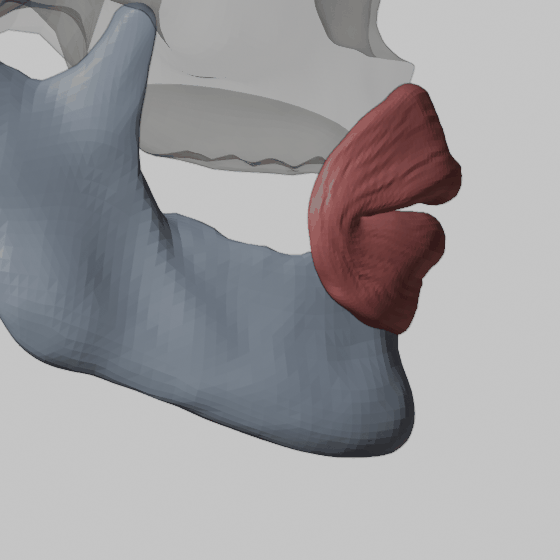

# ASRP



*The lab's real lips, pulled by the jaw (red: lips computed by FEBio; blue: jaw; grey: skull). Placeholder jaw motion, temporary material values, no landmark layer yet.*

ASRP replaces Ziva (the physics backend under the lab's facial controller) with FEBio, and Maya (the host) with Blender. The prototype takes the lab's real lip mesh, lets the jaw pull it through 51 frames, solves it with FEBio in about two minutes and plays it back in Blender; the numbers and their limits are on one page: **[docs/15-prototype.md](docs/15-prototype.md)** (Chinese).

## Run the prototype

After the setup below (`uv sync`, `uv run asrp doctor` all `ok`), three commands, about two minutes, no Maya or Ziva needed (the output folders are git-ignored):

```bash
uv run asrp import-asset data/lab_export runs/prototype_scene
uv run python tools/placeholder_jaw_motion.py runs/prototype_scene/scene.json runs/prototype_scene/placeholder_jaw.json
uv run asrp run runs/prototype_scene/scene.json runs/prototype_scene/placeholder_jaw.json
```

The last line printed is `run COMPLETE: 51 frames; plausibility PASSED`. The result is `runs/<date>_placeholder-jaw_001/`; how to play it in Blender and what is in the folder: [docs/15-prototype.md](docs/15-prototype.md).

- `src/asrp_core/`: solver core. Runs in its own process with its own venv; no `bpy`.
- `blender_addon/asrp_blender/`: thin Blender add-on. UI only; calls the core as a subprocess.
- `docs/`: the project's design documents (Chinese). They are the single source of truth for scope, design, standards and tasks.

**Start here: [docs/README.md](docs/README.md).**

## Commands

| Command | What it does |
|---|---|
| `uv run asrp doctor` | check that FEBio, Blender and Python are usable |
| `uv run asrp check <scene.json> [trajectory.json]` | check a scene (and a motion against it) |
| `uv run asrp import-asset <export folder> <new folder>` | turn the lab export in `data/lab_export` into a `scene.json` |
| `uv run asrp run <scene.json> <trajectory.json>` | generate the FEBio model, solve it, write a run folder (generated mode) |
| `uv run asrp run --feb <model.feb>` | stand-in mode: run an existing `.feb` as is, same run folder |
| `uv run python tools/verify.py` | everything below under "Checks" |

`asrp run` options: `--runs-dir` (default `runs`, an English-only path), `--name`, `--timeout`.

## Setup (Windows)

```bash
uv sync
uv run asrp doctor
```

`doctor` reports Python, FEBio, Blender and whether the project path is ASCII-only.
FEBio binaries need a free registration at febio.org (GitHub releases are source only).
Override tool locations with `ASRP_FEBIO` / `ASRP_BLENDER`.

The lab's Maya scene goes in `assets/` and solver runs in `runs/`: both are git-ignored and must never be committed. Exports and derived data go in `data/`; `data/lab_export/`, `data/preview/`, `data/briefing/` and `data/tetmesh/` are committed because this repo is private (docs ADR-19). The lab's `.mb` files, paper and video are never committed.

## Scene files

A scene is `scene.json` (what to solve) plus `trajectory.json` (how the drivers move); formats in `src/asrp_core/scene.py` and `src/asrp_core/trajectory.py`, contents in docs/04 section 5. Check them before a run; errors fail, warnings do not:

```bash
uv run asrp check tests/fixtures/s1/scene.json tests/fixtures/s1/trajectory.json
```

Turn the lab export into a scene (into an empty folder; the report lands next to scene.json):

```bash
uv run asrp import-asset data/lab_export runs/lab_scene
uv run asrp check runs/lab_scene/scene.json
```

## Checks (definition of done)

```bash
uv run python tools/verify.py
```

Runs the tests, `asrp doctor`, Blender's own validation of the add-on manifest, the Blender add-on round trip (`tools/check_blender_addon.py`) and the playback check (`tools/check_playback.py`, which runs S1 through real FEBio, loads the result with the add-on, and compares Blender's evaluated mesh with the FEBio log frame by frame). Blender is located like `asrp doctor` does (`ASRP_BLENDER`, PATH, default install).

## Install the Blender add-on

Run from the repo root, and again after changing the add-on:

```bash
mkdir -p dist
"C:/Program Files/Blender Foundation/Blender 5.2/blender.exe" --factory-startup --command extension build --source-dir blender_addon/asrp_blender --output-dir dist
"C:/Program Files/Blender Foundation/Blender 5.2/blender.exe" --command extension install-file -r user_default -e dist/asrp_blender-0.0.1.zip
```

In PowerShell, put `&` in front of the quoted path.
Installed this way the add-on lives outside the repo, so Check Backend needs `ASRP_PROJECT` set to the repo path. Load Result does not.

## Playing a result in Blender

A solved run is a folder with `playback.json` (surface mesh, mm) and `playback.pc2` (per-frame positions). `runs/` is git-ignored, so a fresh clone has to run something first: the lab lips (the three commands above) or the small S1 test block (`uv run python spikes/s1_dynamic_jaw.py`, writes `runs/s1_dynamic_jaw`).

In Blender (with the add-on installed, above): delete the default cube, then sidebar (N) > ASRP > Load Result, pick the run folder (the one that contains `playback.json`), View > Frame Selected (numpad `.`), press play. The object is scaled 0.001 so mm data shows in metres. Load Result brings in the lips only; the skull and jaw in the pictures come from `tools/render_prototype.py`:

```bash
"C:/Program Files/Blender Foundation/Blender 5.2/blender.exe" --background --factory-startup --python-exit-code 1 --python tools/render_prototype.py -- runs/<run folder> --out runs/<run folder>/render
```

It checks the Blender result against the solver's numbers, then renders three side views (rest, settled, jaw fully open). Add `--frames-dir <folder>` to render every frame (that is how `data/preview/prototype_motion.gif` was made).

To render a few frames of the S1 block from the side (the camera and context props fit S1's geometry only). In PowerShell, put `&` in front of the quoted path:

```bash
"C:/Program Files/Blender Foundation/Blender 5.2/blender.exe" --background --factory-startup --python-exit-code 1 --python tools/render_playback.py -- runs/s1_dynamic_jaw runs/s1_dynamic_jaw/render 0 15 30 45
```

## Spikes

`spikes/` holds throwaway experiments that settle one assumption each; results are recorded in the assumption ledger (docs/11-risks-and-questions.md).

## Lab asset (not product code)

Migration tools, run once per scene (docs ADR-18): the product needs neither Maya nor Ziva. The results in `data/lab_export/` and `data/preview/` are committed, so these are only needed when the scene changes. `data/briefing/asrp-briefing.html` is the newcomer's guide to all of this: open it locally, because GitHub doesn't run HTML. In PowerShell, put `&` in front of the commands below that start with a quoted path.

Read the scene without Maya: nodes, attributes, connections, keyframes. This step doesn't decode mesh geometry (see docs/03-asset.md). The report needs the Ziva scene (v36): the non-Ziva copy has no Ziva nodes to report on.

```bash
uv run python tools/mb_inventory.py "assets/<ziva scene>.mb" data/asset_inventory.json
uv run python tools/asset_report.py data/asset_inventory.json
```

Export meshes, weights and joints from the non-Ziva scene with plain Maya, then check them against the `.mb`:

```bash
"C:/Program Files/Autodesk/Maya2027/bin/mayapy.exe" tools/maya_export.py "assets/<non-ziva scene>.mb" data/lab_export
uv run python tools/check_lab_export.py data/lab_export "assets/<non-ziva scene>.mb"
```

Bring the export into Blender and render the preview. This checks the meshes landed right; there is no physics in it.

```bash
"C:/Program Files/Blender Foundation/Blender 5.2/blender.exe" --background --factory-startup --python-exit-code 1 --python tools/blender_import_preview.py -- data/lab_export data/preview
```

What only Ziva can give us comes from `tools/ziva_machine_export.py`, run once in Maya's Script Editor on the Ziva machine (steps in docs/12-lab-export-checklist.md). `tools/rehearse_ziva_export.py` rehearses its plumbing without Ziva.
