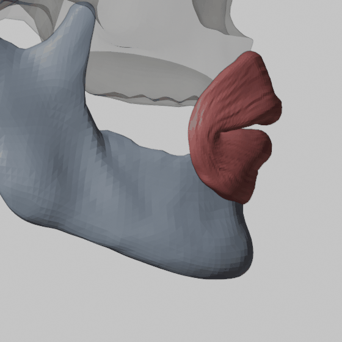

# 01 项目一页纸

## 一句话

把实验室面部仿真研究里负责"物理计算"的那一层，从 **Maya + Ziva** 换成 **Blender + FEBio**，让研究在 Ziva 停售之后还能继续，并且整套计算变得开源、可检查、可复现。

## 背景

实验室的研究（论文 *Beneath the Skin*）做的是一个**控制器**：给定一个目标表情（比如发 "AA" 音），它算出脸上几百个控制点（landmark）该怎么动，让肌肉自然地变成那个表情。控制器是实验室自己的成果。

控制器之下，还需要一个**物理引擎**来算软组织在重力、骨头带动下怎么变形。这一层现在用的是 Ziva，一个装在 Maya 里的商业插件。landmark 本身不进物理，控制器输出里进物理的只有下颌的转动（[03](03-asset.md) 第 4 节）。问题是：

- Ziva 已经在 2024 年 4 月停售（Unity 公告 *An update about Ziva*），许可到期后就不能再用；
- Ziva 是闭源的，内部怎么算的看不到，不方便写进论文的方法部分。

FEBio 是一个专门为生物力学开发、经过同行评审的开源有限元软件，可以接替这一层。Blender 是免费开源的 3D 软件，可以接替 Maya，用来操作和显示。

## 这个项目要交付什么

**第一阶段（v0.1 原型）**：用实验室提供的资产（颅骨、下颌、牙齿、嘴唇肌肉），在 Blender 里算出"下颌张合带动嘴唇"的物理过程，由 FEBio 计算。结果要通过合理性检查，并且实验室研究员把它和以前 Ziva 的结果并排看过以后，认为可以用于继续研究。

**原型机**：实验室负责人期待 1–2 周出。定义和路径见 [09](09-roadmap-and-tasks.md) 第 1 节，项目负责人已确认（2026-11-11，11 的 P-05），目标日期 2026-11-17；已完成（2026-11-11，T-06a）。

**我们不是要复刻 Ziva**（ADR-17）。实验室的成果是控制器，物理层只要让控制器能继续工作、结果合理就够了。实验室会议也说：解出和 Ziva 一样的数值不是成功标准，实验看的是动作本身，所以模型按真人大小算（ADR-31）。和 Ziva 的差别会算出来，但只作参考，不当合格线。

**Hill 肌肉力**：实验室负责人希望顶层设计把它考虑进去。按实验室代码，Hill 力是控制器目标函数里的一项，物理层里没有主动收缩；所以第一阶段物理层先输出每块组织的应变能，只作诊断（它替换不了目标函数里的近似，ADR-33），纤维方向和激活留到第二阶段。

更具体的要求见 [02 需求](02-requirements.md)。

## 不在第一阶段做的事

- 移植实验室的控制器（优化算法、表情过渡）；第一阶段只接收控制器已经算好的结果。
- 钢琴式表情界面、完整的面部（几十块肌肉）、皮肤层。
- 逐项、逐点复刻 Ziva 的行为。两者的算法不同，Ziva 的参数很可能也只是默认值，对齐它的意义不大。
- 任何医学结论。

## 现在做到哪了（2026-11-12）

| 已完成 | 证据 |
|---|---|
| 地基：代码仓库（GitHub 私有，ADR-14）、开发环境、任何电脑都能运行的自动检查；FEBio 能在本机算动力学，结果能逐帧放回 Blender（T-00）；被哈希的数据在任何电脑上检出都逐字节相同（`.gitattributes`，08 第 10 节） | `uv run python tools/verify.py`；`spikes/s1_dynamic_jaw.py`、`tools/check_playback.py`；[09](09-roadmap-and-tasks.md) T-00 |
| 实验室资产：完整盘点；网格、landmark 权重和关节已导出（网格和 `.mb` 逐点核对过，权重和关节目前只有 Maya 自检）；真实资产已进 Blender，下颌能绕真实铰链转动（`data/preview/`）；一条命令导入成场景描述（T-02，里程碑 M1）；嘴唇的四组粘连顶点集（T-03，粘连权重的读法已更正，ADR-32） | [03](03-asset.md) 第 6、12 节；`uv run asrp import-asset data/lab_export <输出文件夹>`；09 的 T-02、T-03。一处缺口：landmark 蒙皮矩阵还没换算成毫米和 Z 轴朝上，归 T-09 |
| 读完实验室控制器源码和论文：landmark 和物理的关系、优化时物理不在环（部分验证，11 的 Q20）、Hill 模型的位置、各实验怎么做、运动文件的格式、目标姿态；对照论文做了需求审计 | [03](03-asset.md) 第 13 节；[02](02-requirements.md) 第 4 节；[10](10-decisions.md) ADR-21 到 ADR-35；[13](13-explanations.md) E-04、E-05 |
| 场景和运动的格式定稿，`asrp check` 查错（T-05）；运行命令、运行文件夹、溯源（T-08） | `uv run asrp check tests/fixtures/s1/scene.json tests/fixtures/s1/trajectory.json`；[04](04-architecture.md) 第 4、5 节 |
| **原型机（T-06a）**，以及审计后的小修（T-22）和二进制结果（T-25）：真实嘴唇被下颌带动，五项合理性检查通过，回放包在 Blender 里逐帧对得上，同一份输入两次相同；材料、粘连刚度、k 都是标明来源的临时值 | [15](15-prototype.md)；[09](09-roadmap-and-tasks.md) T-06a、T-22、T-25；`data/preview/prototype_*.png` |
| Ziva 机器要跑的脚本已准备好，并在普通 Maya 上排练过（需要 Ziva 的部分只能到现场验证） | [12](12-lab-export-checklist.md) 第二部分；`tools/ziva_machine_export.py`、`tools/rehearse_ziva_export.py` |

**原型机已经跑通（2026-11-11 的参考运行）**：实验室的真实嘴唇被下颌带动，FEBio 算完 51 帧、五项合理性检查通过，结果在 Blender 里回放，同一份输入两次的结果在 1×10⁻⁹ mm 内相同（`--threads 1` 时回放文件逐字节相同）。它只有物理层，下颌运动和材料都是临时值，还没有 landmark 层，也没有和 Ziva 对比。动图、数字、自己跑一遍的命令和结果的局限，都在一页里：[15 原型机：怎么跑、跑出了什么](15-prototype.md)。

**第二轮审计（2026-11-12，[13](13-explanations.md) E-09）**查出一件要紧的事：实验室的 AA 目标形状里，嘴唇几乎不跟着下颌走，而我们的物理让下唇完全跟着走。所以原型机二的"中性到 AA"两种拼法都做、并排报告（ADR-40）；哪一种当正式结果，等项目负责人定（11 的 P-07）。

下一步是**原型机二**（ADR-39、ADR-40）：landmark 层（T-09）→ 中性到 AA（T-27）→ 甩头（T-28）→ 来回 10 次（T-29）；然后是几个互不依赖的试验（T-17 软粘软、T-23 主动收缩、T-24 "landmark 进物理"、T-30 逐帧接着算、T-20 规则格子），再定 `asrp-scene/2`（T-26）。拿到 Ziva 设置和运动文件以后换掉临时值（T-12）。顺序和理由见 [09 路线图与任务](09-roadmap-and-tasks.md) 第 1、2 节。等项目负责人拍板的四件事（P-06、P-07、P-09、P-10）只列在 [11](11-risks-and-questions.md) 第 1 节。

## 谁参与、各自负责什么

| 角色 | 负责 |
|---|---|
| 项目负责人 | 定优先级、拍板决策、和实验室沟通、最终验收 |
| 实验室 | 提供资产、配合 Ziva 机器上的导出、回答待决问题、评审结果（[07](07-validation.md) 第 4.4 节） |
| 开发者（人或 AI 开发会话） | 按任务卡开发，交付代码、测试和证据 |
| 审查者 | 按开发规范和任务卡检查每一个合并请求 |

## 最需要尽快解决的三件事

1. **约 Ziva 机器，趁许可还有效拿到只有它能给的数据**（ADR-35）：Ziva 的完整设置和权重表、一条运动的参考结果、Ziva 存的各物体网格（尤其嘴角链条上的），以及运动的检查点文件（远程登录取）。许可约一年半后到期（Q5，2026-11-11 项目负责人转述），不急，也不挡原型机二；但它决定 AA 的两种读法哪一种是实验室实际得到的（E-09）。步骤见 [12 导出清单](12-lab-export-checklist.md) 第二部分；第二阶段要的多网格、多运动，脚本也已支持（T-19），可以同一次做。
2. **把问题发给实验室**：可以直接转发的一页在 [12](12-lab-export-checklist.md) 第三部分（现在实际是第 1、3、5 问，Q5、Q17 不再等实验室）；运动文件不再向实验室要，在 Ziva 机器上取（D2）。
3. **原型机给实验室看**：T-06a 已跑通（2026-11-11，目标日期 2026-11-17），可以拿 `data/preview/prototype_*.png` 和回放包给研究员看下唇跟下颌、嘴角拉长是否合理；参数都是临时值（09 T-06a 卡）。

第二阶段投入之前还有一道关：T-17、T-18 复核 FEBio 撑不撑得起第二阶段（ADR-26）；它们随时可以做，不挡 M3。
