# 15 Prototypes one and two: how to use them, what they compute, how far they are from Ziva

> **English translation.** The Chinese page [15-prototype.md](15-prototype.md) is the source; where the two differ, the Chinese page is right. The other documents this page links to are in Chinese.

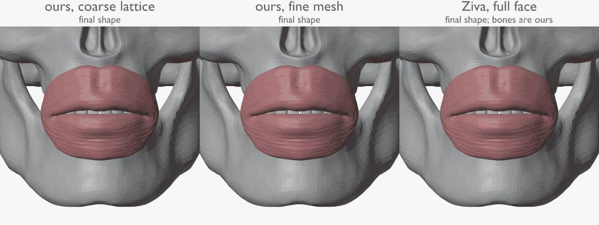

What to look at: the lab's "neutral to AA" motion (frames 0 to 46, final shape). The mouth goes from closed to open, the jaw and lower teeth move down with it, and the mouth shapes in the three panels are close. In all three panels the bones are moved by us from the motion file (Ziva's export holds only the lips). We use the same jaw motion that Ziva recorded: frame by frame, the jaw transforms read on the two sides differ by about 1e-13 mm at most.

Who this is for: the lab's researchers, and whoever shows the prototypes to the lab. After reading you will know what the prototypes are, how to run them in Blender, how far the computed lips are from Ziva's, and what is still missing. You do not need to use a command line (the command-line way is at the end of section 2, for developers). The panel text is in English, so this page quotes it exactly as the panel shows it.

Every number on this page, unless it says "quoted from" some document, comes from reports the product itself wrote on this machine. They are stored in `data/preview/` and regenerated by `tools/prototype_archive.py`. The tables of the Chinese page are written in by `tools/prototype_numbers.py`, and `tests/test_prototype_page.py` fails when the reports and that page disagree. This English page copies those tables by hand; `tests/test_docs_references.py` fails when a number here is not the number there.

Archive date 2026-11-15, commit 2155f87; Ziva's two runs: full face `neutral_to_AA_export_20261112_202048_16aa06ab`, lips only `AA_lips_only_export_20261112_205041_de5be4be`; how it was made: `uv run python tools/prototype_archive.py`.

## 1. What this is

The prototype is a chain that runs end to end: the lab's bones and lip mesh → our tetrahedra → FEBio computes the physics → playback in Blender, compared point by point with Ziva's result. It exists to answer one question: now that Ziva is no longer sold, can FEBio and Blender take over the lips? The full project is in [01](01-overview.md).

**What is the lab's and what is ours**

| The lab's (input only) | What we made |
|---|---|
| The skull, jaw, upper and lower teeth, and lips meshes (`data/lab_export`); the "neutral to AA" motion file; the material values measured in Ziva; the results Ziva computed itself (as reference); the landmark layer and the training code | The lips tet mesh (two kinds); the program that writes bones, attachments and materials into a FEBio model; the run report and five plausibility checks; the Blender panel; the tool that compares with Ziva; the `final_shape` function for the training code to call |

**Prototypes one and two use the same asset**: skull, jaw, upper teeth, lower teeth, lips (five objects). The only difference is which motion is chosen. The panel has three:

| Title on the panel | What it is |
|---|---|
| Prototype 1: jaw opens 12 deg | Prototype one. A jaw hinge motion we wrote, opening to 12°, with no Ziva result to compare against |
| Prototype 2: neutral to AA | Prototype two. The lab's "neutral to AA" motion file, converted and played as it is |
| Prototype 2: head shake | Prototype two. Head shake: the keyframes are from the lab's script, the curves between frames are our reading |

**Two lip meshes**: step 1 of the panel has two radio buttons. **Coarse lattice (Ziva's tet size)** is the default: a regular lattice of 126 tetrahedra, with a cell edge of 25.37 mm (Ziva's own tetrahedron size), upper and lower lip not separated, and all attachments are soft springs. **Fine (lips move separately)** is the fine mesh: 26,721 tetrahedra, the upper and lower lip move separately, and the upper lip is attached to the skull (hard attachment). Why the coarse lattice is the default is in section 3.3. The material is the value Ziva measured: Young's modulus 12 kPa, Poisson's ratio 0.4, the same for both meshes.

**What it is not**

- It is not a proof of "the same as Ziva": section 3 below reports how far apart they are, and does not judge pass or fail (there is no pass line, [10](10-decisions.md) ADR-17).
- It has only the lips as tissue. The other 40 pieces of tissue and the skin are phase two.
- It computes the whole motion first and then plays it back. It is not frame-by-frame interaction. The panel says "Computes the whole motion, then replays it. Not frame-by-frame.".
- Ziva's result on this page is what our script got by playing the lab's motion file in Ziva. It is not what a researcher produced by pressing keys on the piano UI.
- The lab's Maya piano UI is still the lab's. We have not replaced it.

## 2. How to use it

### 2.1 Install once

First you need what the core program needs. Follow "Setup (Windows)" in the [README](../README.md) once: install `uv`, install FEBio (you must register for free at febio.org to download it), run `uv sync` in the project folder, and `uv run asrp doctor` must show `ok` on every line. Without `uv`, Open asset reports "Cannot find uv on PATH". Without FEBio, Run fails.

Then build the add-on package once in the project folder (this is the only command line; after that you use only the mouse). The full steps are in the README under "Install the Blender add-on":

```bash
"C:/Program Files/Blender Foundation/Blender 5.2/blender.exe" --factory-startup --command extension build --source-dir blender_addon/asrp_blender --output-dir dist
```

Then in Blender: Edit > Preferences > Add-ons, the small arrow at the top right > Install from Disk..., choose `dist/asrp_blender-0.0.1.zip`, and tick ASRP. Close the preferences, press N in the 3D viewport, and open the **ASRP** tab. The first time, it says "Choose the ASRP project folder.": press **Choose project folder** and pick the downloaded ASRP folder (the one that holds `pyproject.toml` and `src`). Blender remembers it.

### 2.2 The steps on the panel

Go from top to bottom. While a step is not done, the next step's button is greyed out, and the reason is written under it. The full description is in [06](06-ui.md) sections 2 and 3.

| Section of the panel | What you do | What you will see |
|---|---|---|
| **1  Open the asset** | Choose Coarse lattice (Ziva's tet size) or Fine (lips move separately), and press **Open asset**. The import takes a few seconds, there is no progress bar, and Blender does not respond meanwhile. If `uv sync` has not been run before, the first time it builds the Python environment first, which can take a few minutes | Five objects appear in the viewport: skull, jaw, upper teeth, lower teeth, lips (bones grey-white, lips red), and 300 small landmark dots on the lips. The panel says "Open: lips, jaw, skull, upper teeth, lower teeth". The 2 m cube in Blender's startup scene is hidden, and the view is aimed at the asset. Units, material ("Material: 12 kPa, 0.4 (measured in Ziva)") and the import report are collected in **Asset details** |
| **Physics setup** (collapsed by default) | Expand it to look. The small button at the right of each row lights up the matching thing in the viewport, and **Check setup** checks the scene setup | What the soft tissue and each of the four bones do in the physics, and how many vertices each of the four groups of attachments connects. This version is read-only: "Read-only in this version." |
| **2  Choose a motion** | Click one in the list: the three titles are in the table in section 1. Under each title a line of small text gives the frame count, the frame rate, and "lab motion" or "test motion". After the asset is opened, the lab's neutral to AA is selected by default | The pressed row is the selected one |
| **3  Run** | Press **Run** | A progress bar and "Frame N / M". You can press **Cancel**. When it finishes the status says Complete, and the result plays automatically on the five objects (Space or **Pause** pauses it). The coarse lattice takes a second or two, the fine mesh about half a minute |
| **Results** | To change layer: press **Physics only** or **Final shape** | The lips change to the other layer's shape, the bones stay. Neutral to AA shows Final shape by default. Head shake and jaw open 12° have Physics only |
| **Compare with Ziva** (collapsed by default) | The first time, press **Ziva reference folder** and choose Ziva's export folder (the lab's data, outside the project, chosen only once). Then press **Compare** | The panel shows the mean, 95% and max difference (mm) at the last frame, which frame is the worst, and "Reported only. There is no pass line.". Tick **Show difference as colours** to paint each vertex's difference on the lips (blue 0 mm, red 5 mm or more). Tick **Show Ziva's lips** to bring Ziva's lips in as a second object |
| **Checks** (collapsed by default) | Expand it to look | Each of the five plausibility checks is PASS, FAIL or NOT RUN, with a note on failures. The rows below are surface numbers that are reported, not judged |
| Saving | Blender's own File > Save (Ctrl+S) | One `.blend` is one scene: save, close, open again, and the asset, results, selected motion and comparison numbers are all still there. The result files are in the project's `runs/`, and the `.blend` remembers where they are. When those folders have been deleted the panel says so and asks you to Open asset again |

The difference between the two layers: **Physics only** is the lips as FEBio computes them. **Final shape** is that with the lab controller's landmark layer added on top, the shape the researcher finally sees in Ziva ([04](04-architecture.md) section 2).

### Walking through it with the mouse (screenshots)

**To see it move first**: [a recording of the prototype](https://github.com/JoKFA/FEBio_Blender_Init/releases/tag/demo-2026-11-17) (`asrp_prototype_demo.mp4`, 81 seconds, no sound). It was recorded on the development machine on 2026-11-17, again with only the mouse, with the coarse lattice and the lab's neutral to AA: it starts at Blender's splash screen, presses N and opens the ASRP tab, then Open asset, Run, switching between Physics only and Final shape, Compare with Ziva, Show difference as colours, Show Ziva's lips, Checks. The add-on was already installed and the project folder already chosen; the pauses spent waiting for results were cut out. The recording is not in the repository (`*.mp4` is kept out of git); it is in a GitHub Release, and downloading it needs access to this repository.

On 2026-11-15 to 16, on the development machine, Blender 5.2 was opened from the start menu and the steps above were followed with only the mouse and keyboard (not a script pressing buttons for a person). It was walked four times in all. The fourth walk was made after fixing the problems found in the first three, and the screenshots are from the fourth (seen from the front). The window is 1920 × 1080 and the sidebar is at its default width.

| Step | Screenshot |
|---|---|
| The panel after installing and choosing the project folder once. The three steps, Results, Compare with Ziva and Checks are all visible on one screen | 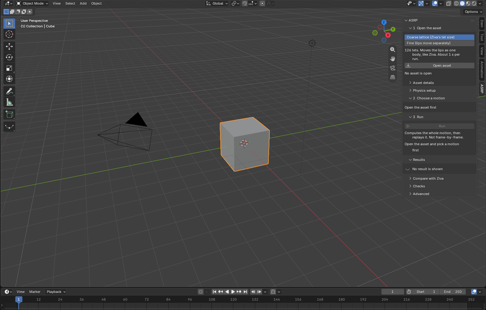 |
| After pressing Open asset: the five objects and the landmark dots appear, the cube is hidden, and the lab's neutral to AA is selected by default | 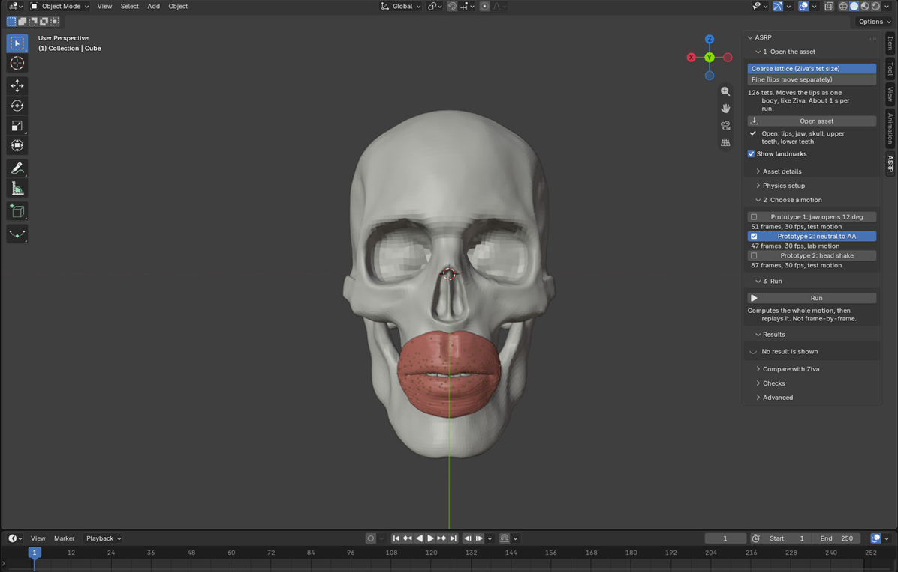 |
| Press Run: after about two seconds it says Complete and plays automatically. Stopped at frame 36 (the last frame of the motion), final shape | 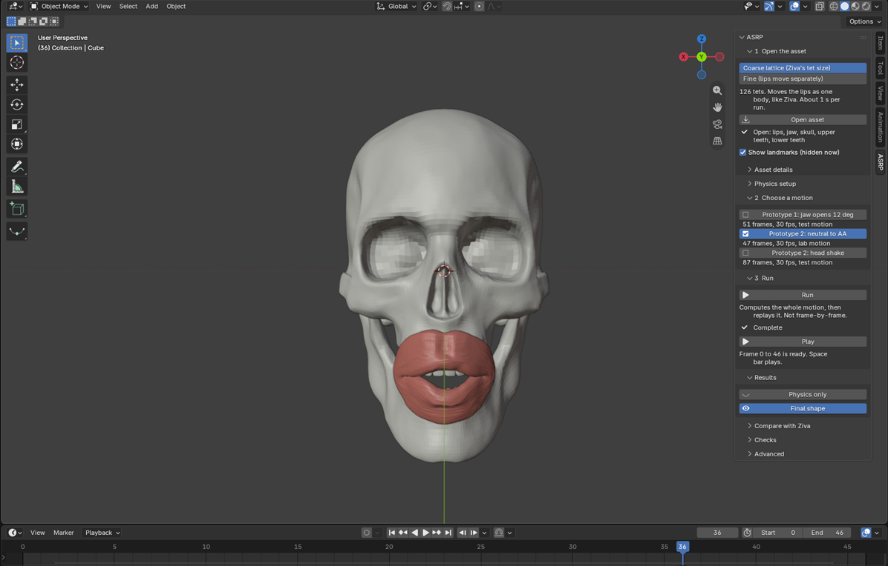 |
| Compare with Ziva: after choosing the reference folder and pressing Compare, the numbers on the panel equal the numbers for the coarse lattice against Ziva full face at frame 46 in the table in section 3.3 | 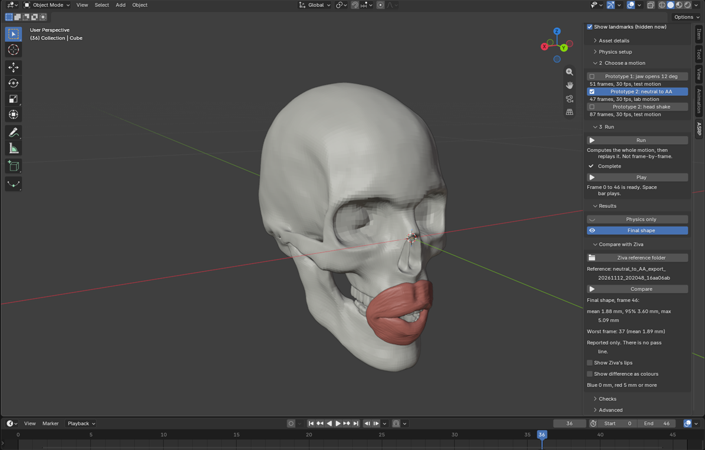 |
| Tick Show difference as colours: blue places are close to Ziva, red places differ by 5 mm or more | 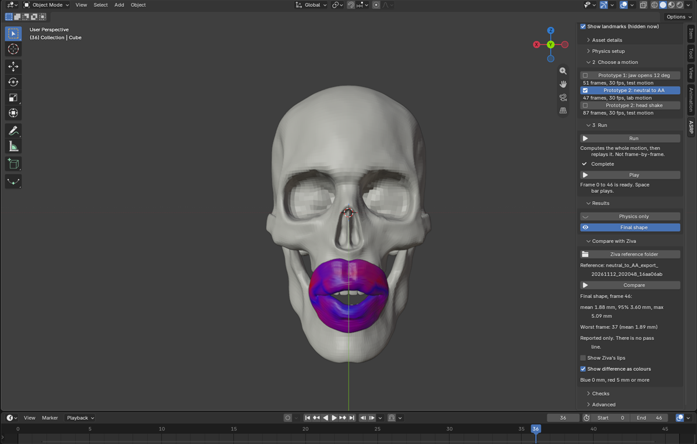 |
| Tick Show Ziva's lips: the grey-blue one is Ziva's lips, overlapping our red lips in the same place | 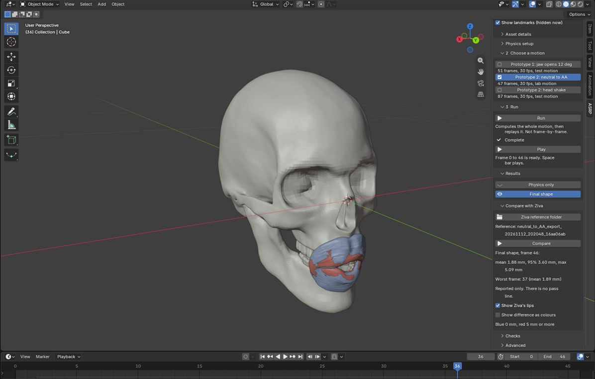 |
| Ctrl+S to save as `.blend`, quit Blender, open Blender again, and open it from the recent files on the splash screen: the scene, the frame 36 result and the comparison numbers are all there | 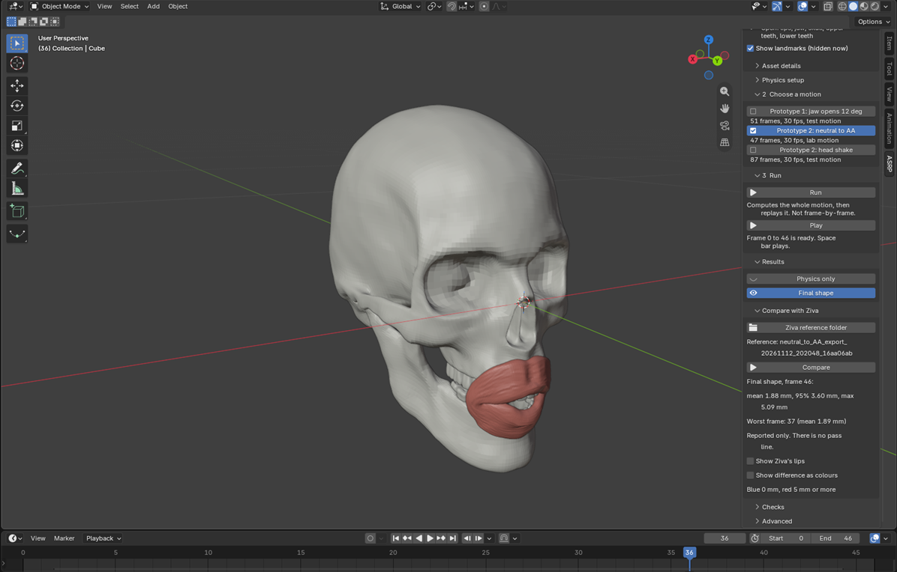 |
| Prototype one (jaw open 12°), coarse lattice, frame 32, front: the lips follow the jaw like one block, and the mouth opens only a crack | 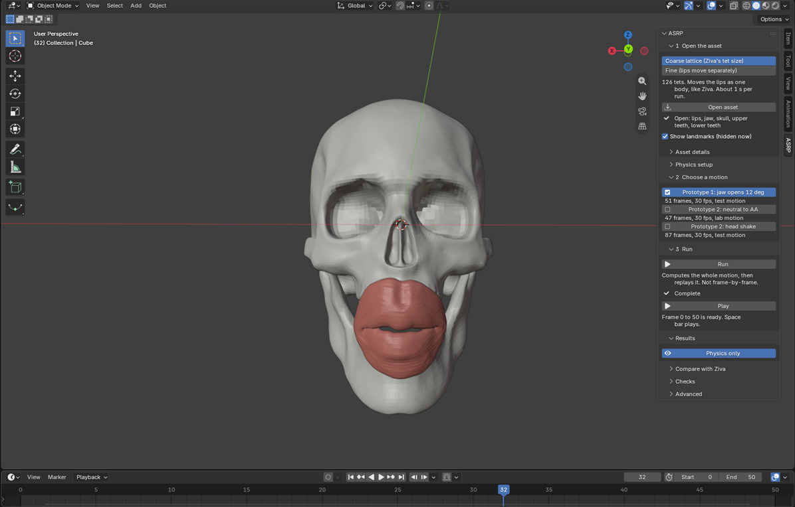 |
| Prototype one, choose Fine instead, Open asset again, Run (about 40 seconds): the upper and lower lip separate and the teeth show | 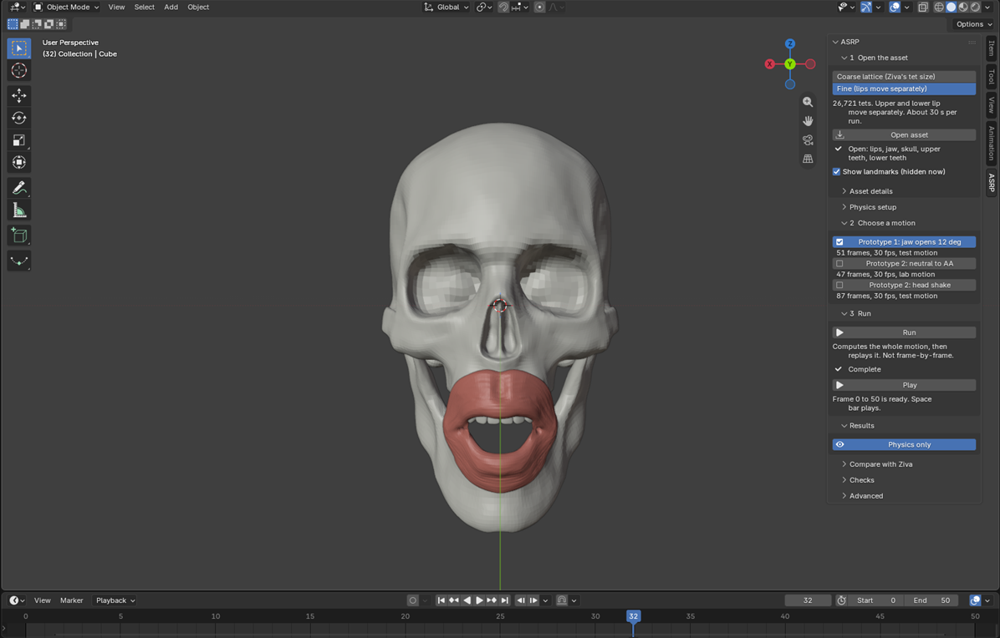 |

What the walk-through did not look at: how the panel looks when a check fails, when a run fails, and when a run is cancelled; systems other than Windows; other people's computers. The problems the walk-through found, which have been fixed, are recorded at the end of card T-35 in [09](09-roadmap-and-tasks.md).

### The same thing on the command line (for developers)

Three commands (first `uv sync`, and `uv run asrp doctor` must be all ok). The results are under `runs/`, which git does not track. For the coarse lattice:

```bash
uv run asrp import-asset data/lab_export runs/prototype_scene --tetmesh data/tetmesh/lips_lattice.json --attachments ziva-soft
uv run asrp run runs/prototype_scene/scene.json data/lab_export/trajectories/neutral_to_AA.json
uv run asrp compare <the run folder printed by the previous command> <Ziva's export folder> --out <output folder>
```

Drop the two options `--tetmesh` and `--attachments` and you get the fine mesh. `asrp list-motions data/lab_export` lists the three motions. `asrp import-asset` uses the material Ziva measured by default (`--tissue-settings lab`). `--tissue-settings ours` is our earlier 15 kPa, 0.45. Ziva's export folder is outside the repository, and the output of `asrp compare` contains Ziva's shape, so the output folder must also be outside the repository, or under `runs/`, which git does not track.

## 3. What it computes, and how far it is from Ziva

### 3.1 How to read it first

- **The reference is Ziva full face** (the lab's real configuration: 41 pieces of soft tissue, with the surrounding tissue moving as well). **Ziva lips only** is a control we made on the Ziva machine by switching off the other 42 objects. The lab does not normally run it like this, its boundary conditions are not ours, and it is still falling at frame 14. How far apart these two Ziva results are: physics layer, at most 8.0 mm over the whole run. So "how far from Ziva" has to say which one is compared.
- The comparison is on the same vertices: all 10,240 vertices of the lips, the same frame against the same frame, in mm. "Mean / P95 / max" are the mean, the 95th percentile and the maximum of the distances of these vertices.
- Frame numbers: frame 14 is the last frame of the settling under gravity alone; frames 15 to 36 are the motion, and frames 37 to 46 hold still. The jaw rotates −5.16°, which comes from the lab's motion file, and we use it as it is after conversion.
- The physics layer is the lips as FEBio computes them, and the final shape is that with the landmark layer added on top.

### 3.2 Looking at pictures: frame 36, just after the motion ends

**Front view with bones**: looking straight at the lower face (along −Y, the picture is 150 mm square, orthographic), bones light grey, lips red, the three panels with the same camera and the same shading. In all three panels the bones (skull, jaw, upper teeth, lower teeth) are moved by us from the motion file. Ziva's export holds only the lips, so the Ziva panel is Ziva's lips placed on our bones, and the picture says "bones are ours". Above is the final shape, below is the physics layer, both at frame 36:

Final shape:

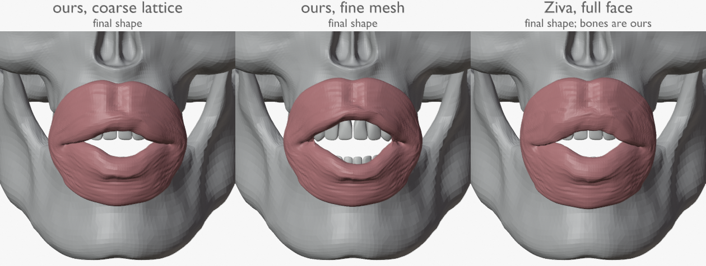

Physics layer:

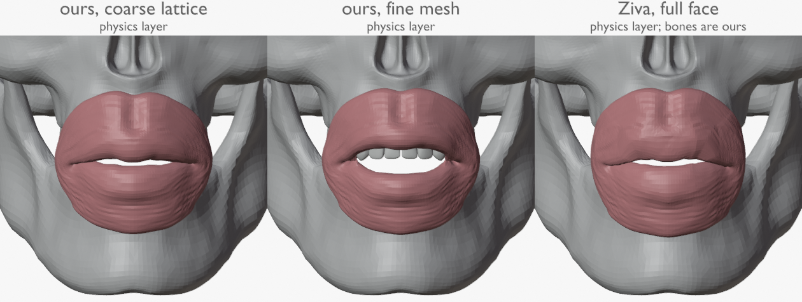

The animation of the physics layer (the same three panels, frames 0 to 46). What to look at: how the mouth opens. The coarse lattice and Ziva open the mouth only a crack, and the fine mesh opens wide and shows the upper teeth:

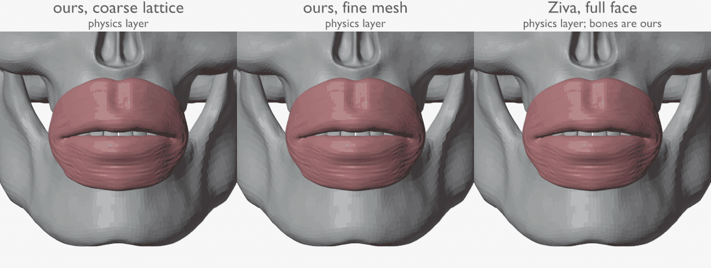

**Close-ups of the lips only** (the two tables below, with the lips shown larger): the same camera (looking straight at the mouth along −Y, the picture 0.10 m wide, orthographic) and the same shading. Three columns: ours with the coarse lattice, ours with the fine mesh, Ziva full face. The upper row is the physics layer and the lower row is the final shape. The pictures were drawn with `tools/render_comparison.py` (Blender without a window), and the data is from the runs above. The pictures show the lab's lip mesh drawn as images, and Ziva's vertex data is not in the repository.

| | Ours: coarse lattice | Ours: fine mesh | Ziva full face |
|---|---|---|---|
| Physics layer | 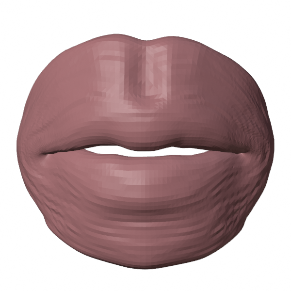 | 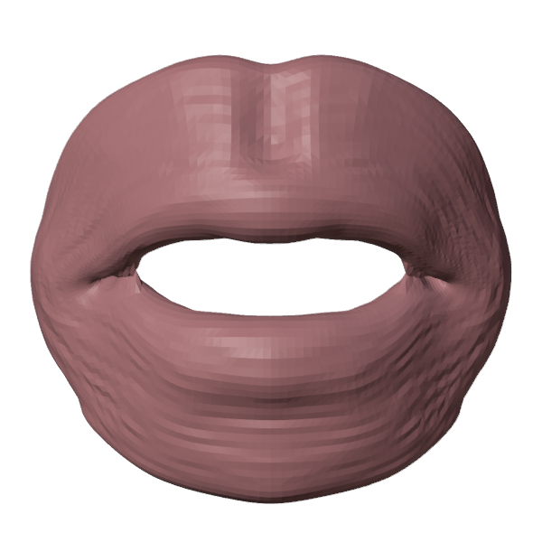 | 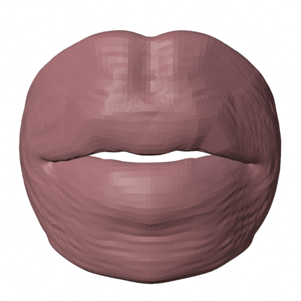 |
| Final shape | 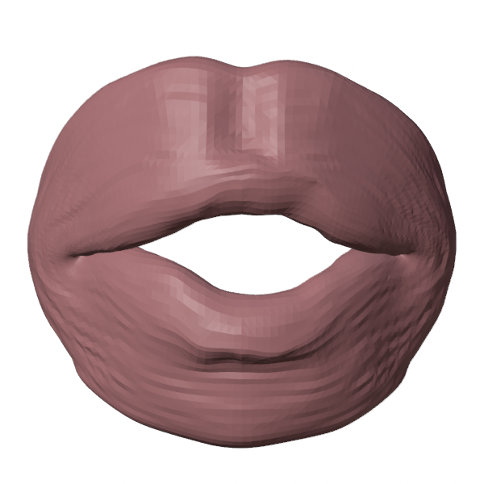 | 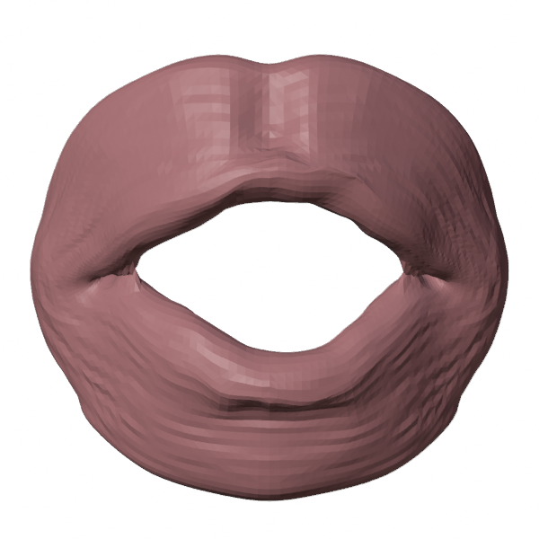 | 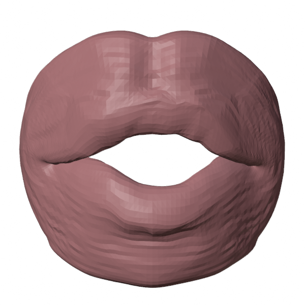 |

What can be seen in the pictures (read by eye, not measured): in the physics layer, the coarse lattice and Ziva open the mouth only a crack, and the fine mesh's mouth opens all the way to the two mouth corners. With the landmark layer added, the mouths of the coarse lattice and Ziva both open into an ellipse with close shapes, and the fine mesh opens wider.

### 3.3 The numbers

**Neutral to AA, physics layer, distance to Ziva** (mm; frame 36 is the last frame of the motion and frame 46 is the last frame of the hold):

| Our mesh | Compared with | Frame 36: mean / P95 / max (mm) | Frame 46: mean / P95 / max (mm) |
|---|---|---|---|
| Coarse lattice (panel default) | Ziva full face (reference) | 1.88 / 3.60 / 5.12 | 1.88 / 3.60 / 5.09 |
| Coarse lattice (panel default) | Ziva lips only (the control we made) | 2.14 / 3.75 / 4.44 | 2.15 / 3.75 / 4.43 |
| Fine mesh | Ziva full face (reference) | 2.21 / 4.91 / 7.64 | 2.21 / 4.91 / 7.63 |
| Fine mesh | Ziva lips only (the control we made) | 2.32 / 4.32 / 7.10 | 2.33 / 4.33 / 7.11 |

The final shape (physics layer with the landmark layer added) has the same mean, P95 and max as the table above at frames 36 and 46 (the largest difference among the four reports is 3e-06 mm, which is floating-point rounding): both sides add the same landmark layer, so the whole difference comes from the physics layer.

Every number in the table above is smaller for the coarse lattice than for the fine mesh, whichever reference is compared. This does not mean the coarse lattice is "right": its mean difference is only a little smaller than the fine mesh's, and it is the P95, the max and the per-region numbers (how far the middle of the upper lip moves, see below) that show whether the mouth shape is right. The sentence about "final shape" just above says that both sides add the same landmark layer, so the final shape's difference equals the physics layer's difference, and the landmark layer neither helps nor gets in the way.

**Gravity sag** (the first 14 frames with gravity only, frame 14 against frame 0, all 10,240 vertices):

| Who (frame 14 against frame 0) | Mean sag (mm) | Max (mm) | Max still moving between frames 13 and 14 (mm) |
|---|---|---|---|
| Ours: coarse lattice (panel default) | 0.059 | 0.158 | 4.4e-08 |
| Ours: fine mesh | 0.122 | 0.497 | 1.2e-06 |
| Ziva full face (reference) | 0.293 | 1.224 | 0.026 |
| Ziva lips only (still falling, not a settled number) | 1.777 | 5.390 | 0.37 |

Our sag is smaller than Ziva's. Ziva lips only is still falling at frame 14 (last column), so it is not a settled number. How much Ziva sags once settled can only be known from a longer run with gravity alone.

**Surface quality** (flipped faces: triangles whose normal is opposite to the rest state; too-short edges: edges shorter than half the rest length; counted with the same algorithm as in the product, against each one's own rest shape, [10](10-decisions.md) ADR-43). This is a reference line, not a pass line: Ziva's own final shape also has flipped faces. The flipping comes from the landmark layer, and is carried by the lab's motion itself.

| Who | Frame with the most flipped faces: flipped faces / too-short edges | Last frame: flipped faces / too-short edges |
|---|---|---|
| Ours: coarse lattice (panel default), physics layer | Frame 0: 0 / 0 | Frame 46: 0 / 0 |
| Ours: coarse lattice (panel default), final shape | Frame 20: 6 / 14 | Frame 46: 1 / 49 |
| Ours: fine mesh, physics layer | Frame 0: 0 / 0 | Frame 46: 0 / 0 |
| Ours: fine mesh, final shape | Frame 20: 8 / 18 | Frame 46: 3 / 109 |
| Ziva full face, physics layer | Frame 0: 0 / 0 | Frame 46: 0 / 0 |
| Ziva full face, final shape | Frame 20: 4 / 14 | Frame 46: 3 / 37 |
| Ziva lips only, final shape | Frame 20: 4 / 13 | Frame 46: 3 / 39 |

**How fast it computes** (FEBio's own timing, an order of magnitude only: one piece of lips, not the whole face):

| Mesh | Tetrahedra | Nodes | Frames | FEBio time (s) | Per frame (s) |
|---|---|---|---|---|---|
| Coarse lattice (panel default) | 126 | 56 | 47 | 1.14 | 0.025 |
| Fine mesh | 26,721 | 6,747 | 47 | 26.53 | 0.577 |

Ziva full face (the lab's machine), per step: about 1.47 to 1.60 on average over that evening's runs, single steps above 3; lips only, per step: 0.0095 on average over the last 46 lines (quoted from the Maya solver log in 13 E-15, not measured on this machine; the original text of the report is in English).

Machine: the development machine (a Windows 11 PC, 16 logical processors), FEBio with 4 threads; what else was running at the same time: other agents of the same batch were running tests and FEBio runs on the same machine at the same time; how much was not measured. Archive date 2026-11-15, commit 2155f87.

This is a development machine, not the lab's demo machine, and other tasks were running on it while FEBio was timed, so the seconds per frame are an order of magnitude only. The two Ziva lines are logs from the lab's machine. The machines, thread counts and numbers of tissue pieces differ between the two sides, so you cannot divide one of these numbers by the other.

**What the coarse lattice changes, and why it is the default**: in the fine mesh the upper and lower lip are separated along the lip line, and the upper lip hangs on the skull only by its own small patch of attachment, so when the jaw rotates it hardly follows. In Ziva the upper lip is carried down. When the tetrahedra are replaced by a regular lattice as coarse as Ziva's, the upper and lower lip fall into the same cells, and the upper lip follows. With the jaw rotated −5.16°, the distance moved by the "middle of the upper lip" (quoted from [13](13-explanations.md) E-20, not recomputed on this page, frame 36 against frame 14): fine mesh 0.15 mm, Ziva full face 4.80 mm, coarse lattice at the position used in the trial 4.20 mm. The coarse lattice in the product is the same: the upper lip is carried along (4.8–5.6 mm, quoted from [10](10-decisions.md) ADR-44). The lab takes Ziva as the reference, so the prototype uses the coarse lattice by default. The fine mesh is kept, and you choose it when you want to see the upper and lower lip move separately. The cost: in the coarse lattice the lips act like one block, and it cannot do motions where the lips close or the upper and lower lip move separately.

**The result depends on where the lattice is placed**: the lattice position is a rule fixed beforehand (the minimum corner of the bounding box of the lip surface), not chosen to give the best result. Shift the lattice by half a cell and the distance to Ziva full face is 1.88–2.19 mm on average and 5.1–5.8 mm at the maximum, and wherever it is placed the upper lip is carried along (4.8–5.6 mm) (quoted from [10](10-decisions.md) ADR-44, frame 36). This is a property of this approach itself. "The coarse lattice is more like Ziva" also does not show that Ziva's own tetrahedra are like this: Ziva's tet mesh has not been retrieved ([11](11-risks-and-questions.md) D12), and the "shared lattice" was matched from behaviour 🔍.

### 3.4 Head shake: it runs, but the amplitude is not a number we can report

The head shake uses the keyframes of the lab's script. In the motion the whole head translates, and we look at how much our lips swing relative to the skull:

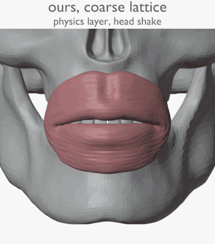

What to look at: only the coarse lattice panel, showing that this motion runs through: the skull, jaw and teeth translate in the picture and the lips follow them. The amplitude of this motion is small, and by eye you can hardly see the lips swing relative to the skull. The numbers below also say that our amplitude is not a number that can be reported.

| Who | Max swing of the lips relative to the skull (mm) | Occurs at | First below 0.04 mm after stopping (frame 46) | Below 0.04 mm from then on |
|---|---|---|---|---|
| Ours: coarse lattice (panel default) (lips only, 1 step per frame) | 0.087 | Frame 19 | Frame 2 | Frame 2 |
| Ours: fine mesh (lips only, 1 step per frame) | 0.121 | Frame 19 | Frame 2 | Frame 2 |
| Ziva (full face, only the skull and jaw moved) | 2.731 | Frame 45 | Frame 14 | Frame 28 |

Ziva's number is for the full face (only the skull and jaw were moved, and the other 8 bones did not move, so it is not all inertia), and we have only the lips: the scope differs. **Our number cannot be used as an amplitude**: when the steps per frame go from 1 up to 16, the whole curve has not converged between any two neighbouring settings. Quoted from the head shake convergence section of [09](09-roadmap-and-tasks.md) (the runs there, not redone on this page): 1, 2, 4, 8 and 16 steps per frame were each computed once, and for each neighbouring pair the largest difference between the whole curves is given as a percentage of the finer setting's peak. The threshold is 5 %, and no pair is below it. The last column is the peak at 16 steps per frame (mm). Group A is the default setting (no physical damping), and group B adds physical damping (a value we chose). "Piecewise-linear" means the bones move at constant speed between frames, and "smooth" means a smooth curve between frames:

| Group | Motion | 1→2 | 2→4 | 4→8 | 8→16 | Peak at 16 steps, mm |
|---|---|---|---|---|---|---|
| A | piecewise-linear | 192 | 72 | 42 | 81 | 0.567 |
| A | smooth | 91 | 67 | 45 | 56 | 0.255 |
| B | piecewise-linear | 79 | 115 | 64 | 50 | 0.313 |
| B | smooth | 72 | 194 | 80 | 38 | 0.152 |

The peaks at 16 steps per frame lie between 0.152 and 0.567 mm and are all still changing, so none of them is "our amplitude". Ziva's 2.731 mm cannot be divided by them either. Why it does not converge has not been found out. Both candidates are only inferred 🔍: numerical damping gets smaller as the step gets smaller; the bones are piecewise-linear between frames, so the speed jumps once per frame. "smooth" is an option of the scene parameter `solver.motion_between_frames`, and the default is still piecewise-linear. Our numbers in the first table of this section are the default setting, 1 step per frame, piecewise-linear.

### 3.5 Prototype one: jaw open 12°

This is only our test motion, and **there is no Ziva result to compare with**, so this section only says what the two meshes each did.

- Quoted from [10](10-decisions.md) ADR-44 (frame 32 against frame 14): in the coarse lattice the middle of the upper lip follows the jaw by 12.1 mm, and the amount the mouth opens (the change in the height difference between the middles of the upper and lower lip) is 9.3 mm. In the fine mesh the upper lip moves only 0.4 mm and the mouth opens 27.0 mm. There is no reference, so it is not known which is more right.
- **In the fine mesh the two mouth corners stay joined**: in the lab's lip surface the upper and lower lip pass through each other at the mouth corners, and the fine mesh's tetrahedra merge the passed-through stretch into one piece. The wider the mouth opens, the more this stretch is pulled, and at 12° it looks like a pillar ([13](13-explanations.md) E-20, last section). In the coarse lattice the whole lip line is connected, and the mouth corners no longer show up on their own. In the second picture below you can see two small holes at the mouth corners in the fine mesh.
- The results of the two runs (archived with this page):

| Mesh | Frames | Times FEBio reduced the step size and recomputed | Plausibility checks |
|---|---|---|---|
| Coarse lattice (panel default) | 51 | 0 | passed 4, not run 1 (b), failed 0 |
| Fine mesh | 51 | 0 | passed 5, not run 0, failed 0 |

The animation seen from the front with bones (frames 0 to 50, physics layer, coarse lattice on the left, fine mesh on the right). What to look at: the jaw goes down, the coarse lattice's mouth opens only a crack, the fine mesh's lip line is wider, and the two mouth corners are joined:

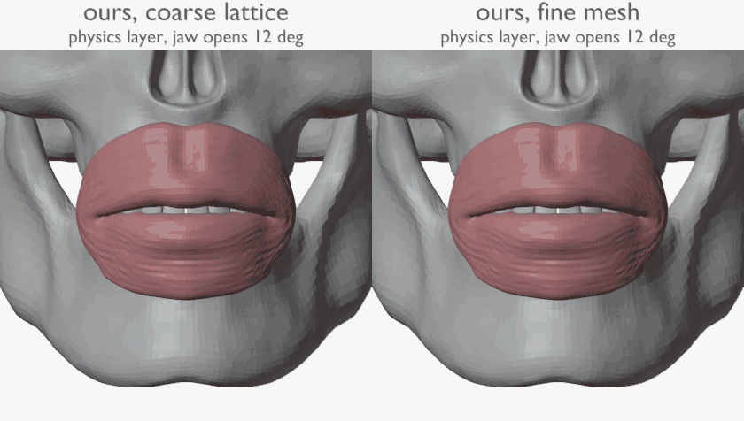

Frame 32 (the frame with the widest opening), with bones, the same camera:

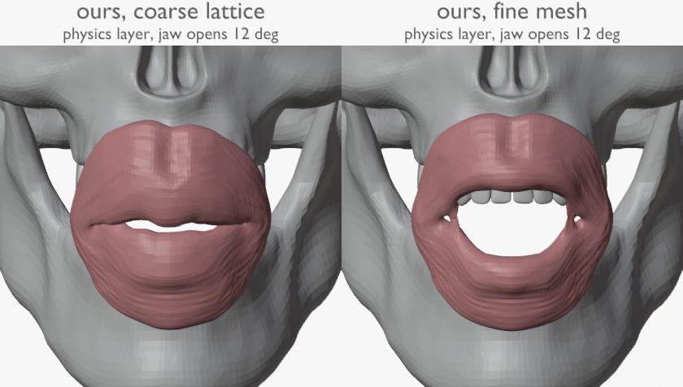

The same frame, close-up of the lips only:

| Ours: coarse lattice | Ours: fine mesh |
|---|---|
| 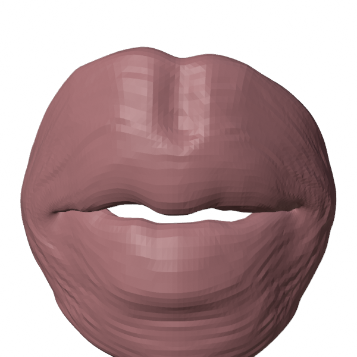 | 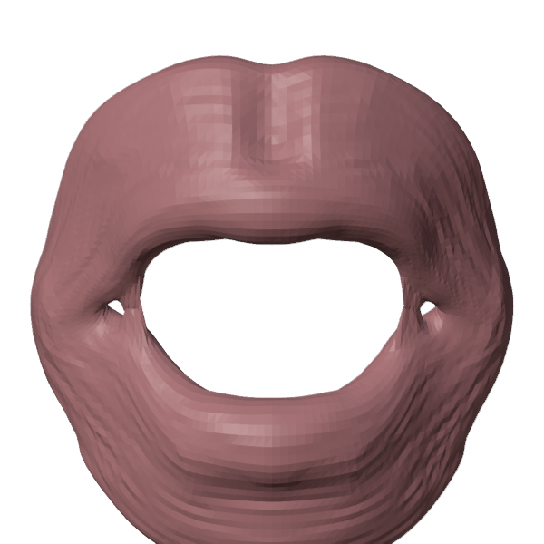 |

The animation in the README's "Playing a result in Blender" section is from an earlier run (the material was still our 15 kPa, and the fine mesh). It shows that the pipeline works, and does not represent the current defaults. The animation at the top of the README is the one at the top of this page.

## 4. Known gaps

If you have read this far and want to know "what is still missing", use this list:

- [ ] **Physical scale not aligned**: Ziva's solver has its own length transform, and the vendor material says it changes the physical scale of the tissue in the simulation. We use real human size. Until it is aligned, scale-dependent gaps such as gravity sag and the head shake are only reported, and no reason is given for them ([11](11-risks-and-questions.md) D18).
- [ ] **Gravity sag is smaller than Ziva's** (the table in section 3.3). We do not tune parameters to match before the scale is aligned.
- [ ] **The head shake has not converged** (section 3.4): the amplitude, the moment of the peak and the decay after stopping cannot be stated. The cause of the non-convergence has to be found first.
- [ ] **The material models differ**: ours is neo-Hookean, Ziva's is StVK (the compression parameters also differ). Only Young's modulus and Poisson's ratio can be set the same.
- [ ] **We have not obtained Ziva's own tet mesh** ([11](11-risks-and-questions.md) D12): so "as coarse as Ziva's" was matched from behaviour, not checked.
- [ ] **The other 40 pieces of tissue and the skin**: phase two, only the lips for now. In Ziva the surrounding tissue affects the lips a lot, and the difference between the two Ziva results written in section 3.1 shows this.
- [ ] **The asset is one fixed copy**: marking meshes as bones or soft tissue in Blender, and generating tetrahedra in Blender, both come after the two prototypes ([01](01-overview.md), the section "最终产品是什么形状", what the final product looks like).
- [ ] **No frame-by-frame interaction**: the panel computes first and then plays back.

## 5. Checks that still hold

**The five plausibility checks** (done automatically on every run and written into the run report, which the panel's Checks section reads; passing only means these things did not go badly wrong, and does not mean the physics is right, [07](07-validation.md) section 3):

| Check | What it asks |
|---|---|
| (a) Motion completed | Did the whole motion finish; how many times FEBio reduced the step size and recomputed on the way |
| (b) Hard attachments | Do the hard-attached vertices follow the bones (not run on a mesh with no hard attachment) |
| (b2) Spring anchors | Do the spring anchor points follow the jaw and the mouth corner anchors |
| (c) Gravity sag | Did the free lip vertices sink, and is the amount within one tenth to ten times the estimate |
| (d) Tet mesh valid | Is every tetrahedron free of flipping throughout |

The results of this neutral to AA run:

| Check (name in the panel's Checks section) | Coarse lattice (panel default): neutral to AA | Fine mesh: neutral to AA |
|---|---|---|
| (a) Motion completed | passed | passed |
| (b) Hard attachments | not run: no hard attachment in this scene | passed |
| (b2) Spring anchors | passed | passed |
| (c) Gravity sag | passed | passed |
| (d) Tet mesh valid | passed | passed |
| Times FEBio reduced the step size and recomputed | 0 | 0 |

(b) and (b2) hold by construction. They are regression checks that show at once if a transform convention is changed and something is written wrong, and they are not evidence that the physics is right.

**Landmark layer against the lab's formula**: our skinning agrees with the lab's own formula (using the lab's own bind pose and weight files) on the 300 landmarks, with a difference as small as numerical error:

| Check | Result |
|---|---|
| Subject | 300 landmarks, 10,240 display vertices |
| Max difference of our skinning against the lab's formula (the lab's own bind pose and weight files) | 5.3e-06 mm (mean 1.1e-06 mm) |
| Threshold | 0.0001 mm |
| Command | `uv run python tests/landmark_layer_check.py` |

**Landmark layer against Ziva**: for every frame, the shape before skinning plus the weights times that frame's landmark displacement, against Ziva's skinned shape for the same frame, has a max difference of 0.000016 mm, in both runs, full face and lips only (quoted from the "comparison" section of [09](09-roadmap-and-tasks.md); this check needs the lab's data, is in `tests/test_lab_motion.py`, and is skipped on a machine without the data).

**Training interface**: the lab's training code has saved 145 results (quoted from [09](09-roadmap-and-tasks.md)), and `final_shape(rest_model(...))` reproduces these 145 without going through Maya, with a max difference below 0.0001 mm (`tests/test_final_shape.py`, `tests/test_lab_facts.py`; these also need the lab's data).

## 6. Where the numbers come from, and how to update them

The numbers are all in `data/preview/`: `prototype_compare_<mesh>_<full_face|lips_only>.json` (the report of `asrp compare`, numbers only), `prototype_ziva_comparison_<mesh>.json`, `prototype_run_<mesh>_<aa|jaw>.json` (the run reports), `prototype_archive_manifest.json` (date, commit, machine, what was running at the same time), `landmark_layer_check.json`, and the pictures of section 3: `prototype_aa36_*.png`, `prototype_jaw32_*.png` (lip close-ups), and the front pictures with bones `prototype_*_front*.gif`, `prototype_*_front*.png` (drawn by `tools/render_comparison.py` and joined into animations with ffmpeg, so redoing the pictures needs ffmpeg on the PATH). To redraw only the pictures without recomputing the numbers: `uv run python tools/prototype_archive.py --pictures-from <the --work folder of the last full run>`. To redo it after changing code or defaults:

```bash
uv run python tools/prototype_archive.py --note "<what else was running on the machine while timing>"
uv run python tools/prototype_numbers.py --write
```

The first needs the lab's Ziva results (outside the repository; see `tools/local_paths.py` for the location), and redraws the pictures when it finishes. The second writes the tables back into the Chinese page; copy the changed numbers into this page afterwards. `uv run python tools/prototype_numbers.py --check` or the verify gate (`tools/verify.py`) fails when the Chinese page and the reports disagree, and the verify gate also fails when this page and the Chinese page disagree.
