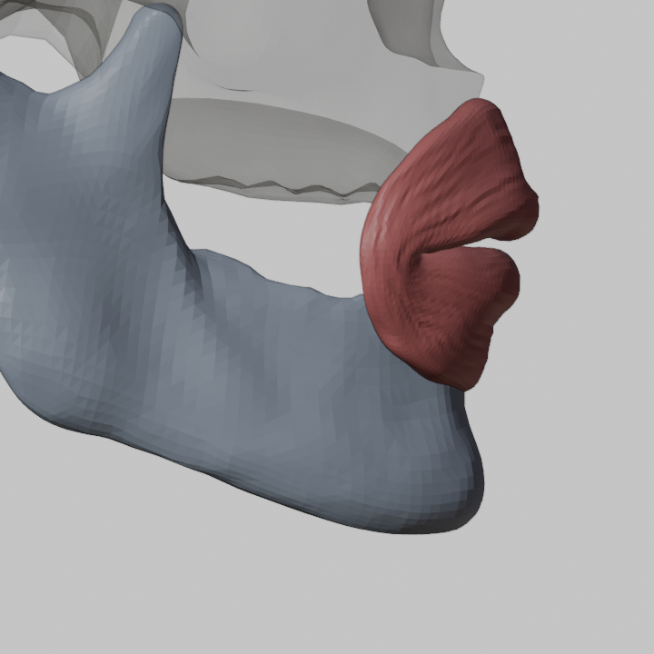
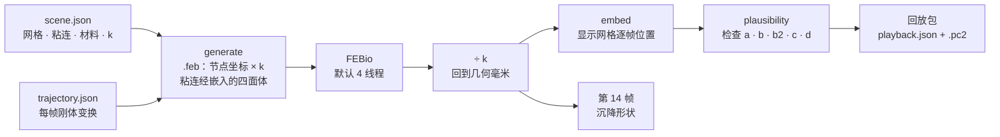
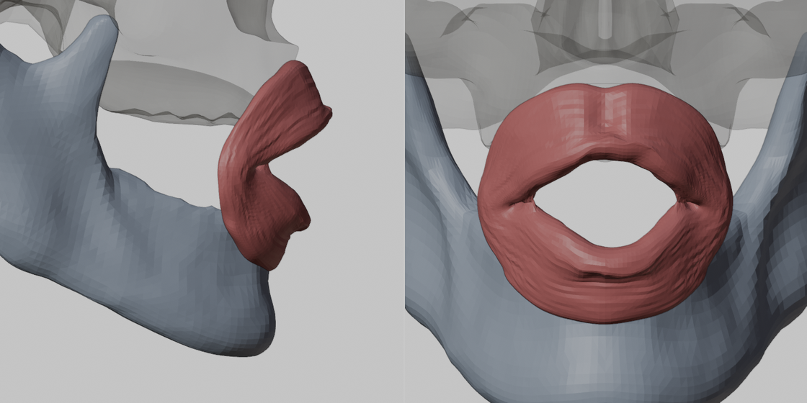
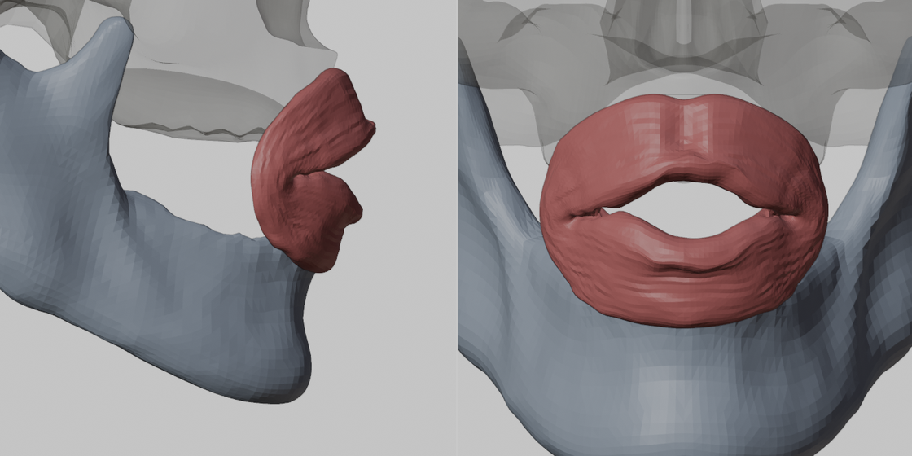

# 15 原型机：怎么跑、跑出了什么


*侧视图，脸朝右。红：嘴唇（FEBio 算出，在 Blender 里回放）；蓝：下颌；灰：颅骨（半透明）。下颌在第 0–14 帧不动，之后张开到 12°（第 32 帧），再合上（第 50 帧）。*

**原型机是什么**：实验室的真实嘴唇网格，被下颌带动，由 FEBio 算出变形，再放回 Blender 播放（定义写在 [09](09-roadmap-and-tasks.md) 第 1 节）。上面的动图就是这次运行的结果：下颌往下转，下唇跟着下颌走，上唇留在颅骨上，两侧嘴角被拉长。整段 51 帧在本机一分钟左右算完（用时见第 1 节），五项合理性检查都通过。这是 2026-11-11 在一台 Windows 11 电脑上跑出的参考结果（数字来源见第 4 节）。

**它还不是什么**：存档的这一次运行只有物理层，没有叠 landmark 层（让实验室控制器输出的表情真正出现的那一层；它后来接上了，见第 8 节），也没有和 Ziva 的结果对比（T-11）；下颌的运动、材料和粘连刚度都是我们定的临时值（第 5 节）。所以它证明"管线通了、结果合理"，不证明"和 Ziva 一样"或"和真人一样"。

## 1. 一眼看结果

<!-- BEGIN generated by tools/prototype_numbers.py: glance -->
| 看什么 | 数字 | 意思 |
|---|---|---|
| 整段运动算完了吗 | 51 帧全部算完（第 0 帧加 FEBio 算的 50 步），**重试 0 次** | FEBio 没有哪一步要缩小步长重算 |
| 算得多快 | 4 线程：FEBio **30.02 s**，**0.60 秒/帧** | 机器同时在做别的事就会慢。**这是嘴唇一块组织的速度，不能拿来和 Ziva 比**：实验室演示机上 Ziva 每帧约 1.5–2.5 秒（[14](14-ziva-demo-walkthrough.md) 第 2 节），算的是整张脸（41 块软组织，[03](03-asset.md) 第 2 节）。线程数和更早的单线程用时见第 3 节 |
| 嘴唇有没有"脱"骨头 | 上唇和颅骨粘住的地方，偏离**不超过 9.63×10⁻¹¹ mm**；用弹簧挂着的下唇，最远偏离 **0.0334 mm**（第 32 帧，张得最大） | 贴骨头的地方确实跟着骨头走（这一条按做法本来就该成立，它查的是管线有没有接对，不是物理证据）；弹簧处允许有一点点"滑"，滑得很小 |
| 重力有没有往下拉 | 自由部分的嘴唇第 10–14 帧平均顺重力下沉 **0.0952 mm**；按材料和尺寸估计是 0.1457 mm | 方向对，量级和估计同一个数量级；估计本身是粗的，不证明准（第 5 节） |
| 网格有没有被压坏 | 26,721 个四面体里，翻转的 **0 个**；体积是静止时的 0.690（第 32 帧）到 3.675 倍 | 没有四面体翻面，但个别很小的四面体胀得不少，见第 5 节 |
| 嘴唇动了多少 | 下颌张 12°，嘴唇上动得最多的顶点离开静止位置 **30.4 mm**（第 32 帧） | 肉眼可见的大幅度运动 |
| 同样的输入，同样的输出吗 | 存档的这一次只跑了一遍，报告里没有重复运行的数据；两次运行相差多少见第 3 节（ADR-38） | 这一份运行报告本身不证明可复现 |
<!-- END generated: glance -->

三张静态图（同一个侧视角度，可以逐张对照）：

| 静止（第 0 帧） | 沉降后（第 14 帧） | 下颌张到最大（第 32 帧） |
|---|---|---|
|  |  |  |
| 嘴唇闭合，嘴唇的位置就是实验室网格的原样。 | 只有重力的 15 帧之后。肉眼看不出和左图的差别：下沉量很小（见第 1 节"重力有没有往下拉"）。这一帧的形状单独存下来，是控制器优化的起点（ADR-30）。 | 下唇跟着蓝色的下颌往下走，上唇留在颅骨上，嘴唇被拉开；从这个侧视角度看不到翻折（牙齿没有画出来，也没有参与计算，见第 5 节）。 |

## 2. 自己跑一遍

需要：Windows、[uv](https://docs.astral.sh/uv/)、FEBio、Blender（安装办法见 [README](../README.md)）。**不需要 Maya，也不需要 Ziva**：嘴唇、颅骨、下颌的网格已经导出，提交在 `data/lab_export/`。

```bash
uv sync
uv run asrp doctor        # 四行都是 [ok   ] 才往下走
uv run asrp import-asset data/lab_export runs/prototype_scene
uv run python tools/placeholder_jaw_motion.py runs/prototype_scene/scene.json runs/prototype_scene/placeholder_jaw.json
uv run asrp run runs/prototype_scene/scene.json runs/prototype_scene/placeholder_jaw.json
```

`runs/` 不进 git，可以随便删。`import-asset` 的输出文件夹要是新的或空的；`asrp run` 的结果默认放在 `runs/<日期>_placeholder-jaw_001/`（用 `--runs-dir` 换位置，路径只能是英文）。`asrp run` 默认让 FEBio 用 4 个线程，`--threads N` 可以改（取 N 和本机核数中小的）；线程数和可复现性的关系见第 3 节。

**每条命令应该看到什么**（下面是 2026-11-11 在本机重跑一遍时的原样输出行；检查的数字和用时每次不同，这里不抄，数字以第 3 节为准）：

| 命令 | 关键输出行 | 用时 |
|---|---|---|
| `import-asset` | `mesh lips 10240 vertices …`、`driver jaw01: pivot (0.00, -121.71, -54.65) mm …`、最后一行 `import PASSED: scene check 0 errors, 0 warnings`。中间的 `missing` 行是在说"这些值还是我们定的"，不是错误 | 几秒 |
| `placeholder_jaw_motion.py` | `wrote …/placeholder_jaw.json: 51 frames at 30 fps, jaw01 opens to 12 degrees at frame 32` | 不到 1 秒 |
| `asrp run` | 51 行 `progress   frame N / 50`（N 从 0 到 50），然后：<br>`generator  k …, … tet nodes, … tets, … hard nodes, … springs, display max distance … mm (limit …)`<br>每个弹簧组一行 `group …`、一行 `slip …`<br>`check a    [PASS] motion completed: all 51 frames; …`<br>`check b    [PASS] hard attachments follow their bones: …`，`check b2 [PASS] spring anchors follow their rigid bodies: …`<br>`check c    [PASS] gravity sag: free vertices moved … mm along gravity (down) on average over frames 10-14; the model expects … mm …`<br>`check d    [PASS] the tet mesh stays valid: on all 51 frames every one of the … tets keeps its orientation; volume / rest volume is between … and …`<br>`returns    drivers back at rest on frame(s) 50: nodes are at most … mm (mean … mm) from the settled shape (reported only)`<br>`timing     FEBio … s, … s per frame; generate … s, post … s`<br>最后一行 `run COMPLETE: 51 frames; plausibility PASSED` | 约一分钟 |

任何一项检查不通过，`asrp run` 以非 0 退出，最后一行写 `run COMPLETE: … plausibility FAILED`；生成器拒绝的场景写 `run NOT STARTED`，不建运行文件夹；FEBio 失败写 `run FAILED: no results written`。

### 在 Blender 里看

1. 安装插件（只需一次，命令在 [README](../README.md) 的 "Install the Blender add-on"）。插件找后端要用环境变量 `ASRP_PROJECT`；只加载结果不需要。
2. 打开 Blender，删掉默认的立方体。
3. 侧栏（按 N）> **ASRP** > **Load Result**，选运行文件夹（里面有 `playback.json` 的那个）。
4. View > Frame Selected（小键盘 `.`），按空格播放。时间线是第 0 到 50 帧。物体缩放了 0.001，所以毫米数据在 Blender 里显示成米。

**注意**：Load Result 只带进嘴唇。图里的颅骨和下颌是 `tools/render_prototype.py` 另外加的。想一次得到和上面一样的图，并让它把 Blender 里的嘴唇和 FEBio 的数字逐帧核对：

```bash
"C:/Program Files/Blender Foundation/Blender 5.2/blender.exe" --background --factory-startup --python-exit-code 1 --python tools/render_prototype.py -- runs/<运行文件夹> --out runs/<运行文件夹>/render
```

（PowerShell 里引号路径前加 `&`。）它先用插件的 Load Result 加载，再核对第 0、14、32、50 帧，通过时打印 `PROTOTYPE PLAYBACK CHECK PASSED`，然后输出三张静态图。加 `--frames-dir <文件夹>` 会把每一帧都渲染出来；本页的动图就是这样渲染 51 帧，再用 Pillow 拼成的（拼图不属于产品，没有放进仓库）。

### 运行文件夹里有什么

每个文件的格式见 [04](04-architecture.md) 第 4、5 节：

| 文件 | 是什么、给谁用 |
|---|---|
| `scene.json`、`trajectory.json` | 这次运行的全部输入（场景和运动），拷进来所以整个文件夹可以原样重跑 |
| `meshes/`、`landmarks/` | 场景用到的网格（`lips.obj`、`lips_tet.json` 四面体网格、`jaw.obj`、`skull.obj`、两排牙）和 landmark 蒙皮权重（原样拷贝，这一版还没用上） |
| `model.feb` | 生成给 FEBio 的输入。想用 FEBio Studio 打开检查就看它 |
| `model.log` | FEBio 的日志，只有进度和提示（约 0.15 MB）；节点位置不在里面 |
| `physics/positions.json`、`positions.npy` | 每帧每个计算点的位置（毫米，已除以 k）。`.json` 是小表头（单位、每帧时间、节点编号、数组形状），数字在 `.npy` 里（float64，帧 × 节点 × 3）；自己的脚本用 `numpy.load` 读 |
| `physics/display.json`、`display.npy` | 每帧显示网格（嘴唇的 10,240 个顶点）的位置，同样是表头加数组；给检查、回放包和 Blender 核对用 |
| `physics/settled_frame14.json`、`.obj` | 沉降后的形状（控制器的起点，ADR-30）；文件名里的帧号来自运动文件的 `settle_until_frame`，原型运动写 14；`.obj` 带面，可以直接拖进 Blender |
| `playback.json`、`playback.pc2` | 回放包：Load Result 加载的就是它 |
| **`run_report.json`** | **运行报告：每个临时值和来源、没建的东西、生成器报告、五项检查的数字、用时。第 1、3 节的数字都来自这里** |
| `provenance.json` | 溯源：输入文件的哈希、软件版本（asrp、Python、FEBio）、命令、线程数、开始和结束时间 |

整个运行文件夹在参考运行（51 帧、4 线程）里约 45 MB，其中显示网格 12.0 MB，位置 9.4 MB，回放包 6.0 MB，输入约 15 MB（蒙皮权重 JSON 一个就 4 MB）。格式为什么这样选、以前是多大：[10](10-decisions.md) ADR-38 第 10 条。

`import-asset` 写出的场景文件夹里还有 `import_report.json`（导入报告）。

## 3. 结果的细节

下面每个数字都来自参考运行的 `run_report.json`，已存档在 [`data/preview/prototype_run_report.json`](../data/preview/prototype_run_report.json)（溯源记录在 [`prototype_provenance.json`](../data/preview/prototype_provenance.json)，里面没有本机路径）。检查的定义和通过标准写在 [07](07-validation.md) 第 3 节，实现在 `src/asrp_core/plausibility.py`。

### 运行

<!-- BEGIN generated by tools/prototype_numbers.py: run -->
| 项 | 结果 |
|---|---|
| 帧数 | 51（第 0 帧是静止姿态，FEBio 算 50 步；运动文件 30 帧/秒，约 1.7 秒） |
| FEBio 重试 | 0 次（步长从没有被迫缩小） |
| 用时（存档的这一次） | FEBio 30.02 s（0.60 秒/帧，4 线程，[05](05-ziva-to-febio.md) 坑 17），生成 5.90 s，后处理 1.14 s。只算了嘴唇一块，所以只报告用时，不和全脸的预算比 |
| 同输入两次 | 存档的这一次只跑了一遍，报告里没有重复运行的数据；两次运行相差多少见第 3 节（ADR-38） |
| 回到沉降形状（只报告，不判） | 第 50 帧：四面体节点离沉降形状最多 0.0041 mm，平均 0.0012 mm（沉降形状在第 14 帧，重力的沉降当时还差这么一点没走完，[13](13-explanations.md) E-08） |
<!-- END generated: run -->

线程数对用时的影响（1、4、8、16 线程的比较）只记在 [10](10-decisions.md) ADR-38 的证据里；为什么默认改成 4 线程见 ADR-38 和 [13](13-explanations.md) E-08。

### 五项合理性检查

<!-- BEGIN generated by tools/prototype_numbers.py: checks -->
| 检查 | 一句话 | 结果 | 上限 |
|---|---|---|---|
| (a) 整段算完 | 51 帧都算出来了，FEBio 中途没有失败 | 通过：重试 0 次 | 没有失败的帧 |
| (b) 粘在骨头上的点跟着骨头 | 上唇粘在颅骨上的计算点和显示顶点，每一帧相对骨头不动 | 通过：计算点最多偏 9.63×10⁻¹¹ mm，显示顶点 8.42×10⁻¹¹ mm | 0.001 mm |
| (b2) 弹簧锚点跟着刚体 | 下唇、嘴角的弹簧另一头钉在下颌、嘴角锚上，钉的位置每一帧都对 | 通过：全部 1,428 个锚点最多偏 1.26×10⁻¹⁰ mm（下颌 234 个，嘴角锚 1,194 个） | 0.001 mm |
| (c) 重力下垂和模型的估计一致 | 没有粘住的嘴唇顶点在第 10–14 帧平均往下沉了多少，和按密度、重力、k、E、尺寸算出的估计比 | 通过：沉 0.0952 mm，估计 0.1457 mm（自由部分最远 25.05 mm） | 估计的 1/10 到 10 倍：0.0146 mm 到 1.4567 mm |
| (d) 四面体网格保持有效 | 每一帧每个四面体的体积除以静止体积，没有翻面（体积 ≤ 0） | 通过：26,721 个四面体、51 帧，翻转 0 个；体积比最小 0.690（第 32 帧），最大 3.675 | 没有翻转的四面体 |
<!-- END generated: checks -->

(c) 拿实测下垂和一个由模型估出来的量级比（估计的写法见 [07](07-validation.md) 第 3 节），范围随材料、重力和尺寸变；(d) 查有没有四面体翻面。检查只抓大错：(c) 抓不到小错，(d) 不看体积涨了多少（见第 5 节）。

(b) 里**弹簧组只报告不判**：显示顶点相对目标的偏离，最大值都出现在张得最大的那一帧：

<!-- BEGIN generated by tools/prototype_numbers.py: spring-deviation -->
| 弹簧组 | 显示顶点偏离目标：最大 | 平均 | 最大值出现的帧 |
|---|---|---|---|
| 下唇 → 下颌（`spring`） | 0.0334 mm | 0.00115 mm | 第 32 帧 |
| 左嘴角 → 嘴角锚（`spring`） | 0.0103 mm | 1.67×10⁻⁴ mm | 第 32 帧 |
| 右嘴角 → 嘴角锚（`spring`） | 0.00811 mm | 1.77×10⁻⁴ mm | 第 32 帧 |
<!-- END generated: spring-deviation -->

**(c) 的局限要看清**：通过的范围是估计的上下 10 倍，所以它只能抓"符号反了"或"错一个数量级"，证明不了尺度和材料；实测比估计小，是因为这块嘴唇一端被粘住，悬臂的平均下垂本来就比估计小（[10](10-decisions.md) ADR-38 的证据）。

### 弹簧和滑移

弹簧是下唇和嘴角"软粘"的办法（粘连的类型见 [05](05-ziva-to-febio.md) 第 3 节）。弹簧的另一头离组织有一段距离 δ（数值在下面的生成器报告里）；组织在弹簧方向上滑动的距离 u 必须远小于 δ，否则弹簧力不再近似线性，所以报告 max|u|/δ，超过 0.1 就要加大 δ：

<!-- BEGIN generated by tools/prototype_numbers.py: springs -->
| 弹簧组 | max\|u\|/δ | 判断 |
|---|---|---|
| 下唇 → 下颌 | 0.0394 | < 0.1，没问题 |
| 左嘴角 → 嘴角锚 | 0.00996 | < 0.1，没问题 |
| 右嘴角 → 嘴角锚 | 0.00828 | < 0.1，没问题 |
<!-- END generated: springs -->

### 生成器报告

<!-- BEGIN generated by tools/prototype_numbers.py: generator -->
| 项 | 数字 |
|---|---|
| 物理尺度 k | 0.67 |
| 计算点、四面体 | 6,747 个计算点、26,721 个四面体（边长中位数 2.42 mm） |
| 显示网格到四面体的最远距离 | 0.931 mm（上限 4.84 mm，即 2 倍边长中位数；超过会报错停止） |
| 上唇 → 颅骨（`hard`） | 74 个顶点 → 74 个计算点，并入颅骨；被截成 0 的重心坐标 34 个；冲突 0 |
| 下唇 → 下颌（`spring`） | 76 个顶点 → 78 个计算点，234 根弹簧，43 档刚度（最大档内误差 1.97%） |
| 左嘴角 → 嘴角锚（`spring`） | 348 个顶点 → 196 个计算点，588 根弹簧，77 档刚度（最大档内误差 1.73%） |
| 右嘴角 → 嘴角锚（`spring`） | 309 个顶点 → 202 个计算点，606 根弹簧，70 档刚度（最大档内误差 1.90%） |
| 弹簧基础刚度 | 2.43 N/mm（100 × E × h，E = 0.015 MPa，h = 1.62 mm）；各节点的刚度不同（左嘴角 0.30–41.97 N/mm；下唇 0.30–9.47 N/mm；右嘴角 0.30–24.78 N/mm），分档后每档用一个 FEBio 弹簧材料（档数取到每个节点分档后和自己的值差不超过 2%）；每组的总刚度不变 |
| 弹簧另一头离组织的距离 δ | 8.10 mm（FEBio 坐标，5 倍四面体边长中位数 × k） |
| 弹簧总数 | 1,428 根（每个计算点 3 根） |
<!-- END generated: generator -->

## 4. 数字的来源

本页的数字来自存档的那一次参考运行：本机日期 2026-11-11（溯源记录里记的是 UTC 时间，日期显示为 2026-11-12），用第 2 节的三条命令；运行报告和溯源记录原样存在 `data/preview/prototype_run_report.json`、`prototype_provenance.json`。它是审计修正（[10](10-decisions.md) ADR-38）之后重跑的：4 线程、五项检查，取代了更早的单线程、四项检查的那一次。这一次的提交、软件和时间：

<!-- BEGIN generated by tools/prototype_numbers.py: source -->
| 项 | 值 |
|---|---|
| 提交 | 83ac48e |
| 软件 | FEBio 4.13.0，Python 3.13.6，asrp 0.0.1 |
| 线程 | 4 |
| 开始、结束（UTC） | 2026-11-12T07:37:30+00:00、2026-11-12T07:38:01+00:00 |
<!-- END generated: source -->

上面三个生成的表（第 1、3 节）里的数字都由 `tools/prototype_numbers.py` 从这两个文件写出，页面里不手抄。新做一次参考运行后，把两个 JSON 文件拷进 `data/preview/`，再跑 `uv run python tools/prototype_numbers.py --write`；忘了的话 `tools/verify.py` 里的 `tests/test_prototype_page.py` 会不通过。

"同输入两次"的结论来自 [10](10-decisions.md) ADR-38 的测量和 `tests/test_prototype.py`。动图和三张静态图由 `tools/render_prototype.py` 渲染，沿用更早的那次运行：重新跑后动作相同（差别在 10⁻¹⁰ mm 量级），肉眼没有差别。

## 5. 这些结果说明什么、不说明什么

**说明的**：真实资产（实验室的嘴唇、颅骨、下颌网格）能一条命令导入、用 FEBio 算完整段运动、结果能放回 Blender，而且可复现；粘连按设计跟着骨头走。

**不说明的**（每条后面是事实所在的文档）：

| 局限 | 细节 | 在哪里看 |
|---|---|---|
| 材料是我们猜的 | neo-Hookean，E = 15 kPa、ν = 0.45、密度 1060 kg/m³：猜测接近 Ziva 的默认值，没有验证，等实验室的 Ziva 属性清单 | [05](05-ziva-to-febio.md) 第 1 节 zMaterial 一行，[13](13-explanations.md) E-06，[11](11-risks-and-questions.md) D6 |
| 材料几乎不影响张嘴的形状 | 2026-11-11 做过一次对照：把 `scene.json` 里嘴唇的 E 改成 10 倍和 1/10，弹簧不变，各重跑一遍。现在可以自己重跑：`uv run python spikes/audit_material.py <场景文件夹> <运动文件>`。张嘴最大时（第 32 帧）基准的嘴唇最多移动 30.41 mm。E × 10：下垂 0.0106 mm，形状和基准相比最多差 0.9824 mm（平均 0.2057 mm）；E ÷ 10：下垂 0.9316 mm，最多差 3.3057 mm（平均 0.8327 mm，主要是多出来的重力下垂）。三种材料都通过检查 (c)（基准的下垂见第 1 节，估计 0.1457 mm）。材料差 100 倍，形状只变 2%–3%。**现在的形状主要由"粘在哪、粘多紧"决定**，就是下面两行那些我们自己定的规则，FEBio 做的接近在给定运动的边界之间插值 | 本页第 3 节，[05](05-ziva-to-febio.md) 第 3 节，[13](13-explanations.md) E-08 |
| 粘连刚度、嘴角混合比例是我们定的，而且它们对形状的影响比材料大 | 弹簧基础刚度按 100 × E × h 的规则取；嘴角锚转下颌角度的 α = 0.5。2026-11-12 量过：α 改 ±0.2，张嘴最大时形状最多差 4.79 mm，比材料差 100 倍还大；弹簧刚度除以 10 最多差 0.95 mm。实验室的 AA 目标形状里嘴角不动，不利于 0.5，但目标不含物理，默认值没改。下唇跟随下颌的比例要等 Ziva 的"只有物理"结果才能定 | [05](05-ziva-to-febio.md) 第 3 节，[13](13-explanations.md) E-09，[10](10-decisions.md) ADR-32、ADR-40，[11](11-risks-and-questions.md) Q17、A-35 |
| 实验室的 AA 目标里嘴唇不跟着下颌走，我们的跟着 | 目标里下唇的跟随比例是 0.09、嘴角 0.00；我们的物理是 1.00 和嘴角锚的比例，下唇差约 13 mm。所以原型机的下唇"跟着下颌走"是我们的设定，不是和实验室结果吻合的证据 | [13](13-explanations.md) E-09，[10](10-decisions.md) ADR-40，[11](11-risks-and-questions.md) Q17、Q20 |
| 粘连顶点集是强推断 | 上唇和下唇的粘连顶点（个数见第 3 节）来自对 Ziva 权重表的读法，等 Ziva 机器导出的权重表确认 | [03](03-asset.md) 第 6 节，[11](11-risks-and-questions.md) A-33 |
| 物理尺度 k = 0.67 是我们定的 | 来自会议结论（按真人大小算），不是 Ziva 的尺度 | [10](10-decisions.md) ADR-31，[05](05-ziva-to-febio.md) 第 2 节 |
| 下颌运动是代用的 | 张开 12° 的铰链运动，不是实验室控制器算出的运动（还没拿到运动文件） | [09](09-roadmap-and-tasks.md) T-10，[11](11-risks-and-questions.md) D2 |
| 检查 (c) 很宽松 | 范围现在随材料、重力和尺寸算（估计的上下 10 倍，[10](10-decisions.md) ADR-38），上一行的硬 10 倍和软 10 倍都通过了；但它只抓符号错或一个数量级的错，抓不到小错 | [07](07-validation.md) 第 3 节，本页第 3 节 |
| 个别很小的四面体被拉得很大 | 检查 (d) 量出来的（2026-11-11，参考运行，第 32 帧）：15 个很小的四面体（静止体积 0.04 到 0.14 mm³）涨到静止体积的 2 到 3.7 倍，另有 516 个涨到 1.25 到 2 倍，14 个缩到 0.8 倍以下；加起来不到嘴唇体积的 0.2%，89.8% 的体积保持在 ±5% 以内。它们都在两侧嘴角（\|x\| 约 26 mm）。🔍 推断：那里是四面体网格把上唇和下唇接起来的地方（[05](05-ziva-to-febio.md) 坑 10 和 13），张嘴时这些四面体被拉开。没有四面体翻面。这些数字不在运行报告里，检查 (d) 只报告最小和最大体积比 | [07](07-validation.md) 第 3 节，[05](05-ziva-to-febio.md) 坑 10、13 |
| 现在算的接近"慢动作" | 每帧只走一个时间步（33 毫秒），比嘴唇自己晃动的周期长，数值上把晃动和惯性都抹掉了，结果接近准静态（每一帧都像是慢慢摆到位的）。所以现在还不能拿它和 Ziva 比"动起来的样子"；子步数和阻尼是占位值，等 Ziva 属性清单 | [05](05-ziva-to-febio.md) 第 5 节坑 2，[09](09-roadmap-and-tasks.md) T-12 |
| 存档的这一次运行只有物理层 | 这一次运行没有叠 landmark 层（landmark 层后来接上了，用法和数字见第 8 节）；嘴周的肌肉、皮肤的粘连没建（第一阶段的简化，运行报告里写明） | [10](10-decisions.md) ADR-29、ADR-32，[09](09-roadmap-and-tasks.md) T-09，本页第 8 节 |
| 没有碰撞，牙齿不在计算里 | 嘴唇不会被牙齿或对侧嘴唇挡住；牙齿没有粘连，所以没有写进 FEBio。实验室在 Ziva 里也关掉了碰撞 | [05](05-ziva-to-febio.md) 第 1、4 节，[10](10-decisions.md) ADR-37 |
| 还没查网格粗细的影响 | 换一份网格、把网格加密、把时间步减半，结果会变多少，还没有量过 | [09](09-roadmap-and-tasks.md) T-06b，[07](07-validation.md) 第 6 节 |
| 下唇的张嘴位移以后可能被算两遍 | 现在下唇几乎完全跟着下颌走；叠上 landmark 层以后，landmark 的运动里可能已经含有这部分位移（推断）。所以下唇绑多紧是参数，等 Ziva 的"只有物理"结果再定 | [11](11-risks-and-questions.md) Q17、Q20，[10](10-decisions.md) ADR-27 |
| 速度还撑不起整张脸 | 一块嘴唇的速度见第 1 节，Ziva 算整张脸每帧约 1.5–2.5 秒（一块组织对整张脸，不能直接比）。多线程已经做了（默认 4 线程），换更粗的计算网格（T-20）还没做，是进第二阶段之前要先试的 | [02](02-requirements.md) N-07，[05](05-ziva-to-febio.md) 坑 17，[09](09-roadmap-and-tasks.md) T-20 |
| 没有和 Ziva 对比，没有实验验证 | 不能说"重现了 Ziva"或"在生物力学上准确" | [07](07-validation.md) 第 4、7 节 |

## 6. 它是怎么搭起来的（给开发者）



| 模块 | 干什么 |
|---|---|
| `src/asrp_core/asset/`（`lab.py`、`coords.py`） | `asrp import-asset`：读实验室导出，写 `scene.json`，坐标换算只在这里 |
| `src/asrp_core/generate.py` | 生成器：scene + trajectory → `.feb`（真实大小、节点坐标 × k；硬粘连并入刚体；弹簧按档生成） |
| `src/asrp_core/embed.py` | 把 10,240 个显示顶点嵌进四面体网格，用重心坐标算每帧位置（我们对 Ziva zEmbedder 的替身） |
| `src/asrp_core/simulate.py` | `asrp run` 的整条流程：生成 → 运行外壳 → 嵌入、沉降形状 → 检查 → 回放包 → 运行报告 |
| `src/asrp_core/run.py` | 运行外壳：运行文件夹、进度、取消、出错处理、读 FEBio 写的位置并除以 k、存成 `.npy` |
| `src/asrp_core/plausibility.py` | 五项合理性检查 |
| `src/asrp_core/provenance.py` | 溯源记录 |
| `src/asrp_core/febio.py`、`playback.py`、`tetmesh.py` | 调用 FEBio 读日志；回放包；四面体网格读写 |

几个关键决定：

- **ADR-36**：节点坐标按真实大小乘 k 写进 FEBio，物理参数不缩放；粘连统一通过显示网格嵌入的四面体来挂，所以显示顶点在四面体外面也能处理。
- **ADR-32**：第一阶段的粘连范围：上唇硬绑颅骨，下唇和嘴角用弹簧，嘴角链条用一个按 α 转下颌角度的锚代替；周围肌肉、皮肤不建。
- **ADR-30**：控制器优化时物理不在环，所以物理层要能交出第 14 帧沉降后的形状作为起点。
- **ADR-31**：物理尺度取真人大小，不是追 Ziva 的数值。

## 7. 下一步

- **"原型机二"**：真实的从中性到 AA 的嘴形（带 landmark 层），加上摇头的运动。AA 这一半的结果在第 8 节；其余的内容、顺序和做到哪里写在 [09](09-roadmap-and-tasks.md) 第 1、2 节。AA 的形状两种拼法都做（ADR-40）：甲是照实验室流程的读法，最终形状不等于目标；乙是对准目标，landmark 要把物理带走的部分拉回来。哪一种作为正式结果，还要项目负责人定（[11](11-risks-and-questions.md) P-07）。
- **去 Ziva 机器**：拿 Ziva 的属性清单、权重表和一条运动的参考结果（[12](12-lab-export-checklist.md) 第二部分，ADR-35）。许可还能用约一年半（[11](11-risks-and-questions.md) Q5），所以不急。
- **和 Ziva 并排比较**（T-11，M4）：[07](07-validation.md) 第 4 节。

## 8. 原型机二：landmark 层和中性到 AA

**这是什么，不是什么**：第 1–7 节的原型机只有物理层。现在 landmark 层接上了：`asrp run` 读运动文件里的 landmark 平移，按实验室的蒙皮权重叠在物理结果上，另外写出最终形状（[09](09-roadmap-and-tasks.md) T-09）。在此之上做了实验室的 AA 口型：下颌转到目标的角度，物理算出嘴唇，landmark 层再动。**这一节用的 landmark 平移是我们自己拟合的，是实验室运动文件（D2）的替身，拿到 D2 后由 T-10 的转换取代**（[04](04-architecture.md) 第 12.1 节）。AA 有两种拼法，都做了（[10](10-decisions.md) ADR-40）：

- **甲**：landmark 平移对着沉降后的形状拟合，再叠到下颌张开后的物理结果上（我们读到的实验室流程）。最终形状**不会**到目标：下唇比目标多走约 13 mm。这是预期的结果，不是缺陷（[10](10-decisions.md) ADR-40；量出来的数见 8.2 的距离表和 8.3 的下唇跟随比例），这里照实报告，没有去调任何东西让它变小；
- **乙**：物理算完再拟合，最终形状落在目标上，landmark 要把物理带走的部分拉回来。**到目标是拟合保证的，不证明物理对。**

本节没有和 Ziva 比较。哪一种是实验室实际得到的，现在判断不了（要 D2 或 [11](11-risks-and-questions.md) Q20）；哪一种作为正式结果，是项目负责人还没定的 P-07。所以这里把两种并排放出来，**不说哪一种对、哪一种更好、哪一种更接近实验室**。

本节每个表里的数字都由 `tools/prototype2_numbers.py` 从 `data/preview/` 里的六个存档文件写出：[`aa_standin_report.json`](../data/preview/aa_standin_report.json)（拟合工具的报告）、[`aa_a_run_report.json`](../data/preview/aa_a_run_report.json)、[`aa_a_provenance.json`](../data/preview/aa_a_provenance.json)、[`aa_b_run_report.json`](../data/preview/aa_b_run_report.json)、[`aa_b_provenance.json`](../data/preview/aa_b_provenance.json)（两次完整的 `asrp run`）、[`landmark_layer_check.json`](../data/preview/landmark_layer_check.json)（landmark 层的核对）。页面里不手抄；改了存档要跑 `uv run python tools/prototype2_numbers.py --write`，忘了的话 `tests/test_prototype2_page.py`（所以 `tools/verify.py`）会不通过。

### 8.1 landmark 层对不对：和实验室自己的公式比

<!-- BEGIN generated by tools/prototype2_numbers.py: p2-layer-check -->
| 项 | 数字 | 结论 |
|---|---|---|
| 检查的东西 | 10,240 个嘴唇顶点、300 个 landmark；实验室的蒙皮权重和绑定姿态，实验室仓库提交 506cd69；随机种子 0 | — |
| 所有 landmark 不动时，蒙皮还原静止嘴唇 | 最多差 4.67×10⁻⁷ mm | 通过 |
| 我们的两个蒙皮函数互相对照（随机位移） | 最多差 7.42×10⁻¹⁴ mm | 通过 |
| 和实验室自己的公式（`绑定姿态 + 权重 @ 平移`）比，用实验室自己的数据 | 最多差 5.34×10⁻⁶ mm，平均差 1.07×10⁻⁶ mm（上限 0.0001 mm） | 通过 |
| 对照（必须失败）：把权重列错开一个 landmark | 最多差 6.79 mm | 能抓出错 |
| 这次比较里放的最大 landmark 平移 | 16.07 mm | — |
| 怎么重跑 | `uv run python tools/landmark_layer_check.py` | — |
<!-- END generated by prototype2: p2-layer-check -->

这张表说明：我们的 landmark 层，在实验室自己的蒙皮权重和绑定姿态上，算出的结果和实验室公式一致（差在表里的上限之内），而且这个比较在权重列被错开时确实会失败。它**不说明**"在 Ziva 算出的嘴唇上叠 landmark，Maya 给出同样的结果"：那要 Ziva 机器上导出的同一条运动的蒙皮前和蒙皮后的形状（[11](11-risks-and-questions.md) D3），还没有。实验室的数据不在本仓库里（ADR-28）。

### 8.2 甲和乙并排

最后一帧的形状离实验室的 AA 目标有多远，三行用同一个度量、对着同一个目标：

<!-- BEGIN generated by tools/prototype2_numbers.py: p2-distance -->
| 最后一帧的形状 | 离目标：最大 (mm) | 离目标：平均 (mm) | 归一化距离（我们的变体：全部顶点） |
|---|---|---|---|
| 只有物理（没有 landmark） | 14.36 | 5.73 | 3.572 |
| 甲 | 14.80 | 5.58 | 3.710 |
| 乙 | 3.03 | 0.24 | 0.178 |
<!-- END generated by prototype2: p2-distance -->

<!-- BEGIN generated by tools/prototype2_numbers.py: p2-normalised -->
**实验室目标函数里的那个归一化距离，这里没有按实验室的定义算出来**（报告里它的值是空，写明了原因）。实验室的那一项是在它采样的控制顶点上，到目标的欧氏距离除以起点的欧氏距离；采样的顶点集是实验室几个采样列表拼起来的，起点是它收到的 `s_next`，这两样我们现在都确定不了，所以不报一个看起来像它的数。上表最后一列是**我们自己的变体**：`sqrt(sum |target - shape|^2) / sqrt(sum |target - rest|^2) over all vertices (same form, every vertex)`。它**不是实验室的数**，不能当作实验室会得到的值来读。
<!-- END generated by prototype2: p2-normalised -->

landmark 走了多远（每个 landmark 的平移的长度）。乙的 landmark 要把物理带走的部分拉回来，所以走得更远，这是 ADR-40 预期的：

<!-- BEGIN generated by tools/prototype2_numbers.py: p2-travel -->
| landmark 走的距离 | 最大 (mm) | 平均 (mm) | 0-1 mm 的个数 | 1-2 mm 的个数 | 2-5 mm 的个数 | 5-10 mm 的个数 | 10-20 mm 的个数 | >20 mm 的个数 |
|---|---|---|---|---|---|---|---|---|
| 甲 | 9.69 | 1.61 | 204 | 23 | 30 | 43 | 0 | 0 |
| 乙 | 14.70 | 6.18 | 44 | 21 | 42 | 132 | 61 | 0 |
<!-- END generated by prototype2: p2-travel -->

拟合带正则项（ADR-40 第 4 条）。下表是它的值，以及带和不带正则项时最大的 landmark 平移。"拟合后还差"是拟合本身的残差：甲是对着沉降形状拟合的，乙是对着最后一帧的物理，所以它不是上面的"最终形状离目标"。两种情况下，带上正则项后最大平移小得多，而拟合后还差的距离几乎不变：

<!-- BEGIN generated by tools/prototype2_numbers.py: p2-ridge -->
正则项取 0.001（相对 W^T W 对角线的平均值，W 是蒙皮权重）。

|  | 带正则项：最大 landmark 平移 (mm) | 不带（正则项 0）：最大 landmark 平移 (mm) | 带正则项：拟合后还差 最大 / 平均 (mm) | 不带：拟合后还差 最大 / 平均 (mm) |
|---|---|---|---|---|
| 甲（对着沉降形状拟合） | 9.69 | 24.62 | 1.18 / 0.07 | 1.18 / 0.07 |
| 乙（对着最后一帧的物理拟合） | 14.70 | 28.21 | 3.03 / 0.24 | 3.02 / 0.24 |
<!-- END generated by prototype2: p2-ridge -->

### 8.3 跟随比例

一组顶点的位移 ≈ 比例 ×"粘在下颌上会走的位移"：1 是完全跟着下颌，0 是不跟（定义和第一次测量见 [13](13-explanations.md) E-09）。"目标"列是实验室目标形状里的，其余是我们的：

<!-- BEGIN generated by tools/prototype2_numbers.py: p2-follow -->
| 顶点组 | 顶点数 | 粘在下颌上会走 (mm) | 目标里实际走 (mm) | 目标 | 只有物理 | 甲 最终 | 乙 最终 |
|---|---|---|---|---|---|---|---|
| 上唇（硬粘颅骨） | 74 | 12.44 | 0.53 | -0.04 | 0.00 | -0.04 | -0.04 |
| 下唇（弹簧连下颌） | 76 | 13.17 | 1.24 | 0.09 | 1.00 | 1.09 | 0.09 |
| 两侧嘴角（弹簧连嘴角锚） | 657 | 10.61 | 0.00 | 0.00 | 0.50 | 0.50 | 0.00 |
| 没有粘连的顶点 | 9,433 | 12.21 | 0.80 | -0.01 | 0.46 | 0.44 | -0.01 |
| 全部顶点 | 10,240 | 12.11 | 0.75 | -0.01 | 0.46 | 0.44 | -0.01 |
<!-- END generated by prototype2: p2-follow -->

这是 [11](11-risks-and-questions.md) Q17 的**旁证，不是证明**，照实报告：目标形状里的比例是一回事，我们的物理是另一回事，哪一种读法对要 D2 或 Q20 才能判断。

### 8.4 嘴角锚的比例扫五个值

嘴角锚的比例（[11](11-risks-and-questions.md) A-35）从 0 到 1 取五个值，每个值各跑一次物理再拟合。表里标"默认"的那一行是现在的默认值：

<!-- BEGIN generated by tools/prototype2_numbers.py: p2-sweep -->
| 嘴角锚比例 | 只有物理：离目标 最大 / 平均 | 甲：离目标 最大 / 平均 | 甲：landmark 走 最大 / 平均 | 乙：离目标 最大 / 平均 | 乙：landmark 走 最大 / 平均 | 这一行的物理运行的五项检查 |
|---|---|---|---|---|---|---|
| 0 | 14.43 / 3.84 | 14.89 / 3.69 | 9.69 / 1.61 | 2.90 / 0.24 | 14.79 / 4.97 | 全部通过（a b b2 c d） |
| 0.25 | 14.40 / 4.77 | 14.85 / 4.62 | 9.69 / 1.61 | 2.96 / 0.23 | 14.75 / 5.54 | 全部通过（a b b2 c d） |
| 0.5（默认） | 14.36 / 5.73 | 14.80 / 5.58 | 9.69 / 1.61 | 3.03 / 0.24 | 14.70 / 6.18 | 全部通过（a b b2 c d） |
| 0.75 | 14.32 / 6.70 | 14.75 / 6.56 | 9.69 / 1.61 | 3.11 / 0.25 | 14.64 / 6.83 | 全部通过（a b b2 c d） |
| 1 | 14.26 / 7.68 | 14.69 / 7.54 | 9.69 / 1.61 | 3.22 / 0.28 | 14.58 / 7.49 | 全部通过（a b b2 c d） |
<!-- END generated by prototype2: p2-sweep -->

**默认值没有改**，什么默认值都没有改（ADR-40 第 3 条）：目标形状不含物理，不能据此改默认值。这张表只是报告形状对这个比例有多敏感。甲的 landmark 位移五行都一样，不是出错：甲对着第 14 帧的沉降形状拟合，那时下颌还没动，嘴角锚的比例影响不到它。

### 8.5 两次完整的运行，和怎么重跑

甲、乙各用 `asrp run` 跑了一整段（物理加 landmark 层）。五项检查都是对物理段做的，叠上 landmark 以后的形状它们不查；`landmark_layer` 一行说 landmark 层有没有叠上、动了多少：

<!-- BEGIN generated by tools/prototype2_numbers.py: p2-runs -->
|  | 甲的运行 | 乙的运行 |
|---|---|---|
| 运行编号 | `2026-11-12_aa-a_001` | `2026-11-12_aa-b_001` |
| 整体 | complete；五项检查全部通过；没运行的检查：无 | complete；五项检查全部通过；没运行的检查：无 |
| (a) 整段算完 | 通过：重试 0 次 | 通过：重试 0 次 |
| (b) 粘在骨头上的点跟着骨头 | 通过：计算点最多偏 9.63×10⁻¹¹ mm | 通过：计算点最多偏 9.63×10⁻¹¹ mm |
| (b2) 弹簧锚点跟着刚体 | 通过：最多偏 1.26×10⁻¹⁰ mm | 通过：最多偏 1.26×10⁻¹⁰ mm |
| (c) 重力下垂和估计一致 | 通过：沉 0.0952 mm，估计 0.1457 mm | 通过：沉 0.0952 mm，估计 0.1457 mm |
| (d) 四面体网格保持有效 | 通过：翻转 0 个；体积比 0.810（第 50 帧）到 3.347 | 通过：翻转 0 个；体积比 0.810（第 50 帧）到 3.347 |
| landmark 层 | 已叠上：动了 300 个 landmark，最大平移 9.69 mm；最终形状和只有物理的形状最多差 8.68 mm（第 50 帧） | 已叠上：动了 300 个 landmark，最大平移 14.70 mm；最终形状和只有物理的形状最多差 14.50 mm（第 50 帧） |
| 只有物理的形状里，动得最多的顶点离开静止位置 | 14.61 mm（第 50 帧） | 14.61 mm（第 50 帧） |
| 运动文件的来源（运行报告里记的） | stand-in (ours): fitted from the lab's AA target shape, not the lab's controller output; jaw01 turns 5.738 degrees by a half cosine over 36 frames after the 14-frame settle; tools/aa_standin.py, replaced by the T-10 conversion once D2 arrives; landmarks: variant A, ridge 0.001 | stand-in (ours): fitted from the lab's AA target shape, not the lab's controller output; jaw01 turns 5.738 degrees by a half cosine over 36 frames after the 14-frame settle; tools/aa_standin.py, replaced by the T-10 conversion once D2 arrives; landmarks: variant B, ridge 0.001 |
<!-- END generated by prototype2: p2-runs -->

条件：

<!-- BEGIN generated by tools/prototype2_numbers.py: p2-source -->
| 项 | 值 |
|---|---|
| 下颌转角（从目标的下颌拟合） | 5.738°，拟合残差 5.17×10⁻⁶ mm；目标的起始嘴唇和我们的静止嘴唇相差 8.29×10⁻¹⁰ mm |
| 帧数和过渡 | 51 帧：前 15 帧不动（第 0–14 帧，沉降），之后 36 帧走半个余弦；10,240 个顶点、300 个 landmark |
| 嘴角锚比例（默认值，两次运行用的） | 0.5 |
| 目标的嘴唇离静止嘴唇 | 最远 8.43 mm，平均 0.75 mm |
| 拟合工具在哪个版本的实验室数据上跑的 | 实验室仓库提交 506cd69 |
| asrp 提交（甲、乙两次运行） | 3bbc075（两次相同） |
| 软件 | FEBio 4.13.0，Python 3.13.6，asrp 0.0.1 |
| 线程 | 4、4 |
| 拟合工具的命令（记在报告里） | `uv run python tools/aa_standin.py --work <work>` |
| `asrp check` 对两份运动文件 | A：通过、B：通过 |
<!-- END generated by prototype2: p2-source -->

重跑（需要 FEBio；实验室的 AA 目标文件不在本仓库里，ADR-28，要自己放在本机）：

```bash
uv sync
uv run python tools/aa_standin.py --work <工作文件夹，放在仓库外，路径只含英文>
uv run asrp run <工作文件夹>/scene/scene.json <工作文件夹>/aa_a.json
uv run asrp run <工作文件夹>/scene/scene.json <工作文件夹>/aa_b.json
```

目标文件 `dataV22_phoneme_AA_for_d2.py` 默认在 `$ASRP_LAB_DATA`（没设就是 `E:/Codebase/_lab/data`）下，放在别处用 `--target <文件>`。工具用 `ast.literal_eval` 读它，不执行，也不把里面的坐标写进仓库；它写出的只有数字和判定（`--report` 换位置，默认会覆盖 `data/preview/aa_standin_report.json`）。第一条命令还会把两份运动文件 `aa_a.json`、`aa_b.json` 写在工作文件夹里，并对它们跑 `asrp check`。重跑后把两个运行文件夹里的 `run_report.json`、`provenance.json` 拷成 `data/preview/aa_a_run_report.json`、`aa_a_provenance.json`、`aa_b_run_report.json`、`aa_b_provenance.json`，再跑 `tools/prototype2_numbers.py --write`。landmark 层的核对是 `uv run python tools/landmark_layer_check.py`，同样要实验室的数据文件夹。

### 8.6 我们自己定的，和等 Ziva 数据的

下面每一行的内容来自 [11](11-risks-and-questions.md) 的对应条目、ADR-40 和 E-09，细节去那里看，这里不重抄：

| 条目 | 现在用的是什么 | 为什么 | 拿到什么就能定 |
|---|---|---|---|
| [A-33](11-risks-and-questions.md)（粘连顶点集） | 上唇的粘连顶点硬粘颅骨，下唇的弹簧连下颌，按"权重表里没存的元素取默认 1.0"这个读法 | 对 Ziva 权重表的强推断（上唇没存的顶点贴着颅骨，和下唇存成 1.0 的顶点贴着下颌对称）；只是推断 | Ziva 机器导出的 `ziva_maps.json` 里的 `default` 字段（D6） |
| [A-35](11-risks-and-questions.md)（嘴角锚的比例） | 嘴角的弹簧连到一个"转下颌角度的一部分"的锚；这一部分的默认值见 8.4 表里标"默认"的一行 | 我们定的（ADR-32），没有外部依据；第 8.4 节的表量的是形状对它多敏感，目标不含物理，不能据此改默认值（ADR-40） | 研究员评审时对嘴角的判断，或有 Ziva 参考结果时的对比；不行就补回整条口角链 |
| [Q17](11-risks-and-questions.md)（下唇绑多紧；张嘴位移算没算两遍） | 下唇用弹簧连下颌，基础刚度按 100 × E × h 取；现在的物理让下唇几乎完全跟着下颌（第 8.3 节"只有物理"列） | 我们自己的设计选择（ADR-27）；第 8.3 节的目标列是旁证，不是证明 | D2（下唇附近的 landmark 有没有一段往回拉）、Q20 的同帧实验、A-33 的权重表 |
| [Q20](11-risks-and-questions.md)（同一帧里转关节，Ziva 重不重新求解） | 没有答案，所以甲、乙两种读法都做，不选 | 源码证明不了；它决定 AA 的哪一种读法是实验室实际得到的 | 上 Ziva 机器做同帧诊断（停在第 14 帧、landmark 不动，只转 `jaw01`，读蒙皮前的嘴唇）；或者看 D2 |
| [D2](11-risks-and-questions.md)（运动轨迹文件） | 本节的 landmark 平移和下颌运动是我们从 AA 目标形状拟合的替身（第 8.5 节"运动文件的来源"一行）；拿到 D2 后由 T-10 的转换取代 | 运动文件在 Ziva 机器上，还没拿到 | 中性到 AA 的 `.pkl`（路径在实验室仓库的 `deformation_path_db.json` 里），远程登录取 |
| [D6](11-risks-and-questions.md)（Ziva 设置的完整导出） | 材料是第 5 节第一行说的那些临时值；求解器的设置（子步数、阻尼）也是我们定的，见 [05](05-ziva-to-febio.md) 和运行报告的 `parameters` | 脚本里一个物理参数都没设，真实值在 `.mb` 里（03 第 13.6 节）；我们的值没有验证 | Ziva 属性清单、逐顶点权重表（含默认值）、zBuilder |
| [P-07](11-risks-and-questions.md)（哪种拼法作为正式结果） | 甲、乙并列，没有选 | 项目负责人的决定；ADR-40 定了"定之前不说哪一种对" | 项目负责人定；证据来自 D2、Q20、A-33 |
| 正则项 | 拟合带正则项，值在第 8.2 节的表头 | 不带时个别 landmark 被推得很远，带上几乎不改变还差的距离（第 8.2 节表；ADR-40 第 4 条）；是我们的数值选择，没有实验室的依据 | D2 里实验室的 landmark 实际走多远，可以和我们拟合出的对照 |
| 36 帧半余弦过渡 | 前面的静止帧不动，之后 36 帧下颌和 landmark 平移按同一个半余弦比例走到目标（帧数见第 8.5 节"条件"表） | 36 是实验室一段过渡的检查点个数（03 第 7 节）；半余弦、landmark 和下颌走同一个比例，是我们定的 | D2（实验室每帧的下颌和 landmark 轨迹） |
| 只转下颌的拟合 | 下颌的运动是从目标的下颌网格拟合的一个刚体运动（转角和残差见第 8.5 节"条件"表）；landmark 的平移是另一份拟合 | 目标里有下颌和嘴唇的起始和目标形状，没有实验室控制器的运动；不是实验室控制器的下颌运动 | D2 里的下颌运动 |

### 8.7 图：最后一帧的物理、甲、乙

同一个相机，第 50 帧（最后一帧），左边侧视图（脸朝右），右边前视图。红：嘴唇；蓝：下颌（按运动文件转）；灰：颅骨（半透明）。牙齿没有画。**图里没有实验室的目标形状**（它不进仓库，ADR-28）。静止的嘴唇和第 1 节的图是同一份。

渲染用 `tools/render_prototype.py`（`--version physics` 或 `final` 选哪一版，`--last <名字>` 只渲最后一帧），再用 Pillow 把侧视图和前视图并成一张（拼图不属于产品，没有放进仓库）：

```bash
blender --background --factory-startup --python tools/render_prototype.py -- <甲的运行文件夹> --version physics --last aa_physics --out <图的文件夹>
blender --background --factory-startup --python tools/render_prototype.py -- <甲的运行文件夹> --version final --last aa_a --out <图的文件夹>
blender --background --factory-startup --python tools/render_prototype.py -- <乙的运行文件夹> --version final --last aa_b --out <图的文件夹>
```

**只有物理**（两次运行的物理段相同）：


我看到的：下颌打开，整个下唇跟着下颌往下走，嘴口是一个横着的椭圆；唇面大体平滑，下唇和下巴部分有一圈圈很细的横向起伏；前视图里两个嘴角各有一处小的挤皱（甲、乙的图里同样有）。除此之外没有看到折痕或尖角。

**甲的最终形状**：



我看到的：下唇比只有物理时落得更低，嘴口更高，前视图里接近菱形；侧视图里下唇前缘有一个小而尖的突起；前视图里下唇中线附近有一道细的横向折痕。其余部分看上去和只有物理的那张相近。

**乙的最终形状**：



我看到的：嘴还张着，前视图里嘴口是一个扁的梭形，比甲的矮得多；下唇被拉回到上唇下面；侧视图里下唇缩成一个朝前翘的圆鼓包；前视图里下唇中线有一道明显的凹痕，下唇和下巴部分的横向起伏比只有物理时更密、更乱，整个表面比只有物理时粗糙。E-09 当时只是推断（🔍）的"landmark 和物理对着干，局部容易鼓包"，在这两张图里都看得到迹象：甲有尖的突起和细折痕，乙有鼓包和凹痕。从这些渲染看不出有没有面和面互相穿插。

这些图是静态的，看的是形状，不能说明形状对不对。另外用 `uv run python spikes/audit_aa_folds.py <甲的运行文件夹> <乙的运行文件夹>` 数过面的朝向和边的长短（一次性的测量，没有存档，没有进五项检查，所以不在上面的生成表里）：只有物理的最后一帧没有面翻到背面，甲和乙的最终形状里都有，并且都有一批边缩到静止长度的一半以下。🔍 所以图里的折痕多半不只是渲染的错觉；单程运行的这次测量没有存档；同样的数在来回 10 次的存档里有，见 8.8 的网格健康表。要把它们变成检查，是另一件事。

### 8.8 来回 10 次

T-29：把 8.5 的两份单程运动（甲、乙）各做成"来回 10 次"，每份用 `asrp run` 完整跑一遍，看五项检查、回到起点的偏差、最终形状有没有越走越坏。

**先说清楚它能说明什么、不能说明什么：**

- 用我们自己的运动，这一条**几乎是按构造通过的**：landmark 的平移是每一帧的绝对量（相对静止位置），不是一段段累加的；回来的那半段只是把出去的那半段倒着原样放一遍，所以每次回到起点时，下颌是单位变换、landmark 平移是零，和第一次完全一样。
- 它**不回答实验室的观察**（同一段过渡来回多次，Ziva 的结果变坏，11 的 A-39）。要回答，需要他们拼出来的那份动作文件，和"坏掉的是 Ziva 解算的网格，还是叠了 landmark 之后的网格"这个问题的答案（11 的 P-06）。这里量的只是"我们的管线在我们自己的运动下会不会越走越偏"。
- 甲和乙并排给出，**不说哪一种对**（P-07）。

**怎么做的**：单程文件的沉降帧不动；然后重复 10 次：单程文件的过渡帧按顺序走出去，再倒着走回来，最后一帧正好是静止帧（所以每次"回到起点"的那一帧，和沉降的最后一帧是同一份数据）。下颌的变换和 landmark 的平移都是原样重放，不累加。其余（场景、默认设置、线程）和 8.5 的运行一样，没有改任何参数。帧数、回到起点和张到最大的帧号、重跑的命令在下表：

<!-- BEGIN generated by tools/prototype2_numbers.py: p2-cycles-conditions -->
| 项 | 值 |
|---|---|
| 运动 | 735 帧：前 15 帧不动，然后 10 次（36 帧走出去 + 36 帧原样倒着走回来） |
| 回到静止的帧（下颌回到起点） | 86、158、230、302、374、446、518、590、662、734 |
| 张到最大的帧 | 50、122、194、266、338、410、482、554、626、698 |
| 怎么重跑 | `uv run python spikes/audit_cycles_aa.py make <work>/aa_a.json <work>/cycles_a.json`<br>`uv run python spikes/audit_cycles_aa.py make <work>/aa_b.json <work>/cycles_b.json`<br>`uv run asrp run <work>/scene/scene.json <work>/cycles_a.json --runs-dir <work>/runs --name aa-cycles-a`<br>`uv run asrp run <work>/scene/scene.json <work>/cycles_b.json --runs-dir <work>/runs --name aa-cycles-b`<br>`uv run python spikes/audit_cycles_aa.py analyse <run a> <run b> --out data/preview/aa_cycles_report.json` |
| 面的朝向和边长怎么数的 | spikes/audit_aa_folds.py: faces of the lips whose normal points the other way against the rest lips (dot < 0), edges shorter than 0.5x their rest length, on final/display.npy at the open frame |
<!-- END generated by prototype2: p2-cycles-conditions -->

**五项检查**（对物理段做的；叠上 landmark 以后的形状它们不查）：

<!-- BEGIN generated by tools/prototype2_numbers.py: p2-cycles-checks -->
|  | 甲 | 乙 |
|---|---|---|
| 整体 | 五项检查全部通过；没运行的检查：无 | 五项检查全部通过；没运行的检查：无 |
| (a) 整段算完 | 通过：重试 0 次 | 通过：重试 0 次 |
| (b) 粘在骨头上的点跟着骨头 | 通过：计算点最多偏 9.63×10⁻¹¹ mm | 通过：计算点最多偏 9.63×10⁻¹¹ mm |
| (b2) 弹簧锚点跟着刚体 | 通过：最多偏 1.26×10⁻¹⁰ mm | 通过：最多偏 1.26×10⁻¹⁰ mm |
| (c) 重力下垂和估计一致 | 通过：沉 0.0952 mm，估计 0.1457 mm | 通过：沉 0.0952 mm，估计 0.1457 mm |
| (d) 四面体网格保持有效 | 通过：翻转 0 个；体积比 0.810（第 50 帧）到 3.347 | 通过：翻转 0 个；体积比 0.810（第 50 帧）到 3.347 |
| (d) 的数字 | 体积比 0.810（第 50 帧）到 3.347；翻转 0 个（0 帧），共 26721 个四面体、735 帧 | 体积比 0.810（第 50 帧）到 3.347；翻转 0 个（0 帧），共 26721 个四面体、735 帧 |
<!-- END generated by prototype2: p2-cycles-checks -->

**物理段：每次回到起点，四面体节点离沉降后形状（第 14 帧）有多远。** 下表是每一次回到起点时的值，从运行的 `physics/positions.npy` 自己算的（运行报告里的 `return_to_settled` 只给所有回到起点的帧合起来的一个最大值和平均值，放在下一张表里对照）：

<!-- BEGIN generated by tools/prototype2_numbers.py: p2-cycles-physics -->
| 第几次回到起点（帧） | 甲 物理：最大 / 平均 (mm) | 乙 物理：最大 / 平均 (mm) |
|---|---|---|
| 1（第 86 帧） | 4.87×10⁻⁴ / 1.41×10⁻⁴ | 4.87×10⁻⁴ / 1.41×10⁻⁴ |
| 2（第 158 帧） | 4.87×10⁻⁴ / 1.41×10⁻⁴ | 4.87×10⁻⁴ / 1.41×10⁻⁴ |
| 3（第 230 帧） | 4.87×10⁻⁴ / 1.41×10⁻⁴ | 4.87×10⁻⁴ / 1.41×10⁻⁴ |
| 4（第 302 帧） | 4.87×10⁻⁴ / 1.41×10⁻⁴ | 4.87×10⁻⁴ / 1.41×10⁻⁴ |
| 5（第 374 帧） | 4.87×10⁻⁴ / 1.41×10⁻⁴ | 4.87×10⁻⁴ / 1.41×10⁻⁴ |
| 6（第 446 帧） | 4.87×10⁻⁴ / 1.41×10⁻⁴ | 4.87×10⁻⁴ / 1.41×10⁻⁴ |
| 7（第 518 帧） | 4.87×10⁻⁴ / 1.41×10⁻⁴ | 4.87×10⁻⁴ / 1.41×10⁻⁴ |
| 8（第 590 帧） | 4.87×10⁻⁴ / 1.41×10⁻⁴ | 4.87×10⁻⁴ / 1.41×10⁻⁴ |
| 9（第 662 帧） | 4.87×10⁻⁴ / 1.41×10⁻⁴ | 4.87×10⁻⁴ / 1.41×10⁻⁴ |
| 10（第 734 帧） | 4.87×10⁻⁴ / 1.41×10⁻⁴ | 4.87×10⁻⁴ / 1.41×10⁻⁴ |
<!-- END generated by prototype2: p2-cycles-physics -->

<!-- BEGIN generated by tools/prototype2_numbers.py: p2-cycles-physics-report -->
|  | 甲 | 乙 |
|---|---|---|
| 运行报告自己的 `return_to_settled`（所有回到起点的帧合起来）最大 / 平均 (mm) | 4.87×10⁻⁴ / 1.41×10⁻⁴（10 个回到起点的帧） | 4.87×10⁻⁴ / 1.41×10⁻⁴（10 个回到起点的帧） |
<!-- END generated by prototype2: p2-cycles-physics-report -->

**最终形状（物理加 landmark 层，`final/display.npy`）：每次回到起点离第 14 帧的最终形状有多远，每次张开到最大时离第 1 次张开的形状有多远**（嘴唇顶点，几何毫米）：

<!-- BEGIN generated by tools/prototype2_numbers.py: p2-cycles-final -->
| 第几次 | 甲 最终形状回到起点：最大 / 平均 (mm) | 乙 最终形状回到起点：最大 / 平均 (mm) | 甲 张开的形状离第 1 次：最大 / 平均 (mm) | 乙 张开的形状离第 1 次：最大 / 平均 (mm) |
|---|---|---|---|---|
| 1 | 4.87×10⁻⁴ / 1.27×10⁻⁴ | 4.87×10⁻⁴ / 1.27×10⁻⁴ | 0 / 0 | 0 / 0 |
| 2 | 4.87×10⁻⁴ / 1.27×10⁻⁴ | 4.87×10⁻⁴ / 1.27×10⁻⁴ | 1.07×10⁻¹¹ / 5.02×10⁻¹⁵ | 1.08×10⁻¹¹ / 1.84×10⁻¹⁵ |
| 3 | 4.87×10⁻⁴ / 1.27×10⁻⁴ | 4.87×10⁻⁴ / 1.27×10⁻⁴ | 1.07×10⁻¹¹ / 4.51×10⁻¹⁵ | 1.08×10⁻¹¹ / 2.10×10⁻¹⁵ |
| 4 | 4.87×10⁻⁴ / 1.27×10⁻⁴ | 4.87×10⁻⁴ / 1.27×10⁻⁴ | 1.21×10⁻¹⁰ / 2.44×10⁻¹⁴ | 1.07×10⁻¹¹ / 5.30×10⁻¹⁵ |
| 5 | 4.87×10⁻⁴ / 1.27×10⁻⁴ | 4.87×10⁻⁴ / 1.27×10⁻⁴ | 1.07×10⁻¹¹ / 5.03×10⁻¹⁵ | 1.07×10⁻¹¹ / 4.51×10⁻¹⁵ |
| 6 | 4.87×10⁻⁴ / 1.27×10⁻⁴ | 4.87×10⁻⁴ / 1.27×10⁻⁴ | 1.08×10⁻¹¹ / 6.83×10⁻¹⁵ | 1.08×10⁻¹¹ / 2.36×10⁻¹⁵ |
| 7 | 4.87×10⁻⁴ / 1.27×10⁻⁴ | 4.87×10⁻⁴ / 1.27×10⁻⁴ | 1.08×10⁻¹¹ / 2.10×10⁻¹⁵ | 1.07×10⁻¹¹ / 4.25×10⁻¹⁵ |
| 8 | 4.87×10⁻⁴ / 1.27×10⁻⁴ | 4.87×10⁻⁴ / 1.27×10⁻⁴ | 1.29×10⁻¹² / 2.64×10⁻¹⁶ | 1.19×10⁻¹³ / 3.21×10⁻¹⁷ |
| 9 | 4.87×10⁻⁴ / 1.27×10⁻⁴ | 4.87×10⁻⁴ / 1.27×10⁻⁴ | 1.08×10⁻¹¹ / 6.06×10⁻¹⁵ | 1.08×10⁻¹¹ / 1.82×10⁻¹⁵ |
| 10 | 4.87×10⁻⁴ / 1.27×10⁻⁴ | 4.87×10⁻⁴ / 1.27×10⁻⁴ | 1.08×10⁻¹¹ / 6.84×10⁻¹⁵ | 1.21×10⁻¹⁰ / 2.50×10⁻¹⁴ |
<!-- END generated by prototype2: p2-cycles-final -->

**有没有随次数变化。** 下表给每一列的第 1 次、第 10 次、最大值和对次数做直线拟合的斜率符号；数字很小的时候，斜率的符号只说明舍入误差往哪边，不说明有趋势，要看第 1 次和第 10 次的数字：

<!-- BEGIN generated by tools/prototype2_numbers.py: p2-cycles-trend -->
| 量 (mm) | 甲 | 乙 |
|---|---|---|
| 物理：回到起点，最大 | 第 1 次 4.87×10⁻⁴；第 10 次 4.87×10⁻⁴；最大 4.87×10⁻⁴（第 1 次）；直线拟合的斜率 -2.58×10⁻²¹ mm/次（持平） | 第 1 次 4.87×10⁻⁴；第 10 次 4.87×10⁻⁴；最大 4.87×10⁻⁴（第 1 次）；直线拟合的斜率 -2.58×10⁻²¹ mm/次（持平） |
| 物理：回到起点，平均 | 第 1 次 1.41×10⁻⁴；第 10 次 1.41×10⁻⁴；最大 1.41×10⁻⁴（第 3 次）；直线拟合的斜率 -2.88×10⁻¹⁷ mm/次（持平） | 第 1 次 1.41×10⁻⁴；第 10 次 1.41×10⁻⁴；最大 1.41×10⁻⁴（第 10 次）；直线拟合的斜率 1.75×10⁻¹⁷ mm/次（持平） |
| 最终形状：回到起点，最大 | 第 1 次 4.87×10⁻⁴；第 10 次 4.87×10⁻⁴；最大 4.87×10⁻⁴（第 1 次）；直线拟合的斜率 -3.39×10⁻²² mm/次（持平） | 第 1 次 4.87×10⁻⁴；第 10 次 4.87×10⁻⁴；最大 4.87×10⁻⁴（第 1 次）；直线拟合的斜率 -3.39×10⁻²² mm/次（持平） |
| 最终形状：回到起点，平均 | 第 1 次 1.27×10⁻⁴；第 10 次 1.27×10⁻⁴；最大 1.27×10⁻⁴（第 3 次）；直线拟合的斜率 -5.59×10⁻¹⁷ mm/次（持平） | 第 1 次 1.27×10⁻⁴；第 10 次 1.27×10⁻⁴；最大 1.27×10⁻⁴（第 1 次）；直线拟合的斜率 -1.27×10⁻¹⁷ mm/次（持平） |
| 最终形状：张开的形状离第 1 次，最大 | 第 1 次 0；第 10 次 1.08×10⁻¹¹；最大 1.21×10⁻¹⁰（第 4 次）；直线拟合的斜率 -1.70×10⁻¹² mm/次（下降） | 第 1 次 0；第 10 次 1.21×10⁻¹⁰；最大 1.21×10⁻¹⁰（第 10 次）；直线拟合的斜率 6.28×10⁻¹² mm/次（上升） |
<!-- END generated by prototype2: p2-cycles-trend -->

**最终表面的网格健康**（张开到最大的那一帧，第 1 次和第 10 次对比）。定义和 `spikes/audit_aa_folds.py` 相同：嘴唇的面里，法线和静止嘴唇的法线反向（点积小于 0）的个数；边长不到静止长度一半的边数。这是表面不是四面体，所以不是检查 (d) 的翻转：

<!-- BEGIN generated by tools/prototype2_numbers.py: p2-cycles-health -->
| 张开的帧 | 甲 | 乙 |
|---|---|---|
| 第 1 次（第 50 帧） | 翻面 12 / 20480 个面；短于静止长度一半的边 125 条；最小面积比 0.103 | 翻面 27 / 20480 个面；短于静止长度一半的边 146 条；最小面积比 0.055 |
| 第 10 次（第 698 帧） | 翻面 12 / 20480 个面；短于静止长度一半的边 125 条；最小面积比 0.103 | 翻面 27 / 20480 个面；短于静止长度一半的边 146 条；最小面积比 0.055 |
<!-- END generated by prototype2: p2-cycles-health -->

**怎么读这些数（只说表里有的）：**

- 五项检查在甲、乙两份里都通过，(d) 没有翻转的四面体。
- 物理段每次回到起点的偏差，从第 1 次到第 10 次没有变大：每一次都和第 1 次一样，没有趋势。注意这个偏差不是零，第 1 次回到起点时就有，之后每次相同，所以不是累积的漂移。🔍 它多半是下颌刚回到起点那一帧组织还在动的余量，不是沉降没沉完：从甲的运行文件夹里量过一次（没有存档，不在上面的表里），第 13 到 14 帧整个网格几乎不动，而回到起点的那一帧和它前一帧之间的移动比这个偏差大得多；运动里下颌回到起点后没有停留，下一帧就又张开。甲、乙的物理段用的是同一份输入，数字到表里显示的位数相同，这是预期。
- 最终形状（叠了 landmark）回到起点的偏差也一样，每次相同。张开的形状十次之间只差舍入量级的数；趋势表里斜率符号的"上升""下降"都落在这个量级里，不说明有趋势。
- 网格健康：最终表面在**第 1 次张开时就有**翻面和很短的边（和 8.7 一致，乙更多），第 10 次张开时这几个数和第 1 次相同，没有增加。也就是说这里没有"越走越坏"，但"一开始就有一批翻面和缩短的边"这件事不会因为来回而消失，也没有因为来回而加重。
- 这些都是在我们自己的运动、我们的默认设置下量的，没有为了让它通过而调任何参数。再说一遍：这**不是**对实验室那个现象的复现，也不是对它的反驳。
