# 15 原型机一、二：怎么用，算出来是什么样，离 Ziva 多远

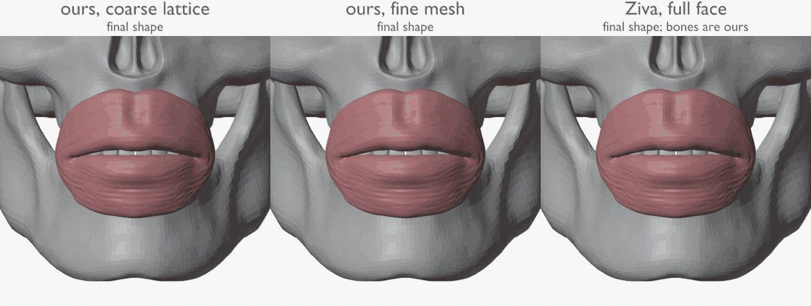

看什么：实验室的“中性到 AA”运动（第 0 到 46 帧，最终形状）；嘴从闭到张开，下颌和下牙跟着往下走，三格的嘴形接近。
三格里的骨头都是我们按运动文件动的（Ziva 的导出里只有嘴唇）；下颌的运动我们和 Ziva 记录的是同一份，两边读到的下颌变换逐帧最大相差约 1e-13 mm。

给谁看：实验室的研究员，和把原型机拿给实验室看的人。
读完能知道：原型机是什么、在 Blender 里怎么跑、算出来的嘴唇和 Ziva 的差多少、还缺什么。
不需要会命令行（命令行的做法放在第 2 节最后，给开发的人）。面板上的字是英文，本页引用时照面板原样写。

这一页的每个数字，除非写明“引自”某份文档，都来自本机上产品自己写出来的报告，存在 `data/preview/`，由 `tools/prototype_archive.py` 重新生成；
页面里的表由 `tools/prototype_numbers.py` 写进来，`tests/test_prototype_page.py` 在报告和页面对不上时报错。

<!-- BEGIN generated by tools/prototype_numbers.py: source -->
存档日期 2026-11-15，提交 2155f87；Ziva 的两次运行：整张脸 `neutral_to_AA_export_20261112_202048_16aa06ab`，只留嘴唇 `AA_lips_only_export_20261112_205041_de5be4be`；做法：`uv run python tools/prototype_archive.py`。
<!-- END generated: source -->

## 1. 这是什么

原型机是一条能跑通的链：实验室的骨头和嘴唇网格 → 我们的四面体 → FEBio 算物理 → 在 Blender 里回放，并和 Ziva 的结果逐点比。
它用来回答一个问题：Ziva 停售以后，嘴唇这一块能不能由 FEBio 和 Blender 接下来做。完整的项目在 [01](01-overview.md)。

**哪些是实验室的，哪些是我们的**

- **实验室的（只作输入）**：颅骨、下颌、上下牙、嘴唇的网格（`data/lab_export`）；“中性到 AA”的运动文件；Ziva 里测到的材料值；Ziva 自己算出来的结果（作参照）；landmark 层和训练程序。
- **我们做的**：嘴唇的四面体网格（两种）；把骨头、粘连、材料写成 FEBio 模型的程序；运行报告和五项合理性检查；Blender 面板；和 Ziva 比较的工具；给训练程序调用的 `final_shape` 函数。

**原型机一、二用同一份资产**：颅骨、下颌、上牙、下牙、嘴唇（五个物体）。区别只在选哪一段运动，面板上有三条：

| 面板上的标题 | 是什么 |
|---|---|
| Prototype 1: jaw opens 12 deg | 原型机一。我们写的下颌铰链运动，张开到 12°，没有 Ziva 的对照 |
| Prototype 2: neutral to AA | 原型机二。实验室的"中性到 AA"运动文件，转换后原样播放 |
| Prototype 2: head shake | 原型机二。甩头：关键帧是实验室脚本的，帧间的曲线是我们的读法 |

**两种嘴唇网格**（面板第 1 步的两个单选按钮；材料均为 Ziva 测到的值：杨氏模量 12 kPa、泊松比 0.4）：

- **Coarse lattice (Ziva's tet size)**（默认）：126 个四面体的规则格子，格边 25.37 mm（Ziva 自己的四面体尺寸），上下唇不分开，粘连都是软弹簧。为什么默认用粗格子见第 3.3 节。
- **Fine (lips move separately)**（细网格）：26,721 个四面体，上下唇各自动，上唇粘在颅骨上（硬粘连）。

**它不是什么**

- 不是“和 Ziva 一样”的证明：下面第 3 节报告差多少，不判合格不合格（没有合格线，[ADR-17](decisions/ADR-17.md)）。
- 只有嘴唇这一块组织。其余 40 块组织和皮肤是第二阶段。
- 先算完整段运动再回放，不是逐帧互动：面板上写着 "Computes the whole motion, then replays it. Not frame-by-frame."。
- 页面里 Ziva 的结果，是我们的脚本照实验室的运动文件在 Ziva 里播出来的，不是研究员在钢琴界面上按出来的。
- 实验室的 Maya 钢琴界面仍是实验室的，我们没有替代它。

## 2. 怎么用

### 2.1 装一次

先要有核心程序要用的东西，照 [README](../README.md) 的 "Setup (Windows)" 做一次：
装 `uv`，装 FEBio（要在 febio.org 免费注册才能下载），在项目文件夹里 `uv sync`，`uv run asrp doctor` 每一行都是 `ok`。
没有 `uv` 时 Open asset 会报 "Cannot find uv on PATH"；没有 FEBio 时 Run 会失败。

然后在项目文件夹里建一次插件包（只有这一条命令行，之后全用鼠标）。完整步骤在 README 的 "Install the Blender add-on"：

```bash
"C:/Program Files/Blender Foundation/Blender 5.2/blender.exe" --factory-startup --command extension build --source-dir blender_addon/asrp_blender --output-dir dist
```

然后在 Blender 里：Edit > Preferences > Add-ons，右上角小箭头 > Install from Disk...，选 `dist/asrp_blender-0.0.1.zip`，勾上 ASRP。
关掉设置，在 3D 视图按 N，打开 **ASRP** 标签。第一次它写 "Choose the ASRP project folder."：按 **Choose project folder**，选下载下来的 ASRP 文件夹（里面有 `pyproject.toml` 和 `src`）。Blender 会记住。

### 2.2 面板上的步骤

按从上到下的顺序，每一步没做完，下一步的按钮是灰的，下面写原因。完整说明在 [06](06-ui.md) 第 2、3 节。

- **1  Open the asset**：选 Coarse lattice (Ziva's tet size) 或 Fine (lips move separately)，按 **Open asset**。
  - 导入要等几秒，没有进度条，Blender 这期间不响应；如果没先做过 `uv sync`，第一次会先建 Python 环境，可能要几分钟。
  - 视口里出现颅骨、下颌、上牙、下牙、嘴唇五个物体（骨头灰白，嘴唇红）和嘴唇上的 300 个 landmark 小点；面板写 "Open: lips, jaw, skull, upper teeth, lower teeth"。
  - Blender 启动场景里那个 2 米的方块被隐藏，视角对准资产。单位、材料（"Material: 12 kPa, 0.4 (measured in Ziva)"）、导入报告收在 **Asset details** 里。
- **Physics setup**（默认收着）：展开看；每一行右边的小按钮在视口里点亮对应的东西，**Check setup** 检查场景设置。
  - 显示软组织、四块骨头各自在物理里做什么、四组粘连各连着多少个顶点。这一版只读："Read-only in this version."。
- **2  Choose a motion**：在列表里点一条（三个标题见第 1 节的表）。
  - 每条标题下一行小字写帧数、帧率、“lab motion”或“test motion”。打开资产后默认选中实验室的中性到 AA；压下的那一条是选中的。
- **3  Run**：按 **Run**。
  - 显示进度条和 "Frame N / M"，可按 **Cancel**；算完后状态写 Complete，结果自动在那五个物体上播放（Space 键或 **Pause** 暂停）。粗格子一两秒算完，细网格约半分钟。
- **Results**：想换一层，按 **Physics only** 或 **Final shape**。
  - 嘴唇换成另一层的形状，骨头不变。中性到 AA 默认显示 Final shape，甩头和张嘴 12° 只有 Physics only。
- **Compare with Ziva**（默认收着）：第一次按 **Ziva reference folder** 选 Ziva 导出文件夹（实验室数据，在项目之外，只选一次），然后按 **Compare**。
  - 面板写出最后一帧的平均、95%、最大差（mm）和最差的一帧，以及 "Reported only. There is no pass line."。
  - 勾 **Show difference as colours** 把每个顶点的差画在嘴唇上（蓝 0 mm，红 5 mm 以上）；勾 **Show Ziva's lips** 把 Ziva 嘴唇作为第二个物体放进来。
- **Checks**（默认收着）：展开看五项合理性检查各是 PASS、FAIL 或 NOT RUN，失败的带说明；下面几行是只报告不判断的表面数字。
- **存盘**：Blender 自己的 File > Save（Ctrl+S）。
  - 一个 `.blend` 就是一个场景：存盘、关掉、再打开，资产、结果、选中的运动和对比的数字都还在。
  - 结果的文件在项目的 `runs/` 里，`.blend` 记着它们在哪；那些文件夹被删掉时面板会说明，并让你重新 Open asset。

两层的区别：**Physics only** 是 FEBio 算出来的嘴唇；**Final shape** 是在它上面叠实验室控制器的 landmark 层，是研究员在 Ziva 里最后看到的形状（[04](archive/prototype/04-v1-architecture.md) 第 2 节）。

### 用鼠标走一遍（截图）

**想先看它动起来**：[原型机演示录像](https://github.com/JoKFA/FEBio_Blender_Init/releases/tag/demo-2026-11-17)（`asrp_prototype_demo.mp4`，81 秒，无声）。
2026-11-17 在开发机上录的，同样只用鼠标，粗格子，实验室的中性到 AA：从 Blender 启动画面开始，按 N 打开 ASRP 标签，Open asset，Run，切换 Physics only 和 Final shape，Compare with Ziva，Show difference as colours，Show Ziva's lips，Checks。
插件已经装好、项目文件夹已经选过；等结果的停顿剪掉了。录像不在仓库里（`*.mp4` 不进 git），放在 GitHub 的 Release 里，要有这个仓库的访问权限才能下载。

2026-11-15 到 16 在开发机上，从开始菜单打开 Blender 5.2，只用鼠标和键盘照上面的步骤走的（不是脚本替人按按钮）。
一共走了四遍，前三遍发现的问题改完以后走的第四遍，截图是第四遍的（从正面看）。窗口 1920 × 1080，侧边栏是默认宽度。

| 步骤 | 截图 |
|---|---|
| 装好、选过一次项目文件夹以后的面板。三步、Results、Compare with Ziva、Checks 一屏看得全 | 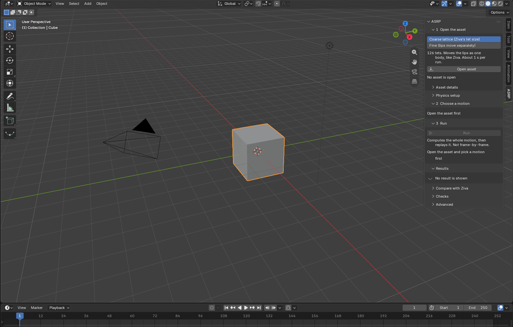 |
| 按 Open asset 以后：五个物体和 landmark 小点出现，方块被隐藏；默认选中实验室的中性到 AA |  |
| 按 Run：约两秒以后写 Complete 并自动播放。停在第 36 帧（运动的最后一帧），最终形状 | 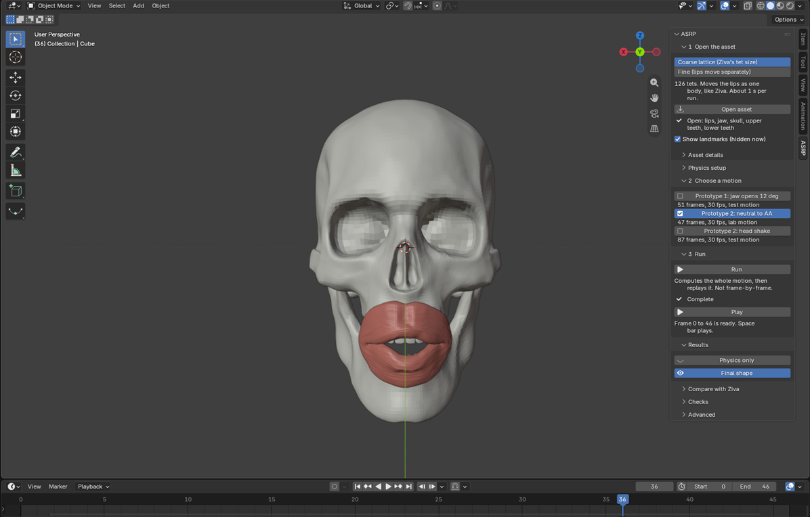 |
| Compare with Ziva：选过参考文件夹、按 Compare 以后，面板上的数和第 3.3 节表里粗格子对整张脸第 46 帧的数相同 |  |
| 勾 Show difference as colours：蓝的地方离 Ziva 近，红的地方差 5 mm 以上 |  |
| 勾 Show Ziva's lips：灰蓝色的是 Ziva 的嘴唇，和我们的红色嘴唇叠在同一个位置 |  |
| Ctrl+S 存成 `.blend`，退出并重开 Blender，从启动画面最近文件打开：场景、第 36 帧结果和对比数字都在 | 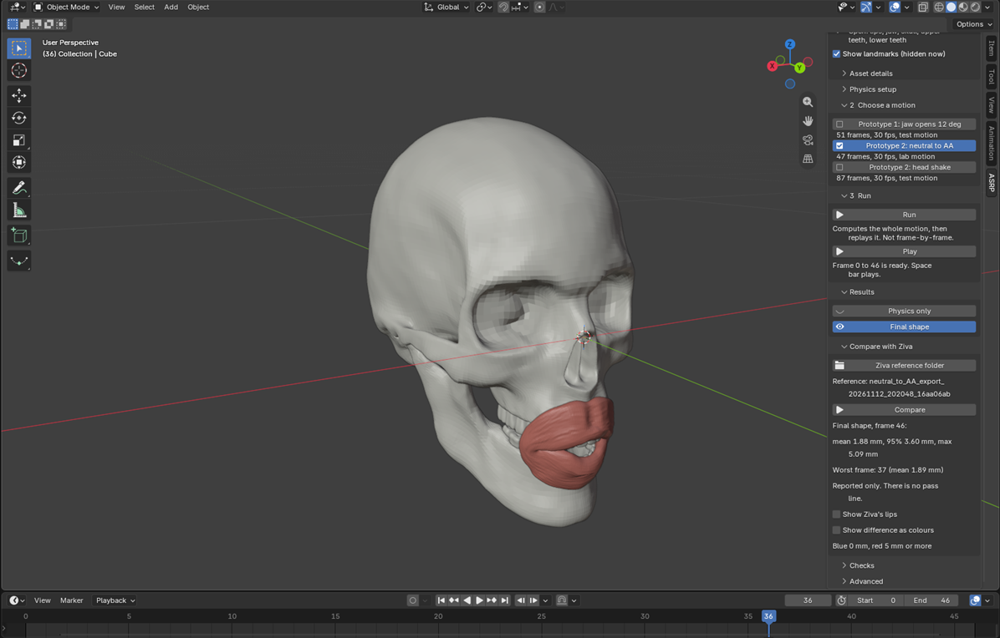 |
| 原型机一（张嘴 12°），粗格子，第 32 帧，正面：嘴唇像一整块跟着下颌走，嘴只开一条缝 | 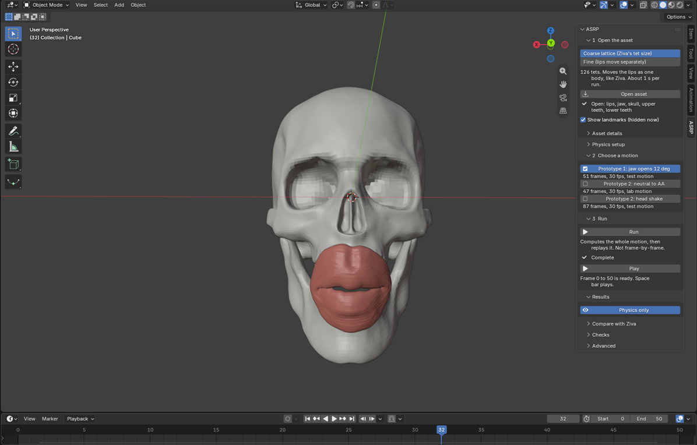 |
| 原型机一，改选 Fine、重新 Open asset、Run（约 40 秒）：上下唇分开，露出牙齿 | 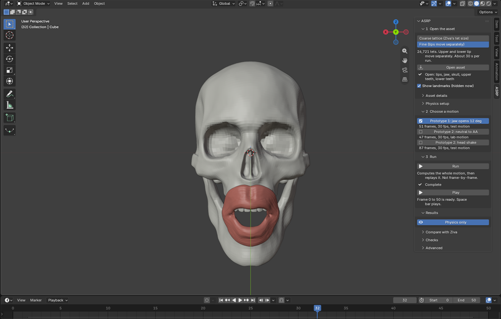 |

走查里没有看的：检查不通过、运行失败和取消时面板的样子；Windows 以外的系统；别人的电脑。走查发现并已经改掉的问题，记在 [T-35](archive/tasks/T-35.md) 卡的末尾。

### 同一件事，用命令行做（给开发的人）

三条命令（先 `uv sync`，`uv run asrp doctor` 全 ok）。结果在 `runs/` 下，git 不收。粗格子的做法：

```bash
uv run asrp import-asset data/lab_export runs/prototype_scene --tetmesh data/tetmesh/lips_lattice.json --attachments ziva-soft
uv run asrp run runs/prototype_scene/scene.json data/lab_export/trajectories/neutral_to_AA.json
uv run asrp compare <上一条打印的运行文件夹> <Ziva 的导出文件夹> --out <输出文件夹>
```

去掉 `--tetmesh` 和 `--attachments` 两个选项就是细网格。`asrp list-motions data/lab_export` 列出三条运动。
`asrp import-asset` 默认用 Ziva 测到的材料（`--tissue-settings lab`）；`--tissue-settings ours` 是我们早先的 15 kPa、0.45。
Ziva 的导出文件夹在仓库外，`asrp compare` 的输出里有 Ziva 的形状，所以输出文件夹也必须在仓库外，或放在 git 不收的 `runs/` 下。

## 3. 算出来是什么样，离 Ziva 多远

### 3.1 先说怎么读

- **参照是 Ziva 整张脸**（实验室真实的配置：41 块软组织，周围的组织也在动）。**Ziva 只留嘴唇**是我们在 Ziva 机器上把另外 42 个物体关掉做的对照，实验室平时不这样跑，它的边界条件不是我们的，第 14 帧还在下落。
  - 这两个 Ziva 结果互相差多少：物理层，整段里最多差 8.0 mm。所以“离 Ziva 多远”要说清比的是哪一个。
- 比的是同一批顶点：嘴唇的全部 10,240 个顶点，同一帧对同一帧，单位 mm。“平均 / P95 / 最大”是这些顶点的距离的平均、第 95 百分位和最大值。
- 帧号：第 14 帧是只有重力的沉降的最后一帧；第 15 到 36 帧是运动，第 37 到 46 帧停住不动。下颌转 −5.16°，来自实验室的运动文件，我们转换后原样用。
- 物理层是 FEBio 算出来的嘴唇，最终形状是在它上面叠 landmark 层。

### 3.2 看图：第 36 帧，运动刚结束

**带骨头的正面图**：正对脸看下半张脸（沿 −Y 看，画面 150 mm 见方，正交），骨头浅灰、嘴唇红，三格同一个相机、同一种着色。
三格里的骨头（颅骨、下颌、上牙、下牙）都是我们按运动文件动的：Ziva 的导出里只有嘴唇，所以 Ziva 那一格是 Ziva 的嘴唇放在我们的骨头上，图上也写着 "bones are ours"。上面是最终形状，下面是物理层，都是第 36 帧：

最终形状：


物理层：


物理层的动图（同样三格，第 0 到 46 帧）。看什么：嘴张开的过程；粗格子和 Ziva 的嘴只张开一条缝，细网格张得宽，露出上牙：


**只有嘴唇的特写**（下面两张表，嘴唇看得更大）：同一个相机（正对嘴，沿 −Y 看，画面 0.10 m 宽，正交），同一种着色。三列：我们用粗格子、我们用细网格、Ziva 整张脸。上一行是物理层，下一行是最终形状。
图是用 `tools/render_comparison.py` 画的（无窗口的 Blender），数据来自上面的运行；图里是实验室的嘴唇网格画成的图片，Ziva 的顶点数据不在仓库里。

| | 我们：粗格子 | 我们：细网格 | Ziva 整张脸 |
|---|---|---|---|
| 物理层 |  | 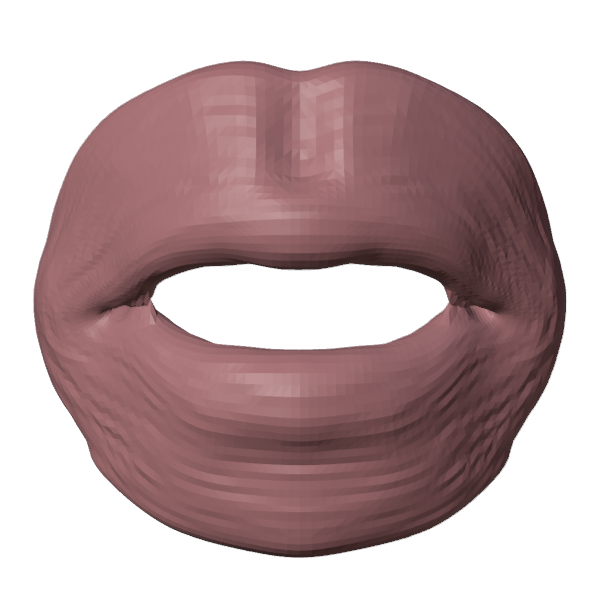 | 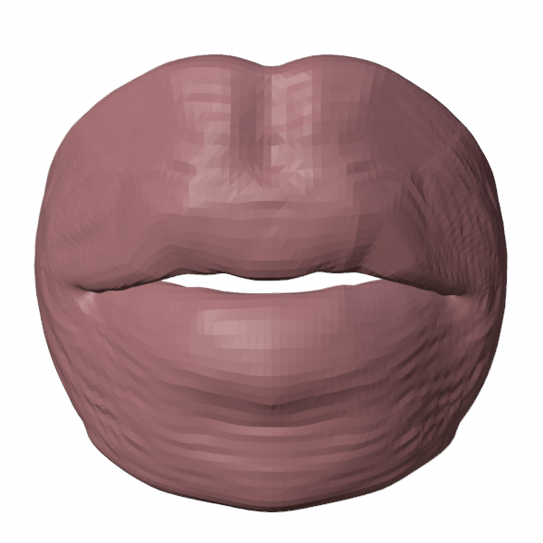 |
| 最终形状 | 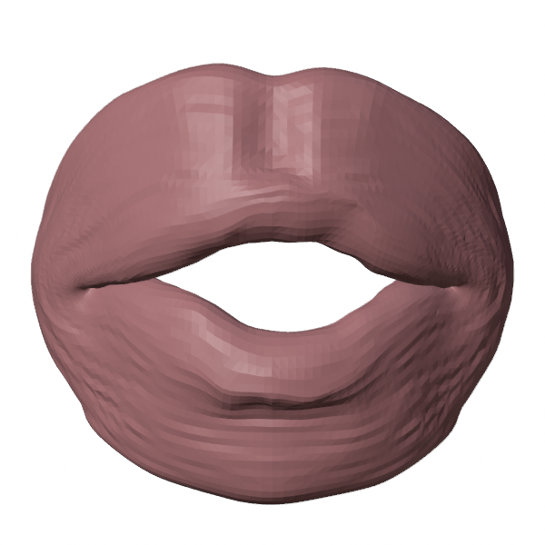 | 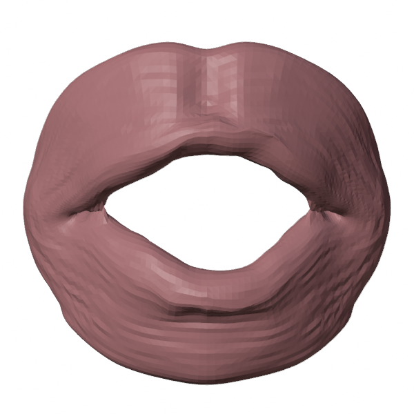 |  |

图上看得到的（肉眼读图，不是量出来的）：物理层里，粗格子和 Ziva 的嘴只张开一条缝，细网格的嘴一直张到两侧嘴角；叠上 landmark 层以后，粗格子和 Ziva 的嘴都张成一个椭圆，形状接近，细网格张得更大。

### 3.3 数字

**中性到 AA，物理层，对 Ziva 的距离**（mm；第 36 帧是运动的最后一帧，第 46 帧是停住的最后一帧）：

<!-- BEGIN generated by tools/prototype_numbers.py: aa-distance -->
| 我们的网格 | 比的是谁 | 第 36 帧：平均 / P95 / 最大（mm） | 第 46 帧：平均 / P95 / 最大（mm） |
|---|---|---|---|
| 粗格子（面板默认） | Ziva 整张脸（参照） | 1.88 / 3.60 / 5.12 | 1.88 / 3.60 / 5.09 |
| 粗格子（面板默认） | Ziva 只留嘴唇（我们做的对照） | 2.14 / 3.75 / 4.44 | 2.15 / 3.75 / 4.43 |
| 细网格 | Ziva 整张脸（参照） | 2.21 / 4.91 / 7.64 | 2.21 / 4.91 / 7.63 |
| 细网格 | Ziva 只留嘴唇（我们做的对照） | 2.32 / 4.32 / 7.10 | 2.33 / 4.33 / 7.11 |
<!-- END generated: aa-distance -->

<!-- BEGIN generated by tools/prototype_numbers.py: aa-final -->
最终形状（物理层叠上 landmark 层）在第 36、46 帧的平均、P95、最大和上表相同（四份报告里最大相差 3e-06 mm，是浮点取整）：两边叠的是同一个 landmark 层，差别全部来自物理层。
<!-- END generated: aa-final -->

粗格子在上表的每一个数上都比细网格小，不论比哪一个参照。这不是说粗格子“对”：平均差只比细网格小一点，P95、最大值和分区域的数（上唇中间走了多少，见下）才看得出嘴型对不对。
上面一句“最终形状”说的是：两边叠同一个 landmark 层，所以最终形状的差等于物理层的差，landmark 层既没有帮忙也没有添乱。

**重力下垂**（只有重力的前 14 帧，第 14 帧对第 0 帧，全部 10,240 个顶点）：

<!-- BEGIN generated by tools/prototype_numbers.py: gravity -->
| 谁（第 14 帧对第 0 帧） | 平均下垂（mm） | 最大（mm） | 第 13 到 14 帧最大还在动（mm） |
|---|---|---|---|
| 我们：粗格子（面板默认） | 0.059 | 0.158 | 4.4e-08 |
| 我们：细网格 | 0.122 | 0.497 | 1.2e-06 |
| Ziva 整张脸（参照） | 0.293 | 1.224 | 0.026 |
| Ziva 只留嘴唇（还在下落，不是停稳的数） | 1.777 | 5.390 | 0.37 |
<!-- END generated: gravity -->

我们的下垂比 Ziva 小。只留嘴唇的 Ziva 在第 14 帧还在下落（最后一列），所以它不是停稳的数；Ziva 停稳后下垂多少，要一段更长的只有重力的运行才知道。

**表面质量**（翻转面：法向和静止时相反的三角形；过短的边：短于静止长度一半的边；用产品里同一个算法数，对各自的静止形状，[ADR-43](decisions/ADR-43.md)）。
这是参照线，不是合格线：Ziva 自己的最终形状也有翻转面，翻转来自 landmark 层，是实验室的运动本身带的。

<!-- BEGIN generated by tools/prototype_numbers.py: surface -->
| 谁 | 翻转面最多的一帧：翻转面 / 过短的边 | 最后一帧：翻转面 / 过短的边 |
|---|---|---|
| 我们：粗格子（面板默认），物理层 | 第 0 帧：0 个 / 0 条 | 第 46 帧：0 个 / 0 条 |
| 我们：粗格子（面板默认），最终形状 | 第 20 帧：6 个 / 14 条 | 第 46 帧：1 个 / 49 条 |
| 我们：细网格，物理层 | 第 0 帧：0 个 / 0 条 | 第 46 帧：0 个 / 0 条 |
| 我们：细网格，最终形状 | 第 20 帧：8 个 / 18 条 | 第 46 帧：3 个 / 109 条 |
| Ziva 整张脸，物理层 | 第 0 帧：0 个 / 0 条 | 第 46 帧：0 个 / 0 条 |
| Ziva 整张脸，最终形状 | 第 20 帧：4 个 / 14 条 | 第 46 帧：3 个 / 37 条 |
| Ziva 只留嘴唇，最终形状 | 第 20 帧：4 个 / 13 条 | 第 46 帧：3 个 / 39 条 |
<!-- END generated: surface -->

**算得多快**（FEBio 自己的计时，只作量级参考：一块嘴唇，不是整张脸）：

<!-- BEGIN generated by tools/prototype_numbers.py: speed -->
| 网格 | 四面体 | 计算点 | 帧数 | FEBio 用时（秒） | 每帧（秒） |
|---|---|---|---|---|---|
| 粗格子（面板默认） | 126 | 56 | 47 | 1.14 | 0.025 |
| 细网格 | 26,721 | 6,747 | 47 | 26.53 | 0.577 |

Ziva 整张脸（实验室的机器）每步：about 1.47 to 1.60 on average over that evening's runs, single steps above 3；只留嘴唇每步：0.0095 on average over the last 46 lines（引自 13 E-15 的 Maya 求解器日志，不是本机测的；报告原文是英文）。

机器：the development machine (a Windows 11 PC, 16 logical processors)，FEBio 4 线程；同时在跑的事：other agents of the same batch were running tests and FEBio runs on the same machine at the same time; how much was not measured。存档日期 2026-11-15，提交 2155f87。
<!-- END generated: speed -->

这是开发用的机器，不是实验室的演示机；FEBio 计时的同时机器上别的任务也在跑，所以每帧的秒数只能看数量级。
Ziva 那两行是实验室机器上的日志，两边的机器、线程数、组织块数都不同，不能拿这两个数互相除。

**粗格子改变了什么，为什么它是默认**：
- 细网格里上下唇沿嘴缝分开，上唇只靠它自己那一小片粘连挂在颅骨上，下颌转了它几乎不跟着走；Ziva 里上唇被带着往下走。
- 把四面体换成和 Ziva 一样粗的规则格子，上下唇落在同一批格子里，上唇就跟着走了。
- 下颌转 −5.16° 时，“上唇中间”走的距离（引自 [E-20](explanations/E-20.md)，不是本页重算的，第 36 帧对第 14 帧）：细网格 0.15 mm，Ziva 整张脸 4.80 mm，试验用位置的粗格子 4.20 mm；产品里的粗格子也一样，上唇都被带动了（4.8–5.6 mm，引自 [ADR-44](decisions/ADR-44.md)）。
- 实验室拿 Ziva 当参照，所以原型机默认用粗格子；细网格留着，想看上下唇各自动的时候选它。代价：粗格子里嘴唇像一整块，嘴唇闭合、上下唇各自动的运动它做不到。

**结果依赖格子放在哪里**：
- 格子的位置是事先定的规则（嘴唇表面包围盒的最小角），不是挑结果最好的。
- 把格子平移半格，对 Ziva 整张脸的距离平均 1.88–2.19 mm，最大值 5.1–5.8 mm，不论放在哪，上唇都被带动了（4.8–5.6 mm）（引自 [ADR-44](decisions/ADR-44.md)，第 36 帧）。这是这种做法本身的性质。
- “粗格子更像 Ziva”也不说明 Ziva 自己的四面体就是这样：Ziva 的四面体网格没有取回（[11](11-risks-and-questions.md) D12），“共用格子”是从行为上对出来的 🔍。

### 3.4 甩头：能跑，但幅度不是一个我们能报的数

甩头用的是实验室脚本的关键帧，运动里整个头平移，我们的嘴唇相对颅骨晃多少：


看什么：只有粗格子一格，说明这条运动能跑通：颅骨、下颌、牙在画面里平移，嘴唇跟着它们。
这个动作的幅度很小，肉眼几乎看不出嘴唇相对颅骨的晃动，下面的数也说我们的幅度不是一个能报的数。

<!-- BEGIN generated by tools/prototype_numbers.py: shake -->
| 谁 | 嘴唇相对颅骨的最大晃动（mm） | 出现在 | 停下（第 46 帧）后第一次低于 0.04 mm | 停下后一直低于 0.04 mm |
|---|---|---|---|---|
| 我们：粗格子（面板默认）（只有嘴唇，每帧 1 步） | 0.087 | 第 19 帧 | 第 2 帧 | 第 2 帧 |
| 我们：细网格（只有嘴唇，每帧 1 步） | 0.121 | 第 19 帧 | 第 2 帧 | 第 2 帧 |
| Ziva（整张脸，只移动了颅骨和下颌） | 2.731 | 第 45 帧 | 第 14 帧 | 第 28 帧 |
<!-- END generated: shake -->

Ziva 的数是整张脸（只移动了颅骨和下颌，另外 8 块骨头没动，所以不全是惯性），我们只有嘴唇：范围不同。
**我们的数不能当幅度用**：把每帧的步数从 1 加到 16，整条曲线在相邻两档之间都没有收敛。
引自 [09](09-roadmap-and-tasks.md) 的甩头收敛一节（那里的运行，不是本页重做的）：每帧 1、2、4、8、16 步各算一次，相邻两档整条曲线的最大差占较细一档峰值的百分比，门限 5 %，没有任何一对低于；最后一列是每帧 16 步的峰值（mm）。
组 A 是默认设置（没有物理阻尼），组 B 加了物理阻尼（我们定的值）；“折线”是骨头在帧之间匀速走，“smooth”是帧之间用平滑曲线：

| 组 | 运动 | 1→2 | 2→4 | 4→8 | 8→16 | 16 步的峰值 mm |
|---|---|---|---|---|---|---|
| A | 折线 | 192 | 72 | 42 | 81 | 0.567 |
| A | smooth | 91 | 67 | 45 | 56 | 0.255 |
| B | 折线 | 79 | 115 | 64 | 50 | 0.313 |
| B | smooth | 72 | 194 | 80 | 38 | 0.152 |

每帧 16 步的峰值在 0.152 到 0.567 mm 之间，它们都还在变，所以没有哪一个是“我们的幅度”；Ziva 的 2.731 mm 也不能拿来除。
为什么不收敛没有查清，两个候选都只是推断 🔍：数值阻尼随步长变小；骨头在帧之间是折线、每帧速度跳一次。
“smooth”是场景参数 `solver.motion_between_frames` 的一个选项，默认仍是折线；这一节第一张表里我们的数是每帧 1 步、折线的默认设置。

### 3.5 原型机一：下颌张开 12°

只有我们的测试运动，**没有 Ziva 的结果可比**，所以这一节只说两种网格各自做了什么。

- 引自 [ADR-44](decisions/ADR-44.md)（第 32 帧对第 14 帧）：粗格子里上唇中部跟着下颌走 12.1 mm，嘴张开的量（上下唇中部的高度差的变化）是 9.3 mm；细网格里上唇只走 0.4 mm，嘴张开 27.0 mm。哪个更对，没有参照，不知道。
- **细网格里两侧嘴角一直连在一起**：实验室的嘴唇表面在嘴角处上下唇互相穿过，细网格的四面体把穿过的一段合成了一块，嘴张得越大这一段被拉得越明显，12° 时像一根柱子（[E-20](explanations/E-20.md) 最后一节）。
  - 粗格子里整条嘴缝都是连着的，嘴角不再单独显出来。下面第二张图能看到细网格里嘴角的两个小孔。
- 两次运行（本页存档）的结果：

<!-- BEGIN generated by tools/prototype_numbers.py: jaw -->
| 网格 | 帧数 | FEBio 缩小步长重算的次数 | 合理性检查 |
|---|---|---|---|
| 粗格子（面板默认） | 51 | 0 | 通过 4 项，没运行 1 项（b），不通过 0 项 |
| 细网格 | 51 | 0 | 通过 5 项，没运行 0 项，不通过 0 项 |
<!-- END generated: jaw -->

正面看带着骨头的动图（第 0 到 50 帧，物理层，左粗格子、右细网格）。看什么：下颌往下走，粗格子的嘴只开一条缝，细网格的嘴缝更宽，两侧嘴角处连着：


第 32 帧（张得最大的一帧），带骨头，同一个相机：

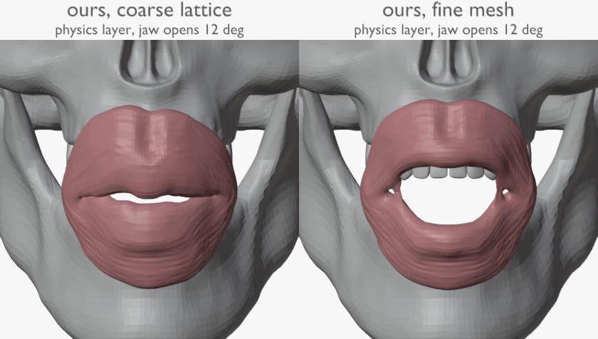

同一帧，只有嘴唇的特写：

| 我们：粗格子 | 我们：细网格 |
|---|---|
| 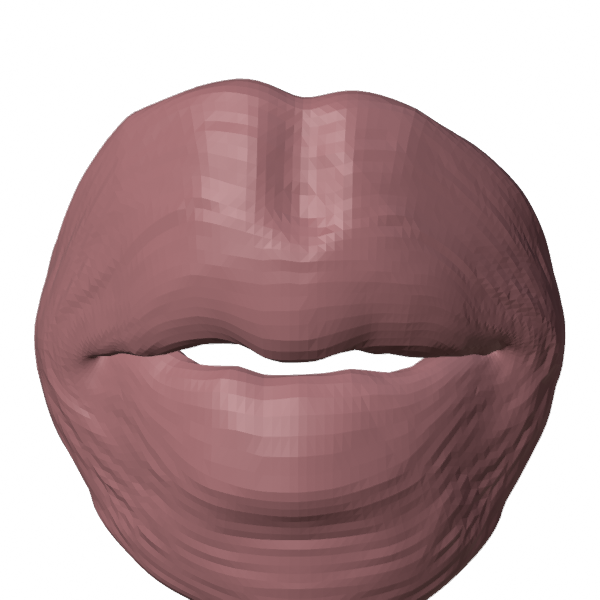 | 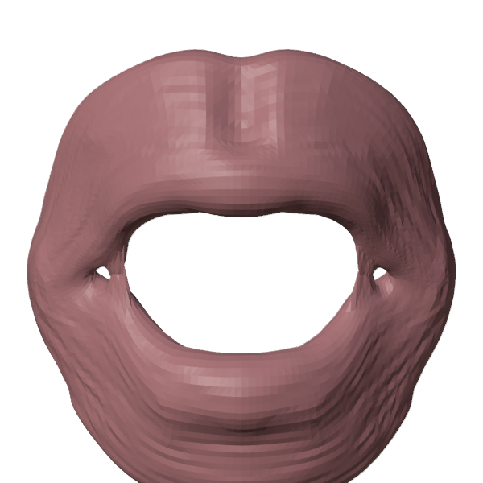 |

README 的 "Playing a result in Blender" 一节里的动图是更早的一次运行（材料还是我们定的 15 kPa、细网格），它说明管线通了，不代表现在的默认设置。README 顶上的动图就是本页顶上那一张。

## 4. 已知的差距

读到这里想知道“还差什么”，按这张单子：

- [ ] **物理尺度没对齐**：Ziva 的求解器有自己的长度变换，厂商资料说它改变组织在仿真里的物理尺度；我们取真人大小。没对齐之前，重力下垂、甩头这类和尺度有关的差距只报，不解释原因（[11](11-risks-and-questions.md) D18）。
- [ ] **重力下垂比 Ziva 小**（第 3.3 节的表）。尺度对齐前不调参数去凑。
- [ ] **甩头没有收敛**（第 3.4 节）：幅度、峰值出现的时刻、停下后的衰减都不能说，要先查清不收敛的原因。
- [ ] **材料模型不同**：我们是 neo-Hookean，Ziva 是 StVK（抗压参数也不同）；只有杨氏模量和泊松比能设成一样。
- [ ] **没有拿到 Ziva 自己的四面体网格**（[11](11-risks-and-questions.md) D12）：所以“和 Ziva 的一样粗”是从行为上对出来的，不是核对出来的。
- [ ] **其余 40 块组织和皮肤**：第二阶段，现在只有嘴唇。Ziva 里周围组织对嘴唇影响很大，第 3.1 节写的两个 Ziva 结果互相的差说明了这一点。
- [ ] **资产是固定的一份**：在 Blender 里把网格标成骨头或软组织、在 Blender 里生成四面体，都排在两个原型机之后（[01](01-overview.md)“最终产品是什么形状”）。
- [ ] **没有逐帧互动**：面板先算完再回放。

## 5. 仍然成立的核对

**五项合理性检查**（每次运行自动做，写进运行报告，面板 Checks 小节读它；通过只说明这几件事没出大错，不说明物理对，[07](07-validation.md) 第 3 节）：

| 检查 | 它问什么 |
|---|---|
| (a) Motion completed | 整段运动算完了吗；FEBio 中途缩小步长重算几次 |
| (b) Hard attachments | 硬粘连的顶点是不是跟着骨头走（没有硬粘连的网格上"没运行"） |
| (b2) Spring anchors | 弹簧的锚点是不是跟着下颌和嘴角锚走 |
| (c) Gravity sag | 自由的嘴唇顶点往下沉了吗，沉的量在估计值的十分之一到十倍之内 |
| (d) Tet mesh valid | 每个四面体全程没有翻转 |

中性到 AA 这一次运行的结果：

<!-- BEGIN generated by tools/prototype_numbers.py: checks -->
| 检查（面板 Checks 小节的名字） | 粗格子（面板默认）：中性到 AA | 细网格：中性到 AA |
|---|---|---|
| (a) Motion completed | 通过 | 通过 |
| (b) Hard attachments | 没运行：no hard attachment in this scene | 通过 |
| (b2) Spring anchors | 通过 | 通过 |
| (c) Gravity sag | 通过 | 通过 |
| (d) Tet mesh valid | 通过 | 通过 |
| FEBio 缩小步长重算的次数 | 0 | 0 |
<!-- END generated: checks -->

(b) 和 (b2) 按做法必然成立，它们是改了变换约定以后能立刻发现写错的回归检查，不是物理对的证据。

**landmark 层对实验室公式**：我们的蒙皮在 300 个 landmark 上和实验室自己的公式（用实验室自己的绑定姿态和权重文件）对得上，差小到数值误差：

<!-- BEGIN generated by tools/prototype_numbers.py: landmark -->
| 核对 | 结果 |
|---|---|
| 对象 | 300 个 landmark，10,240 个显示顶点 |
| 我们的蒙皮对实验室公式（实验室自己的绑定姿态和权重文件）最大差 | 5.3e-06 mm（平均 1.1e-06 mm） |
| 门限 | 0.0001 mm |
| 命令 | `uv run python tests/landmark_layer_check.py` |
<!-- END generated: landmark -->

**landmark 层对 Ziva**：每一帧，蒙皮前的形状加权重乘该帧 landmark 位移，对同一帧 Ziva 蒙皮后的形状，最大差 0.000016 mm，整张脸和只留嘴唇两次运行都是（引自 [09](09-roadmap-and-tasks.md) 的“对比”一节；这一条的核对要实验室的数据，在 `tests/test_lab_motion.py`，没有数据的机器上跳过）。

**训练接口**：实验室的训练程序存下的结果有 145 份（引自 [09](09-roadmap-and-tasks.md)），`final_shape(rest_model(...))` 不经过 Maya 复现了这 145 份，最大差小于 0.0001 mm（`tests/test_final_shape.py`、`tests/test_lab_facts.py`；同样要实验室的数据）。

## 6. 数字从哪里来，怎么更新

数字都在 `data/preview/`：
- `prototype_compare_<网格>_<full_face|lips_only>.json`（`asrp compare` 的报告，只有数字）、`prototype_ziva_comparison_<网格>.json`、`prototype_run_<网格>_<aa|jaw>.json`（运行报告）；
- `prototype_archive_manifest.json`（日期、提交、机器、同时在跑的事）、`landmark_layer_check.json`；
- 第 3 节的图：`prototype_aa36_*.png`、`prototype_jaw32_*.png`（嘴唇特写），和带骨头的正面图 `prototype_*_front*.gif`、`prototype_*_front*.png`（`tools/render_comparison.py` 画，用 ffmpeg 拼成动图，重做图要求 ffmpeg 在 PATH 里）。

只想重画图、不重算数字：`uv run python tools/prototype_archive.py --pictures-from <上一次完整运行的 --work 文件夹>`。改了代码或默认值以后重做：

```bash
uv run python tools/prototype_archive.py --note "<计时的时候机器上还有什么在跑>"
uv run python tools/prototype_numbers.py --write
```

第一条要实验室的 Ziva 结果（在仓库外，位置见 `tools/local_paths.py`），做完会重新画图。
第二条把表写回本页；`uv run python tools/prototype_numbers.py --check` 或验证门（`tools/verify.py`）在页面和报告对不上时失败。
