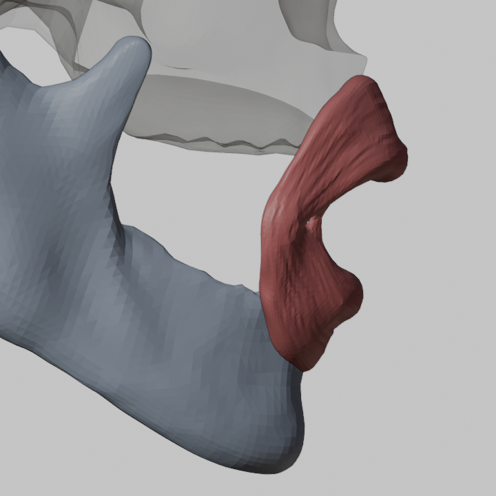
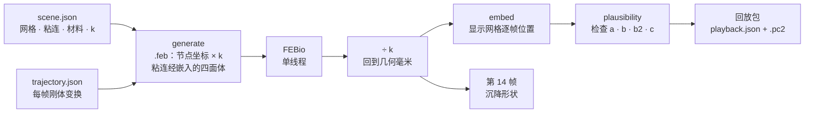

# 15 原型机：怎么跑、跑出了什么


*侧视图，脸朝右。红：嘴唇（FEBio 算出，在 Blender 里回放）；蓝：下颌；灰：颅骨（半透明）。下颌在第 0–14 帧不动，之后张开到 12°（第 32 帧），再合上（第 50 帧）。*

**原型机是什么**：实验室的真实嘴唇网格，被下颌带动，由 FEBio 算出变形，再放回 Blender 播放（定义写在 [09](09-roadmap-and-tasks.md) 第 1 节）。上面的动图就是这次运行的结果：下颌往下转，下唇跟着下颌走，上唇留在颅骨上，两侧嘴角被拉长。整段 51 帧在本机 1–2 分钟算完，四项合理性检查都通过。这是 2026-11-11 在一台 Windows 11 电脑上跑出的参考结果（数字来源见第 4 节）。

**它还不是什么**：它只有物理层。让实验室控制器输出的表情真正出现的 landmark 层还没接上（[09](09-roadmap-and-tasks.md) T-09），也没有和 Ziva 的结果对比（T-11）；下颌的运动、材料和粘连刚度都是我们定的临时值（第 5 节）。所以它证明"管线通了、结果合理"，不证明"和 Ziva 一样"或"和真人一样"。

## 1. 一眼看结果

<!-- BEGIN generated by tools/prototype_numbers.py: glance -->
| 看什么 | 数字 | 意思 |
|---|---|---|
| 整段运动算完了吗 | 51 帧全部算完（第 0 帧加 FEBio 算的 50 步），**重试 0 次** | FEBio 没有哪一步要缩小步长重算 |
| 算得多快 | 4 线程：FEBio **28.63 s**，**0.57 秒/帧** | 机器同时在做别的事就会慢。**这是嘴唇一块组织的速度，不能拿来和 Ziva 比**：实验室演示机上 Ziva 每帧约 1.5–2.5 秒（[14](14-ziva-demo-walkthrough.md) 第 2 节），算的是整张脸（41 块软组织，[03](03-asset.md) 第 2 节）。线程数和更早的单线程用时见第 3 节 |
| 嘴唇有没有"脱"骨头 | 上唇和颅骨粘住的地方，偏离**不超过 9.63×10⁻¹¹ mm**；用弹簧挂在下颌上的下唇，最远偏离 **0.0334 mm**（第 32 帧，张得最大） | 贴骨头的地方确实跟着骨头走（这一条按做法本来就该成立，它查的是管线有没有接对，不是物理证据）；弹簧处允许有一点点"滑"，滑得很小 |
| 重力有没有往下拉 | 自由部分的嘴唇第 10–14 帧平均顺重力下沉 **0.0952 mm**；按材料和尺寸估计是 0.1457 mm | 方向对，量级和估计同一个数量级；估计本身是粗的，不证明准（第 5 节） |
| 网格有没有被压坏 | 26,721 个四面体里，翻转的 **0 个**；体积是静止时的 0.690（第 32 帧）到 3.675 倍 | 没有四面体翻面，但个别很小的四面体胀得不少，见第 5 节 |
| 嘴唇动了多少 | 下颌张 12°，嘴唇上动得最多的顶点动了 **30.4 mm**（第 32 帧） | 肉眼可见的大幅度运动（这一个数字不在运行报告里，来自 `tools/render_prototype.py` 的 max motion） |
| 同样的输入，同样的输出吗 | 同一份输入跑两次：默认（4 线程）每帧每个点的坐标差不超过 1×10⁻⁹ mm（实测最多差 1×10⁻¹⁰ mm，ADR-38）；用 `--threads 1` 时回放文件逐字节相同 | 结果可以复现，不是随机的 |
<!-- END generated: glance -->

三张静态图（同一个侧视角度，可以逐张对照）：

| 静止（第 0 帧） | 沉降后（第 14 帧） | 下颌张到最大（第 32 帧） |
|---|---|---|
|  |  |  |
| 嘴唇闭合，嘴唇的位置就是实验室网格的原样。 | 只有重力的 15 帧之后。肉眼看不出和左图的差别：平均只下沉 0.1 mm。这一帧的形状单独存下来，是控制器优化的起点（ADR-30）。 | 下唇跟着蓝色的下颌往下走，上唇留在颅骨上，嘴唇被拉开；从这个侧视角度看不到翻折（牙齿没有画出来，也没有参与计算，见第 5 节）。 |

## 2. 自己跑一遍

需要：Windows、[uv](https://docs.astral.sh/uv/)、FEBio、Blender（安装办法见 [README](../README.md)）。**不需要 Maya，也不需要 Ziva**：嘴唇、颅骨、下颌的网格已经导出，提交在 `data/lab_export/`。

```bash
uv sync
uv run asrp doctor        # 四行都是 [ok   ] 才往下走
uv run asrp import-asset data/lab_export runs/prototype_scene
uv run python tools/placeholder_jaw_motion.py runs/prototype_scene/scene.json runs/prototype_scene/placeholder_jaw.json
uv run asrp run runs/prototype_scene/scene.json runs/prototype_scene/placeholder_jaw.json
```

`runs/` 不进 git，可以随便删。`import-asset` 的输出文件夹要是新的或空的；`asrp run` 的结果默认放在 `runs/<日期>_placeholder-jaw_001/`（用 `--runs-dir` 换位置，路径只能是英文）。

**每条命令应该看到什么**（下面是 2026-11-11 参考运行的原样输出）：

| 命令 | 关键输出行 | 用时 |
|---|---|---|
| `import-asset` | `mesh lips 10240 vertices …`、`driver jaw01: pivot (0.00, -121.71, -54.65) mm …`、最后一行 `import PASSED: scene check 0 errors, 0 warnings`。中间的 `missing` 行是在说"这些值还是我们定的"，不是错误 | 几秒 |
| `placeholder_jaw_motion.py` | `wrote …/placeholder_jaw.json: 51 frames at 30 fps, jaw01 opens to 12 degrees at frame 32` | 不到 1 秒 |
| `asrp run` | 50 行 `progress   frame N / 50`，然后：<br>`generator  k 0.67, 6747 tet nodes, 26721 tets, 74 hard nodes, 1428 springs, display max distance 0.931 mm (limit 4.837)`<br>`check a … [PASS] motion completed: all 51 frames; FEBio cut and retried a step 0 times`<br>`check b / b2 / c … [PASS]`<br>`timing     FEBio 102.299 s, 2.046 s per frame …`<br>最后一行 `run COMPLETE: 51 frames; plausibility PASSED` | 约 2 分钟 |

任何一项检查不通过，`asrp run` 以非 0 退出，最后一行写 `run COMPLETE: … plausibility FAILED`；生成器拒绝的场景写 `run NOT STARTED`，不建运行文件夹；FEBio 失败写 `run FAILED: no results written`。

### 在 Blender 里看

1. 安装插件（只需一次，命令在 [README](../README.md) 的 "Install the Blender add-on"）。插件找后端要用环境变量 `ASRP_PROJECT`；只加载结果不需要。
2. 打开 Blender，删掉默认的立方体。
3. 侧栏（按 N）> **ASRP** > **Load Result**，选运行文件夹（里面有 `playback.json` 的那个）。
4. View > Frame Selected（小键盘 `.`），按空格播放。时间线是第 0 到 50 帧。物体缩放了 0.001，所以毫米数据在 Blender 里显示成米。

**注意**：Load Result 只带进嘴唇。图里的颅骨和下颌是 `tools/render_prototype.py` 另外加的。想一次得到和上面一样的图，并让它把 Blender 里的嘴唇和 FEBio 的数字逐帧核对：

```bash
"C:/Program Files/Blender Foundation/Blender 5.2/blender.exe" --background --factory-startup --python-exit-code 1 --python tools/render_prototype.py -- runs/<运行文件夹> --out runs/<运行文件夹>/render
```

（PowerShell 里引号路径前加 `&`。）它先用插件的 Load Result 加载，再核对第 0、14、32、50 帧，参考运行的结果是 `max error vs display.json 7.67e-06 mm`、`PROTOTYPE PLAYBACK CHECK PASSED`，然后输出三张静态图。加 `--frames-dir <文件夹>` 会把每一帧都渲染出来；本页的动图就是这样渲染 51 帧，再用 Pillow 拼成的（拼图不属于产品，没有放进仓库）。

### 运行文件夹里有什么

下面是参考运行的实际内容（共约 99 MB；每个文件的格式见 [04](04-architecture.md) 第 4、5 节）：

| 文件 | 大小 | 是什么、给谁用 |
|---|---|---|
| `scene.json`、`trajectory.json` | 87 KB、11 KB | 这次运行的全部输入（场景和运动），拷进来所以整个文件夹可以原样重跑 |
| `meshes/`、`landmarks/` | — | 场景用到的网格（`lips.obj`、`lips_tet.json` 四面体网格、`jaw.obj`、`skull.obj`、两排牙）和 landmark 蒙皮权重（原样拷贝，这一版还没用上） |
| `model.feb` | 2.2 MB | 生成给 FEBio 的输入。想用 FEBio Studio 打开检查就看它 |
| `model.log` | 21 MB | FEBio 的日志，含每帧每个节点的位置 |
| `physics/positions.json` | 25 MB | FEBio 全部计算点每帧的位置（毫米，已除以 k） |
| `physics/display.json` | 32 MB | 嘴唇显示网格（10,240 个顶点）每帧的位置 |
| `physics/settled_frame14.json`、`.obj` | 1.0 MB、0.9 MB | 第 14 帧沉降后的形状（控制器的起点，ADR-30）；`.obj` 带面，可以直接拖进 Blender |
| `playback.json`、`playback.pc2` | 1.0 MB、6.3 MB | 回放包：Load Result 加载的就是它 |
| **`run_report.json`** | 21 KB | **运行报告：每个临时值和来源、没建的粘连、生成器报告、四项检查的数字、用时。第 1、3 节的数字都来自这里** |
| `provenance.json` | 3.9 KB | 溯源：输入文件的哈希、软件版本（asrp、Python、FEBio 4.13.0）、命令、开始和结束时间 |

`import-asset` 写出的场景文件夹里还有 `import_report.json`（导入报告）。

## 3. 结果的细节

下面每个数字都来自参考运行的 `run_report.json`，已存档在 [`data/preview/prototype_run_report.json`](../data/preview/prototype_run_report.json)（溯源记录在 [`prototype_provenance.json`](../data/preview/prototype_provenance.json)，里面没有本机路径）。检查的定义和通过标准写在 [07](07-validation.md) 第 3 节，实现在 `src/asrp_core/plausibility.py`。

### 运行

<!-- BEGIN generated by tools/prototype_numbers.py: run -->
| 项 | 结果 |
|---|---|
| 帧数 | 51（第 0 帧是静止姿态，FEBio 算 50 步；运动文件 30 帧/秒，约 1.7 秒） |
| FEBio 重试 | 0 次（步长从没有被迫缩小） |
| 用时（存档的这一次） | FEBio 28.63 s（0.57 秒/帧，4 线程，[05](05-ziva-to-febio.md) 坑 17），生成 4.96 s，后处理 3.73 s。只算了嘴唇一块，所以只报告用时，不和全脸的预算比 |
| 同输入两次 | 同一份输入跑两次：默认（4 线程）每帧每个点的坐标差不超过 1×10⁻⁹ mm（实测最多差 1×10⁻¹⁰ mm，ADR-38）；用 `--threads 1` 时回放文件逐字节相同 |
| 回到沉降形状（只报告，不判） | 第 50 帧：四面体节点离沉降形状最多 0.0041 mm，平均 0.0012 mm（沉降形状在第 14 帧，重力的沉降当时还差这么一点没走完，[13](13-explanations.md) E-08） |
<!-- END generated: run -->

### 四项合理性检查

<!-- BEGIN generated by tools/prototype_numbers.py: checks -->
| 检查 | 一句话 | 结果 | 上限 |
|---|---|---|---|
| (a) 整段算完 | 51 帧都算出来了，FEBio 中途没有失败 | 通过，重试 0 次 | 没有失败的帧 |
| (b) 粘在骨头上的点跟着骨头 | 上唇粘在颅骨上的计算点和显示顶点，每一帧相对骨头不动 | 通过：计算点最多偏 9.63×10⁻¹¹ mm，显示顶点 8.42×10⁻¹¹ mm | 0.001 mm |
| (b2) 弹簧锚点跟着刚体 | 下唇、嘴角的弹簧另一头钉在下颌、嘴角锚上，钉的位置每一帧都对 | 通过：全部 1,428 个锚点最多偏 1.26×10⁻¹⁰ mm（下颌 234 个，嘴角锚 1,194 个） | 0.001 mm |
| (c) 重力下垂和模型的估计一致 | 没有粘住的嘴唇顶点在第 10–14 帧平均往下沉了多少，和按密度、重力、k、E、尺寸算出的估计比 | 通过：沉 0.0952 mm，估计 0.1457 mm（自由部分最远 25.05 mm） | 估计的 1/10 到 10 倍：0.0146 mm 到 1.4567 mm |
| (d) 四面体网格保持有效 | 每一帧每个四面体的体积除以静止体积，没有翻面（体积 ≤ 0） | 通过：26,721 个四面体、51 帧，翻转 0 个；体积比最小 0.690（第 32 帧），最大 3.675 | 没有翻转的四面体 |
<!-- END generated: checks -->

(b) 里**弹簧组只报告不判**：显示顶点相对目标的最大偏离，下唇 0.0334 mm（平均 0.00115 mm）、左嘴角 0.0103 mm、右嘴角 0.0081 mm，最大值都出现在张得最大的第 32 帧。

<!-- BEGIN generated by tools/prototype_numbers.py: spring-deviation -->
| 弹簧组 | 显示顶点偏离目标：最大 | 平均 | 最大值出现的帧 |
|---|---|---|---|
| 下唇 → 下颌（`spring`） | 0.0334 mm | 0.00115 mm | 第 32 帧 |
| 左嘴角 → 嘴角锚（`spring`） | 0.0103 mm | 1.67×10⁻⁴ mm | 第 32 帧 |
| 右嘴角 → 嘴角锚（`spring`） | 0.00811 mm | 1.77×10⁻⁴ mm | 第 32 帧 |
<!-- END generated: spring-deviation -->

**(c) 的局限要看清**：0.095 mm 离下限 0.067 mm 只差 0.028 mm，而范围宽了两个数量级，所以它只能抓"符号反了"或"错 100 倍"，证明不了尺度和材料。T-06b 会换成手算的窄范围（[09](09-roadmap-and-tasks.md) T-06b）。

### 弹簧和滑移

弹簧是下唇和嘴角"软粘"的办法（粘连的类型见 [05](05-ziva-to-febio.md) 第 3 节）。弹簧的另一头离组织有一段距离 δ = 8.10 mm（FEBio 坐标，5 倍四面体边长中位数 × k）；组织在弹簧方向上滑动的距离 u 必须远小于 δ，否则弹簧力不再近似线性，所以报告 max|u|/δ，超过 0.1 就要加大 δ：

<!-- BEGIN generated by tools/prototype_numbers.py: springs -->
| 弹簧组 | max\|u\|/δ | 判断 |
|---|---|---|
| 下唇 → 下颌 | 0.0394 | < 0.1，没问题 |
| 左嘴角 → 嘴角锚 | 0.00996 | < 0.1，没问题 |
| 右嘴角 → 嘴角锚 | 0.00828 | < 0.1，没问题 |
<!-- END generated: springs -->

### 生成器报告

<!-- BEGIN generated by tools/prototype_numbers.py: generator -->
| 项 | 数字 |
|---|---|
| 物理尺度 k | 0.67（颅骨宽 216.6 mm 按真人大小约 145 mm，ADR-31） |
| 计算点、四面体 | 6,747 个计算点、26,721 个四面体（边长中位数 2.42 mm） |
| 显示网格到四面体的最远距离 | 0.931 mm（上限 4.84 mm，即 2 倍边长中位数；超过会报错停止） |
| 上唇 → 颅骨（`hard`） | 74 个顶点 → 74 个计算点，并入颅骨；被截成 0 的重心坐标 34 个；冲突 0 |
| 下唇 → 下颌（`spring`） | 76 个顶点 → 78 个计算点，234 根弹簧，43 档刚度（最大档内误差 1.97%） |
| 左嘴角 → 嘴角锚（`spring`） | 348 个顶点 → 196 个计算点，588 根弹簧，77 档刚度（最大档内误差 1.73%） |
| 右嘴角 → 嘴角锚（`spring`） | 309 个顶点 → 202 个计算点，606 根弹簧，70 档刚度（最大档内误差 1.90%） |
| 弹簧基础刚度 | 2.43 N/mm（100 × E × h，E = 0.015 MPa，h = 1.62 mm）；各节点的刚度不同（下唇 0.30–9.47 N/mm），分档后每档用一个 FEBio 弹簧材料（档数取到每个节点分档后和自己的值差不超过 2%）；每组的总刚度不变 |
| 弹簧另一头离组织的距离 δ | 8.10 mm（FEBio 坐标，5 倍四面体边长中位数 × k） |
| 弹簧总数 | 1,428 根（每个计算点三根，沿 x、y、z） |
<!-- END generated: generator -->

## 4. 数字的来源

<!-- BEGIN generated by tools/prototype_numbers.py: source -->
| 项 | 值 |
|---|---|
| 提交 | 122d9e7 |
| 软件 | FEBio 4.13.0，Python 3.13.6，asrp 0.0.1 |
| 线程 | 4 |
| 开始、结束（UTC） | 2026-11-12T06:43:08+00:00、2026-11-12T06:43:40+00:00 |
<!-- END generated: source -->

本页所有数字来自 2026-11-11（本机日期；溯源记录里记的是 UTC 时间，日期显示为 2026-11-12）的一次参考运行：上面第 2 节的三条命令，在 `main`（提交 1f5c454）上，FEBio 4.13.0，Blender 5.2.1，Python 3.13.6；运行报告和溯源记录原样存在 `data/preview/prototype_run_report.json`、`prototype_provenance.json`。"同输入两次相同"来自同一份输入的第二次运行；七次用时来自 T-06a 开发时的两次运行、写本页时的两次、以及随后连续的三次（都是第 2 节的同一组命令）。动图和三张静态图由 `tools/render_prototype.py` 渲染；静态图重新渲染后肉眼没有差别，沿用仓库里已有的版本（[09](09-roadmap-and-tasks.md) T-06a 的结果记录的是首次运行的 0.90 秒/帧，其余数字与本页一致）。

## 5. 这些结果说明什么、不说明什么

**说明的**：真实资产（实验室的嘴唇、颅骨、下颌网格）能一条命令导入、用 FEBio 算完整段运动、结果能放回 Blender，而且可复现；粘连按设计跟着骨头走。

**不说明的**（每条后面是事实所在的文档）：

| 局限 | 细节 | 在哪里看 |
|---|---|---|
| 材料是我们猜的 | neo-Hookean，E = 15 kPa、ν = 0.45、密度 1060 kg/m³：猜测接近 Ziva 的默认值，没有验证，等实验室的 Ziva 属性清单 | [05](05-ziva-to-febio.md) 第 1 节 zMaterial 一行，[13](13-explanations.md) E-06，[11](11-risks-and-questions.md) D6 |
| 材料几乎不影响张嘴的形状 | 2026-11-11 做过一次对照（结果没有存档）：把 `scene.json` 里嘴唇的 E 改成 10 倍和 1/10，弹簧不变，各重跑一遍。张嘴最大时（第 32 帧）嘴唇最多移动 30.4 mm；和基准相比，硬 10 倍的形状最多差 0.98 mm，软 10 倍最多差 3.3 mm（主要是多出来的重力下垂）。也就是材料差 100 倍，形状只变 2%–3%。**现在的形状主要由"粘在哪、粘多紧"决定**，就是下面两行那些我们自己定的规则，FEBio 做的接近在给定运动的边界之间插值 | 本页第 3 节，[05](05-ziva-to-febio.md) 第 3 节 |
| 粘连刚度、嘴角混合比例是我们定的 | 弹簧基础刚度按 100 × E × h 的规则取；嘴角锚转下颌角度的 α = 0.5。下唇跟随下颌的比例要等 Ziva 的"只有物理"结果才能定 | [05](05-ziva-to-febio.md) 第 3 节，[10](10-decisions.md) ADR-32，[11](11-risks-and-questions.md) Q17、A-35 |
| 粘连顶点集是强推断 | 上唇 74、下唇 76 个顶点来自对 Ziva 权重表的读法，等 Ziva 机器导出的权重表确认 | [03](03-asset.md) 第 6 节，[11](11-risks-and-questions.md) A-33 |
| 物理尺度 k = 0.67 是我们定的 | 来自会议结论（按真人大小算），不是 Ziva 的尺度 | [10](10-decisions.md) ADR-31，[05](05-ziva-to-febio.md) 第 2 节 |
| 下颌运动是代用的 | 张开 12° 的铰链运动，不是实验室控制器算出的运动（还没拿到运动文件） | [09](09-roadmap-and-tasks.md) T-10，[11](11-risks-and-questions.md) D2 |
| 检查 (c) 很宽松，而且范围是按现在的材料定死的 | 只抓符号错或 100 倍的错。上一行那次对照里，硬 10 倍是一次正确的运行，却被 (c) 判成失败（下垂 0.011 mm，低于下限 0.067 mm）。范围要改成随材料算（T-06b） | [07](07-validation.md) 第 3 节，本页第 3 节 |
| 现在算的接近"慢动作" | 每帧只走一个时间步（33 毫秒），比嘴唇自己晃动的周期长，数值上把晃动和惯性都抹掉了，结果接近准静态（每一帧都像是慢慢摆到位的）。所以现在还不能拿它和 Ziva 比"动起来的样子"；子步数和阻尼是占位值，等 Ziva 属性清单 | [05](05-ziva-to-febio.md) 第 5 节坑 2，[09](09-roadmap-and-tasks.md) T-12 |
| 只有物理层 | 让表情真正出现的 landmark 层（蒙皮权重已有）还没叠上；嘴周的肌肉、皮肤的粘连没建（第一阶段的简化，运行报告里写明） | [10](10-decisions.md) ADR-29、ADR-32，[09](09-roadmap-and-tasks.md) T-09 |
| 没有碰撞，牙齿不在计算里 | 嘴唇不会被牙齿或对侧嘴唇挡住；牙齿没有粘连，所以没有写进 FEBio。实验室在 Ziva 里也关掉了碰撞 | [05](05-ziva-to-febio.md) 第 1、4 节，[10](10-decisions.md) ADR-37 |
| 还没查网格粗细的影响 | 换一份网格、把网格加密、把时间步减半，结果会变多少，还没有量过 | [09](09-roadmap-and-tasks.md) T-06b，[07](07-validation.md) 第 6 节 |
| 下唇的张嘴位移以后可能被算两遍 | 现在下唇几乎完全跟着下颌走；叠上 landmark 层以后，landmark 的运动里可能已经含有这部分位移（推断）。所以下唇绑多紧是参数，等 Ziva 的"只有物理"结果再定 | [11](11-risks-and-questions.md) Q17、Q20，[10](10-decisions.md) ADR-27 |
| 速度还撑不起整张脸 | 一块嘴唇单线程 0.9–2.0 秒/帧，而 Ziva 算整张脸每帧约 1.5–2.5 秒。放开多线程、换更粗的计算网格是进第二阶段之前要先试的 | [02](02-requirements.md) N-07，[05](05-ziva-to-febio.md) 坑 17，[09](09-roadmap-and-tasks.md) T-20 |
| 没有和 Ziva 对比，没有实验验证 | 不能说"重现了 Ziva"或"在生物力学上准确" | [07](07-validation.md) 第 4、7 节 |

## 6. 它是怎么搭起来的（给开发者）



| 模块 | 干什么 |
|---|---|
| `src/asrp_core/asset/`（`lab.py`、`coords.py`） | `asrp import-asset`：读实验室导出，写 `scene.json`，坐标换算只在这里 |
| `src/asrp_core/generate.py` | 生成器：scene + trajectory → `.feb`（真实大小、节点坐标 × k；硬粘连并入刚体；弹簧按档生成） |
| `src/asrp_core/embed.py` | 把 10,240 个显示顶点嵌进四面体网格，用重心坐标算每帧位置（我们对 Ziva zEmbedder 的替身） |
| `src/asrp_core/simulate.py` | `asrp run` 的整条流程：生成 → 运行外壳 → 嵌入、第 14 帧形状 → 检查 → 回放包 → 运行报告 |
| `src/asrp_core/run.py` | 运行外壳：运行文件夹、进度、取消、出错处理、把位置除以 k |
| `src/asrp_core/plausibility.py` | 四项合理性检查 |
| `src/asrp_core/provenance.py` | 溯源记录 |
| `src/asrp_core/febio.py`、`playback.py`、`tetmesh.py` | 调用 FEBio 读日志；回放包；四面体网格读写 |

几个关键决定：

- **ADR-36**：节点坐标按真实大小乘 k 写进 FEBio，物理参数不缩放；粘连统一通过显示网格嵌入的四面体来挂，所以显示顶点在四面体外面也能处理。
- **ADR-32**：第一阶段的粘连范围：上唇硬绑颅骨，下唇和嘴角用弹簧，嘴角链条用一个按 α 转下颌角度的锚代替；周围肌肉、皮肤不建。
- **ADR-30**：控制器优化时物理不在环，所以物理层要能交出第 14 帧沉降后的形状作为起点。
- **ADR-31**：物理尺度取真人大小，不是追 Ziva 的数值。

## 7. 下一步

- **T-06b**：应变能、k = 0.67 和 k = 1 的对比、网格敏感性报告，并把检查 (c) 收紧成手算的窄范围（[09](09-roadmap-and-tasks.md) T-06b）。
- **去 Ziva 机器**：拿 Ziva 的属性清单、权重表和一条运动的参考结果，趁许可还有效（[12](12-lab-export-checklist.md) 第二部分，ADR-35）。
- **T-10 实验室运动**：向实验室要运动文件，把代用的 12° 换成真的（[09](09-roadmap-and-tasks.md) T-10）。
- **T-09 landmark 层**：把 landmark 的运动叠到物理结果上，得到最终的嘴唇形状（[09](09-roadmap-and-tasks.md) T-09）。
- **T-12 换真实数据**：Ziva 设置到手后替换临时值，按研究员评审调整参数（[09](09-roadmap-and-tasks.md) T-12）。
- **和 Ziva 并排比较**（T-11，M4）：[07](07-validation.md) 第 4 节。
